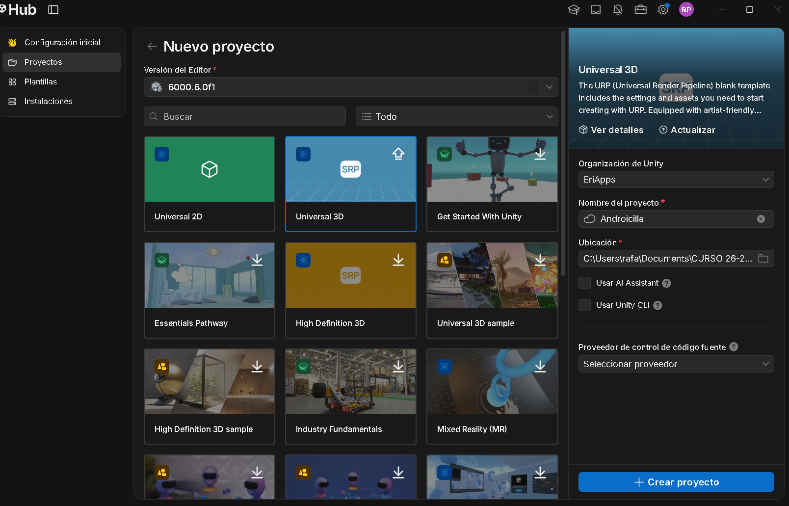
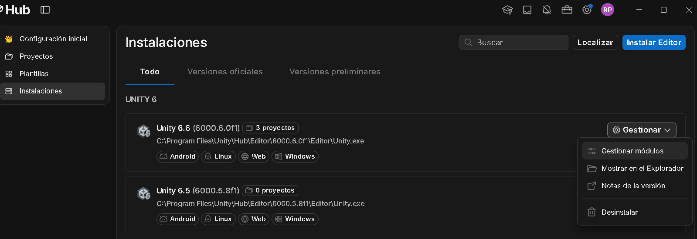
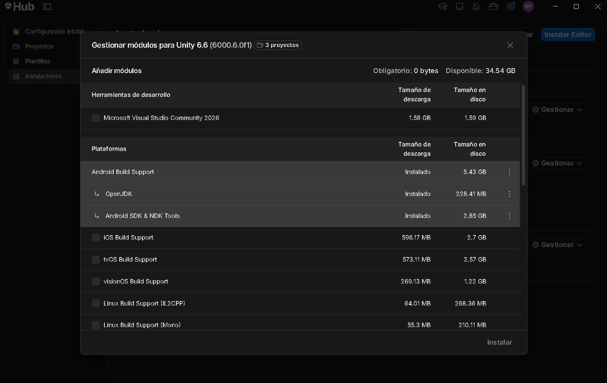
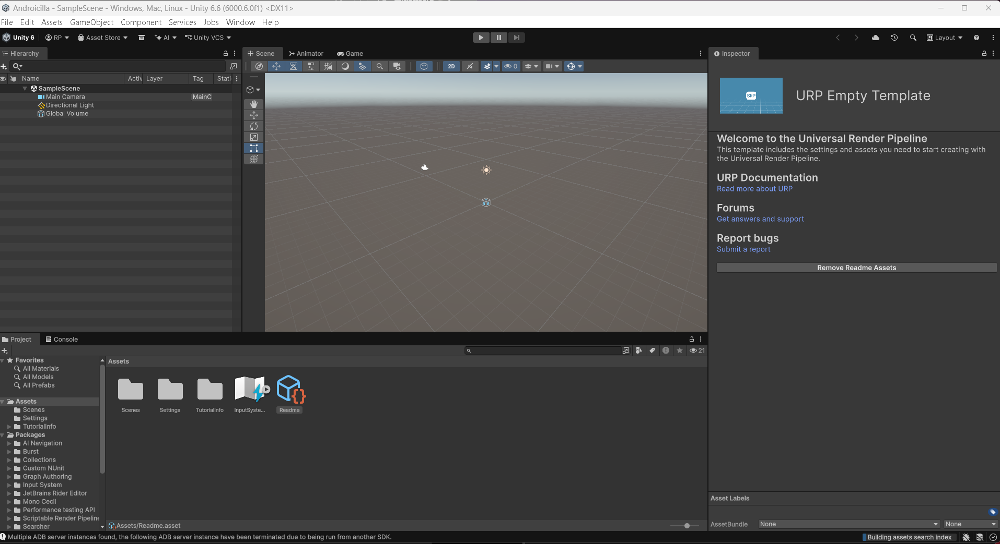
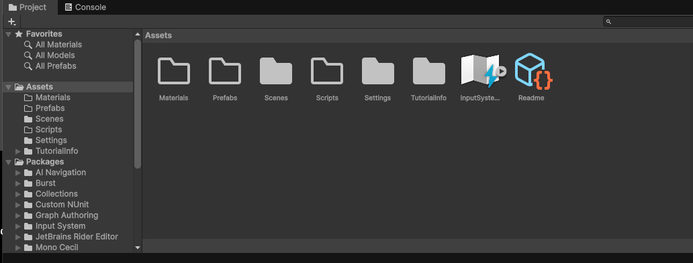
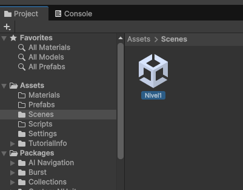
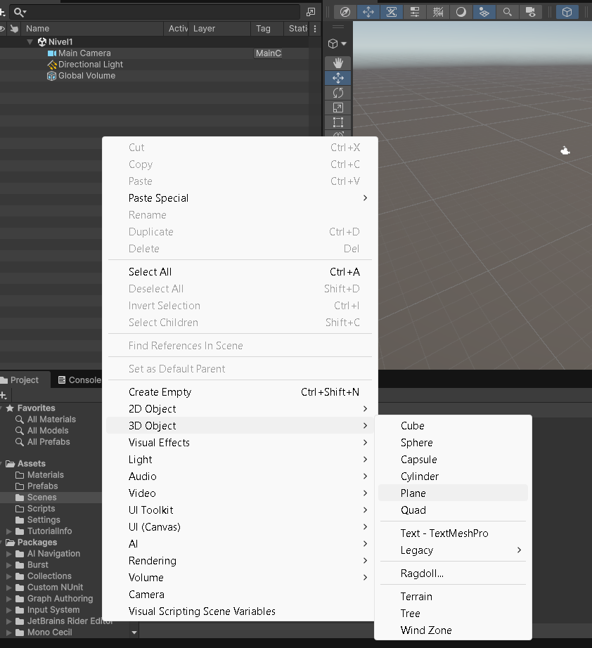
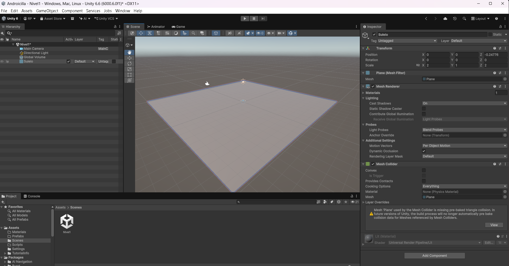
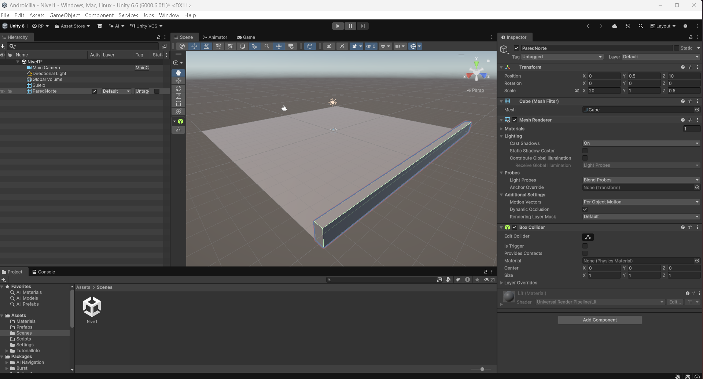
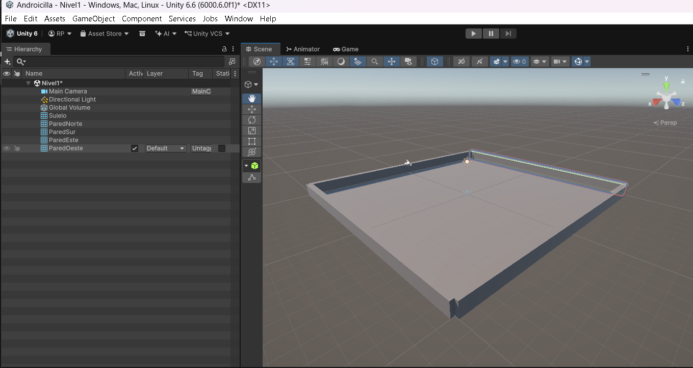

# 1. Preparación y tablero

Crear el proyecto, instalar Android y levantar el recinto.

## Proyecto y preparación

En **Unity Hub → Nuevo proyecto**, escoge **Universal 3D** y nombra el proyecto `Androicilla`. En **Instalaciones → Gestionar módulos** comprueba que estén instalados **Android Build Support**, **Android SDK & NDK Tools** y **OpenJDK**.

<figure class="unity-shot" markdown="1">

[{ loading=lazy }](../../assets/images/pmdm/androicilla/20261013-203002.png){ aria-label="Ampliar imagen: Creación de proyecto en Unity Hub" }

<figcaption>Creación de proyecto en Unity Hub.</figcaption>
</figure>

<figure class="unity-shot" markdown="1">

[{ loading=lazy }](../../assets/images/pmdm/androicilla/20261013-203028.png){ aria-label="Ampliar imagen: Versión del editor instalada" }

<figcaption>Versión del editor instalada.</figcaption>
</figure>

<figure class="unity-shot" markdown="1">

[{ loading=lazy }](../../assets/images/pmdm/androicilla/20261013-203046.png){ aria-label="Ampliar imagen: Módulos de Android" }

<figcaption>Módulos de Android.</figcaption>
</figure>

<figure class="unity-shot" markdown="1">

[{ loading=lazy }](../../assets/images/pmdm/androicilla/20261013-203448.png){ aria-label="Ampliar imagen: Proyecto abierto en Unity" }

<figcaption>Proyecto abierto en Unity.</figcaption>
</figure>

Dentro de `Assets`, crea `Materials`, `Prefabs`, `Scenes` y `Scripts`. Guarda la escena inicial como `Nivel1` dentro de `Scenes`. Unity ya incluye otras carpetas de la plantilla que podemos conservar.

<figure class="unity-shot" markdown="1">

[{ loading=lazy }](../../assets/images/pmdm/androicilla/20261013-203633.png){ aria-label="Ampliar imagen: Carpetas iniciales" }

<figcaption>Carpetas iniciales.</figcaption>
</figure>

<figure class="unity-shot" markdown="1">

[{ loading=lazy }](../../assets/images/pmdm/androicilla/20261013-203645.png){ aria-label="Ampliar imagen: Escena Nivel1 guardada" }

<figcaption>Escena Nivel1 guardada.</figcaption>
</figure>

## Suelo y paredes exteriores

Crea **3D Object → Plane**, llámalo `Suelo` y configura `Position (0, 0, 0)` y `Scale (2, 1, 2)`. Obtendrás una superficie de 20 × 20 unidades. Comprueba que tiene `Mesh Collider`.

Crea después cuatro **3D Object → Cube**, con estas dimensiones:

| Objeto | Position (X, Y, Z) | Scale (X, Y, Z) |
|---|---|---|
| ParedNorte | (0, 0.5, 10) | (20, 1, 0.5) |
| ParedSur | (0, 0.5, -10) | (20, 1, 0.5) |
| ParedEste | (10, 0.5, 0) | (0.5, 1, 20) |
| ParedOeste | (-10, 0.5, 0) | (0.5, 1, 20) |

Los cubos ya incluyen `Box Collider`. Podemos seleccionar las cuatro paredes y agruparlas bajo un GameObject `Bordes`, manteniendo los colliders; si las fusionamos con ProBuilder, hay que revisar el collider de la malla resultante.

<figure class="unity-shot" markdown="1">

[{ loading=lazy }](../../assets/images/pmdm/androicilla/20261013-203746.png){ aria-label="Ampliar imagen: Crear un Plane" }

<figcaption>Crear un Plane.</figcaption>
</figure>

<figure class="unity-shot" markdown="1">

[{ loading=lazy }](../../assets/images/pmdm/androicilla/20261013-203844.png){ aria-label="Ampliar imagen: Configurar Suelo y su Mesh Collider" }

<figcaption>Configurar Suelo y su Mesh Collider.</figcaption>
</figure>

<figure class="unity-shot" markdown="1">

[{ loading=lazy }](../../assets/images/pmdm/androicilla/20261013-204111.png){ aria-label="Ampliar imagen: Primera pared del recinto" }

<figcaption>Primera pared del recinto.</figcaption>
</figure>

<figure class="unity-shot" markdown="1">

[{ loading=lazy }](../../assets/images/pmdm/androicilla/20261013-204319.png){ aria-label="Ampliar imagen: Cuatro paredes exteriores" }

<figcaption>Cuatro paredes exteriores.</figcaption>
</figure>

---

[Volver al índice](index.md) · [2. Bola y cámara →](02-jugador-camara.md)
