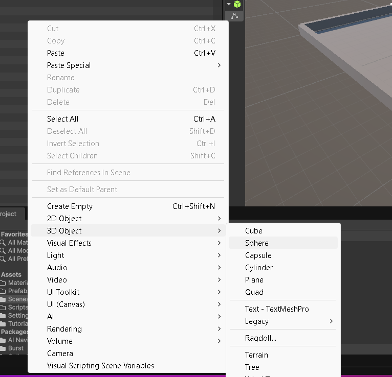
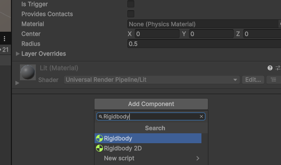
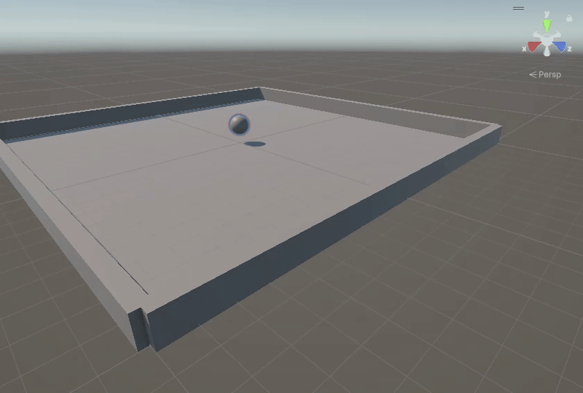
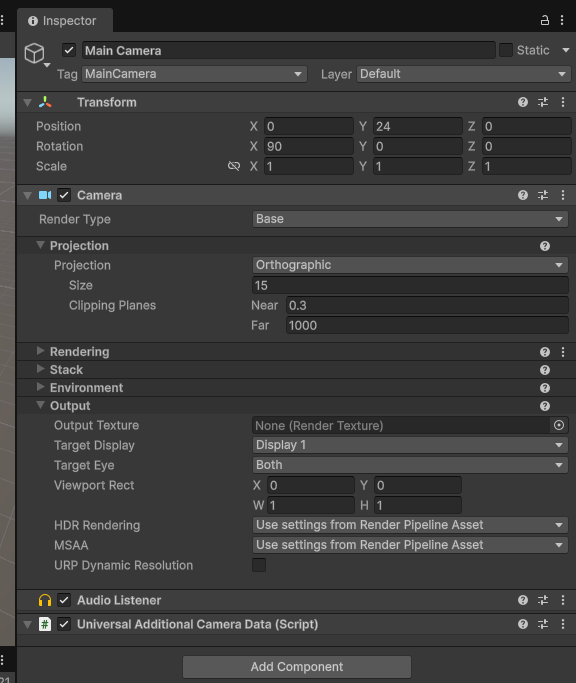

# 2. Bola y cámara

Rigidbody, colliders y cámara cenital.

## La bola y las físicas

Crea **3D Object → Sphere**, llámala `Jugador`, ponle `Position (0, 1, 0)` y `Scale (1, 1, 1)`. Añade un `Rigidbody` **3D** (no `Rigidbody 2D`). Mantén el `Sphere Collider` de la esfera.

| Propiedad Rigidbody | Valor |
|---|---|
| Mass | 1 |
| Use Gravity | Sí |
| Is Kinematic | No |
| Interpolate | Interpolate |
| Collision Detection | Continuous |

Prueba **Play** y comprueba que la bola cae y se apoya en el plano. Cuando abramos el agujero, moveremos la posición inicial a un lugar seguro.

<figure class="unity-shot" markdown="1">

[{ loading=lazy }](../../assets/images/pmdm/androicilla/20261013-204452.png){ aria-label="Ampliar imagen: Creación de Jugador" }

<figcaption>Creación de Jugador.</figcaption>
</figure>

<figure class="unity-shot" markdown="1">

[{ loading=lazy }](../../assets/images/pmdm/androicilla/20261013-204631.png){ aria-label="Ampliar imagen: Rigidbody y Sphere Collider" }

<figcaption>Rigidbody y Sphere Collider.</figcaption>
</figure>

<figure class="unity-shot" markdown="1">

[{ loading=lazy }](../../assets/images/pmdm/androicilla/bolacae.gif){ aria-label="Ampliar imagen: Prueba de caída" }

<figcaption>Prueba de caída.</figcaption>
</figure>

<figure class="unity-shot" markdown="1">

[{ loading=lazy }](../../assets/images/pmdm/androicilla/20261013-205218.png){ aria-label="Ampliar imagen: Ajustes finales del Rigidbody" }

<figcaption>Ajustes finales del Rigidbody.</figcaption>
</figure>

## Cámara

Para empezar utilizamos una cámara cenital: selecciona `Main Camera`, configura `Position (0, 24, 0)` y `Rotation (90, 0, 0)`. En el componente `Camera` elige **Orthographic**, `Size = 15`.

Más tarde usamos una vista con algo de profundidad: `Position (0, 24, -10)` y `Rotation (65, 0, 0)`. La cámara se inclina, pero **la física de la bola sigue usando X y Z** del mundo. Conviene revisar el resultado en la pestaña `Game`.

---

[← 1. Preparación y tablero](01-preparacion-tablero.md) · [Volver al índice](index.md) · [3. Movimiento y Android →](03-movimiento-android.md)
