# 6. Meta y pantalla de victoria

Trigger, TextMeshPro y reinicio de nivel.

## Detectar la caída en la meta

Crea un GameObject vacío llamado `DetectorMeta`, colócalo debajo del agujero y añade un `Box Collider` con **Is Trigger** activado. Debe tener volumen, no escala cero, y estar colocado de forma que detecte la bola cuando empieza a caer, nunca antes.

Selecciona `Jugador` y establece **Tag = Player**.

Crea `Assets/Scripts/Meta.cs` y asígnalo a `DetectorMeta`:

```csharp
using UnityEngine;
using UnityEngine.SceneManagement;

public class Meta : MonoBehaviour
{
    public GameObject panelVictoria;
    private bool completado = false;

    private void Start()
    {
        panelVictoria.SetActive(false);
    }

    private void OnTriggerEnter(Collider other)
    {
        if (other.CompareTag("Player") && !completado)
        {
            completado = true;
            panelVictoria.SetActive(true);
            Debug.Log("¡Nivel completado!");
        }
    }

    public void ReiniciarNivel()
    {
        SceneManager.LoadScene(SceneManager.GetActiveScene().buildIndex);
    }
}
```

Primero hicimos una prueba con `Debug.Log` y comprobamos la aparición de `¡Nivel completado!` en la consola.

<figure class="unity-shot" markdown="1">

[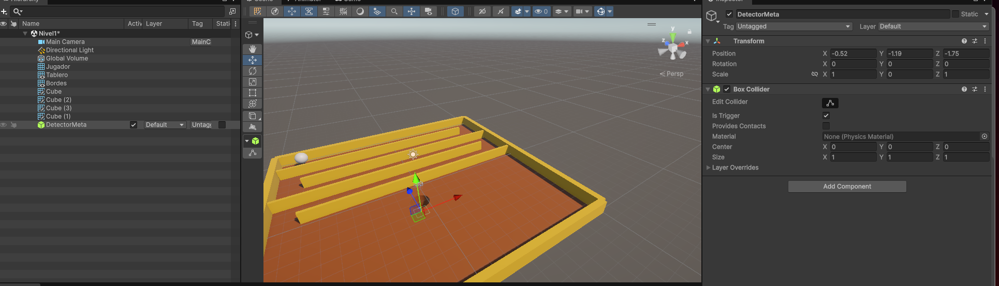{ loading=lazy }](../../assets/images/pmdm/androicilla/20261014-073315.png){ aria-label="Ampliar imagen: DetectorMeta e Is Trigger" }

<figcaption>DetectorMeta e Is Trigger.</figcaption>
</figure>

<figure class="unity-shot" markdown="1">

[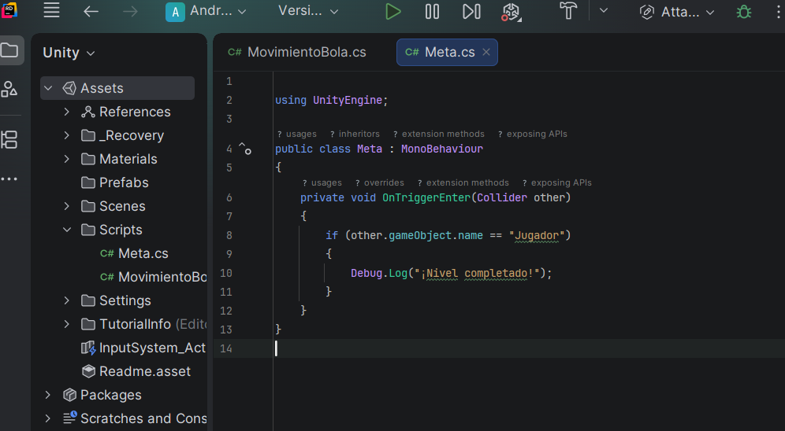{ loading=lazy }](../../assets/images/pmdm/androicilla/20261014-073529.png){ aria-label="Ampliar imagen: Script de detección de meta" }

<figcaption>Script de detección de meta.</figcaption>
</figure>

<figure class="unity-shot" markdown="1">

[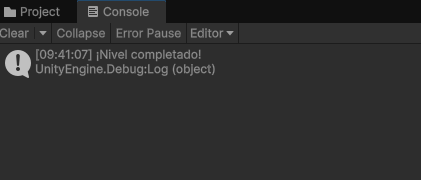{ loading=lazy }](../../assets/images/pmdm/androicilla/20261014-074121.png){ aria-label="Ampliar imagen: Mensaje en Console" }

<figcaption>Mensaje en Console.</figcaption>
</figure>

## Pantalla de victoria

Crea **UI (Canvas) → Canvas** y renómbralo `CanvasFinNivel`. El componente `Canvas Scaler` debe utilizar **Scale With Screen Size**, con referencia **1920 × 1080** y `Match = 0.5`.

Dentro del Canvas crea `PanelVictoria` y configúralo para ocupar toda la pantalla (anclajes Stretch y márgenes a cero). Usa un `Image` negro semitransparente, con alfa aproximado de 180/255.

Dentro del panel añade un **Text - TextMeshPro** (`TextoVictoria`) con «¡NIVEL COMPLETADO!» y un **Button - TextMeshPro** (`BotonReiniciar`) con «REINICIAR». Importa **TMP Essentials** si Unity lo solicita. Utiliza el estilo normal/negrita si no quieres texto en cursiva: el preset *Quote* lo inclina.

La jerarquía debe quedar así:

```text
CanvasFinNivel
└── PanelVictoria
    ├── TextoVictoria
    └── BotonReiniciar
        └── Text (TMP)
```

En el componente `Meta` de `DetectorMeta`, arrastra `PanelVictoria` al campo `Panel Victoria`. En **BotonReiniciar → Button → On Click()**, pulsa **+**, arrastra `DetectorMeta` y escoge **Meta → ReiniciarNivel()**.

Al pulsar Play, el panel debe desaparecer; al caer la bola, aparecerá la victoria; al pulsar Reiniciar, se recargará `Nivel1`. Comprueba que la escena esté incluida en `Build Profiles → Scene List`.

<figure class="unity-shot" markdown="1">

[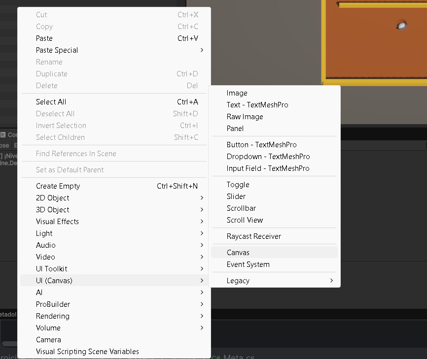{ loading=lazy }](../../assets/images/pmdm/androicilla/20261014-074213.png){ aria-label="Ampliar imagen: Crear Canvas" }

<figcaption>Crear Canvas.</figcaption>
</figure>

<figure class="unity-shot" markdown="1">

[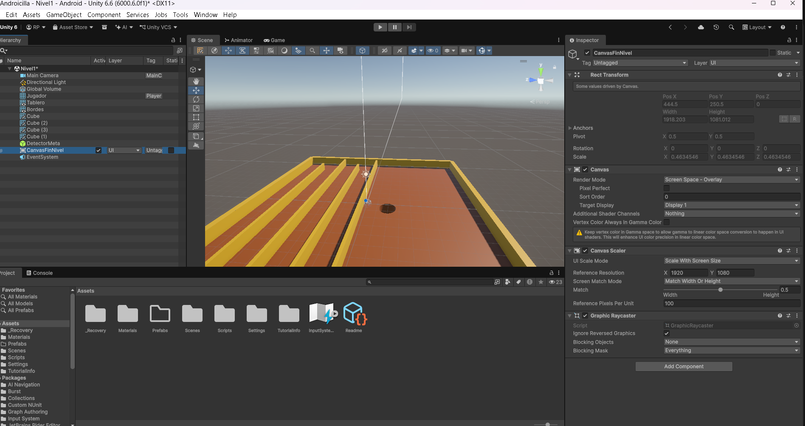{ loading=lazy }](../../assets/images/pmdm/androicilla/20261014-074525.png){ aria-label="Ampliar imagen: Configurar Canvas Scaler" }

<figcaption>Configurar Canvas Scaler.</figcaption>
</figure>

<figure class="unity-shot" markdown="1">

[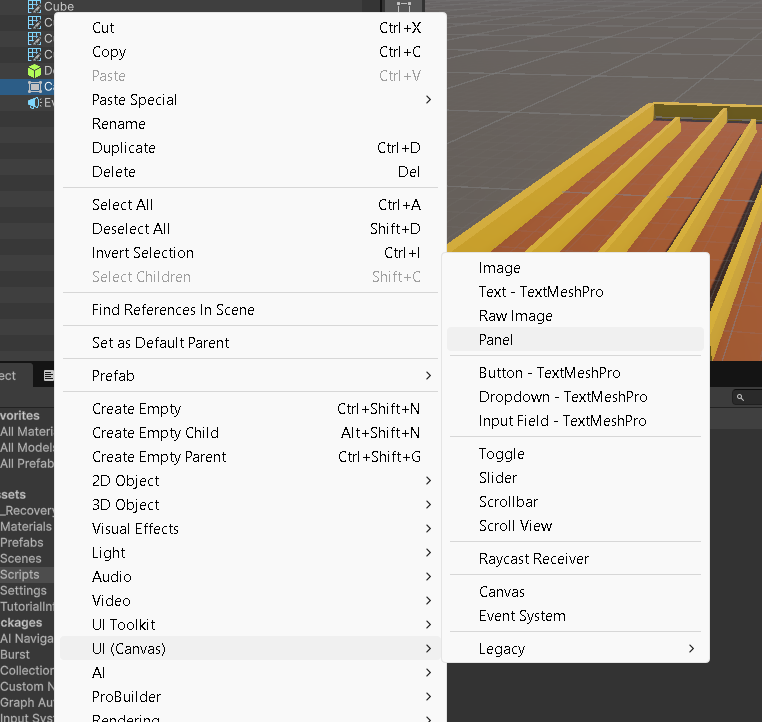{ loading=lazy }](../../assets/images/pmdm/androicilla/20261014-074813.png){ aria-label="Ampliar imagen: Crear PanelVictoria" }

<figcaption>Crear PanelVictoria.</figcaption>
</figure>

<figure class="unity-shot" markdown="1">

[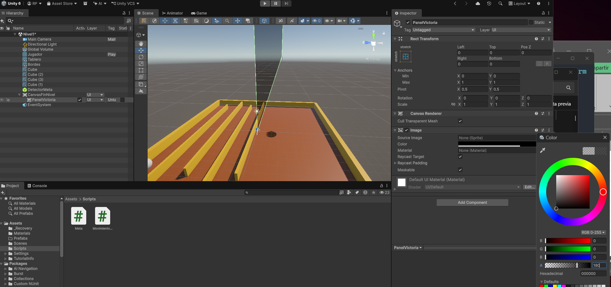{ loading=lazy }](../../assets/images/pmdm/androicilla/20261014-074958.png){ aria-label="Ampliar imagen: Texto TMP" }

<figcaption>Texto TMP.</figcaption>
</figure>

<figure class="unity-shot" markdown="1">

[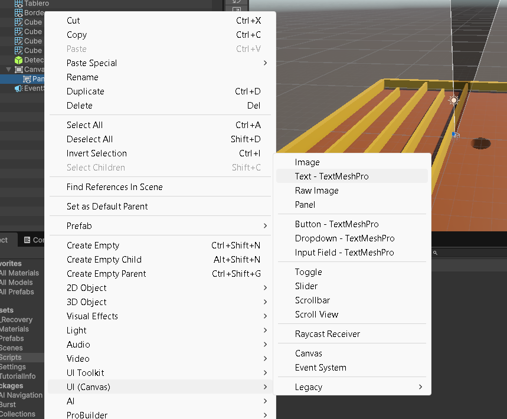{ loading=lazy }](../../assets/images/pmdm/androicilla/20261014-075048.png){ aria-label="Ampliar imagen: Crear botón" }

<figcaption>Crear botón.</figcaption>
</figure>

<figure class="unity-shot" markdown="1">

[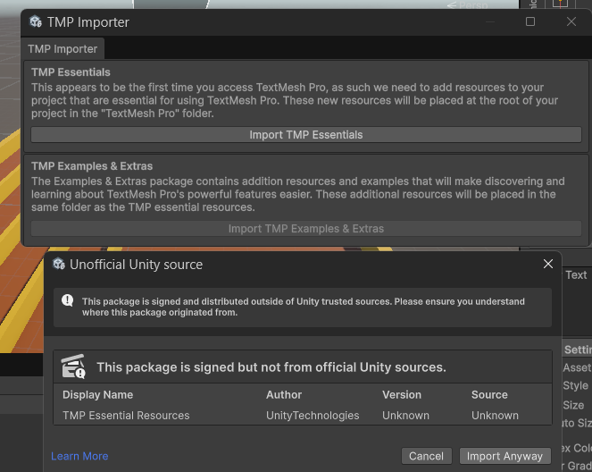{ loading=lazy }](../../assets/images/pmdm/androicilla/20261014-075111.png){ aria-label="Ampliar imagen: Interfaz final" }

<figcaption>Interfaz final.</figcaption>
</figure>

<figure class="unity-shot" markdown="1">

[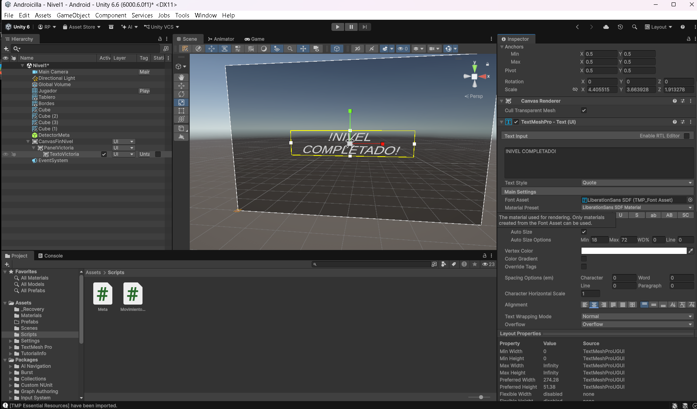{ loading=lazy }](../../assets/images/pmdm/androicilla/20261014-075318.png){ aria-label="Ampliar imagen: Código Meta final" }

<figcaption>Código Meta final.</figcaption>
</figure>

<figure class="unity-shot" markdown="1">

[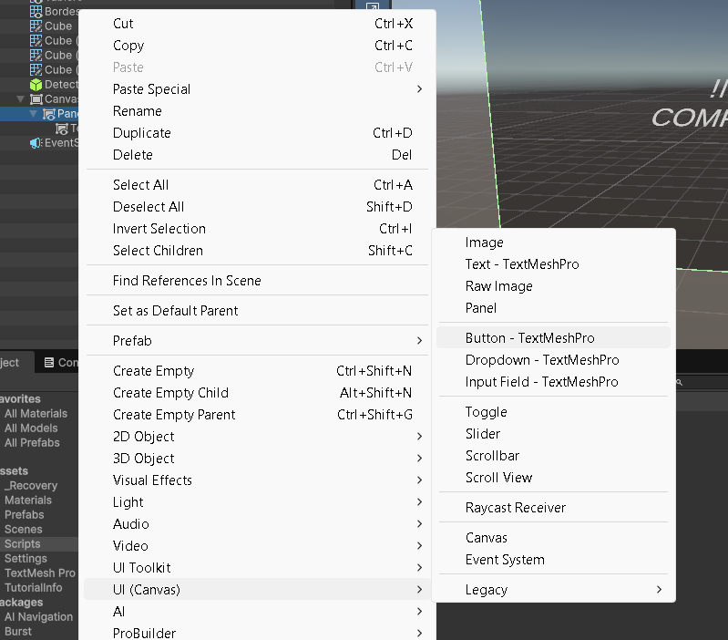{ loading=lazy }](../../assets/images/pmdm/androicilla/20261014-075428.png){ aria-label="Ampliar imagen: Enlazar PanelVictoria" }

<figcaption>Enlazar PanelVictoria.</figcaption>
</figure>

<figure class="unity-shot" markdown="1">

[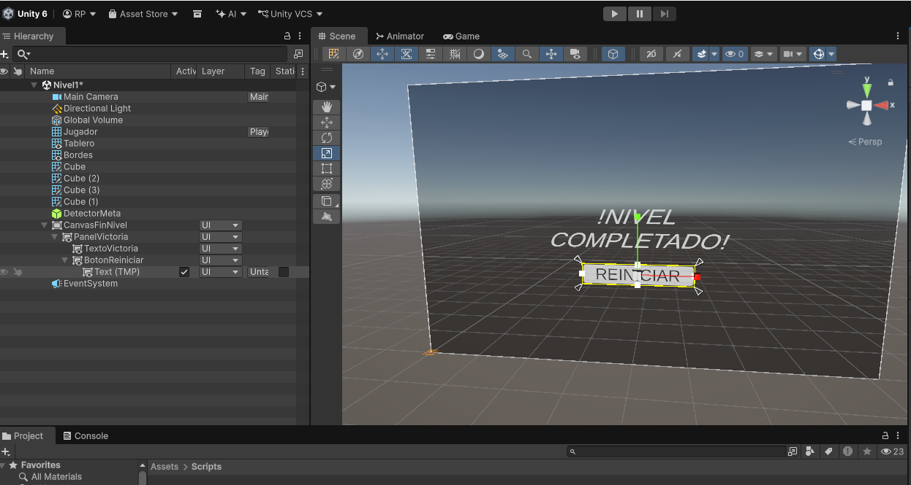{ loading=lazy }](../../assets/images/pmdm/androicilla/20261014-075537.png){ aria-label="Ampliar imagen: Configurar On Click" }

<figcaption>Configurar On Click.</figcaption>
</figure>

<figure class="unity-shot" markdown="1">

[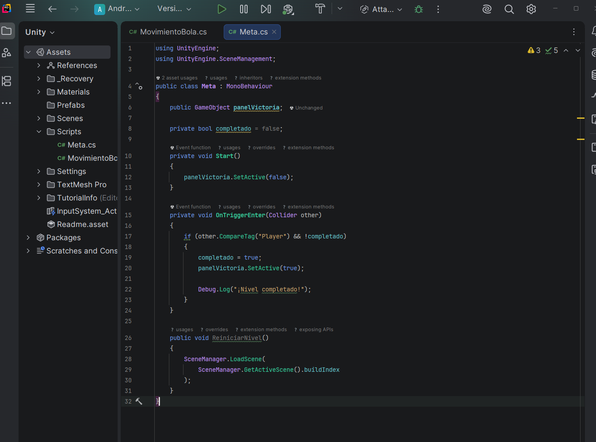{ loading=lazy }](../../assets/images/pmdm/androicilla/20261014-075850.png){ aria-label="Ampliar imagen: Vista Game" }

<figcaption>Vista Game.</figcaption>
</figure>

<figure class="unity-shot" markdown="1">

[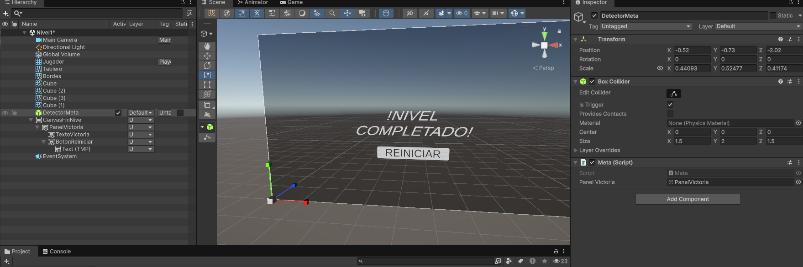{ loading=lazy }](../../assets/images/pmdm/androicilla/20261014-075930.png){ aria-label="Ampliar imagen: Pantalla victoria en ejecución" }

<figcaption>Pantalla victoria en ejecución.</figcaption>
</figure>

<figure class="unity-shot" markdown="1">

[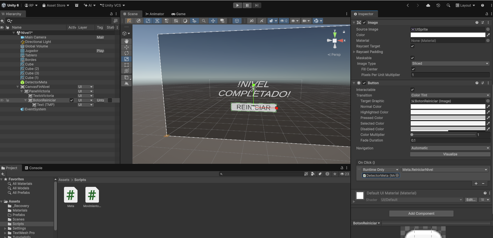{ loading=lazy }](../../assets/images/pmdm/androicilla/20261014-080027.png){ aria-label="Ampliar imagen: Reinicio nivel" }

<figcaption>Reinicio nivel.</figcaption>
</figure>

<figure class="unity-shot" markdown="1">

[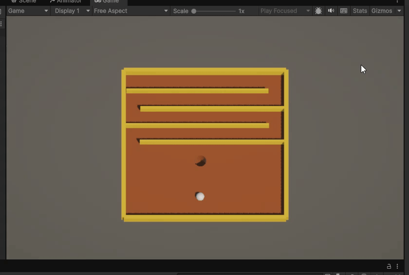{ loading=lazy }](../../assets/images/pmdm/androicilla/nivel_completado.gif){ aria-label="Ampliar imagen: Prueba animada de nivel completado" }

<figcaption>Prueba animada de nivel completado.</figcaption>
</figure>

## Comprobaciones finales

- [ ] El proyecto se abre sin errores de compilación.
- [ ] `Nivel1` está guardada e incluida en Android Build Profiles.
- [ ] La bola tiene `Rigidbody` y `Sphere Collider`.
- [ ] El teclado mueve la bola en Windows y Linux.
- [ ] El sensor funciona al menos en el teléfono Android de prueba y se comprueba el sentido de los ejes.
- [ ] El tablero tiene `Mesh Collider` **no convexo** y la bola cae por el agujero.
- [ ] Las paredes interiores conservan sus colliders.
- [ ] El Trigger de meta muestra la victoria al caer.
- [ ] El botón de reinicio vuelve a cargar la escena.

### Próximos cambios

El control por inclinación puede hacerse más cómodo incorporando calibración, inversión de ejes y límite de velocidad. También falta ajustar el encuadre para distintas relaciones de aspecto y mejorar el diseño del panel. No forman parte de la versión que hemos probado en estas capturas.


??? info "Capturas adicionales del proceso"

    Estas imágenes documentan pruebas y ajustes realizados en clase. No son pasos nuevos del tutorial.

    <figure class="unity-shot" markdown="1">

    [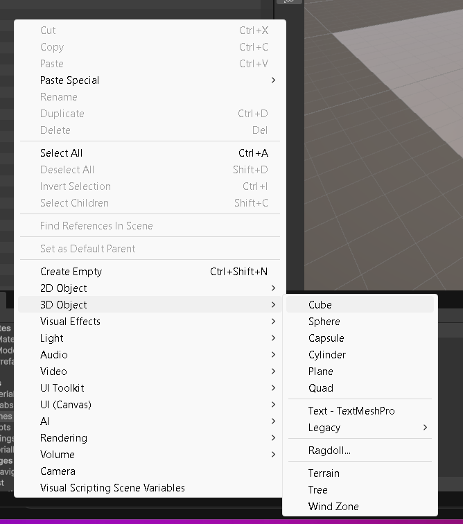{ loading=lazy }](../../assets/images/pmdm/androicilla/20261013-204007.png){ aria-label="Ampliar captura" }

    <figcaption>Vista adicional del tablero durante la construcción.</figcaption>
    </figure>

    <figure class="unity-shot" markdown="1">

    [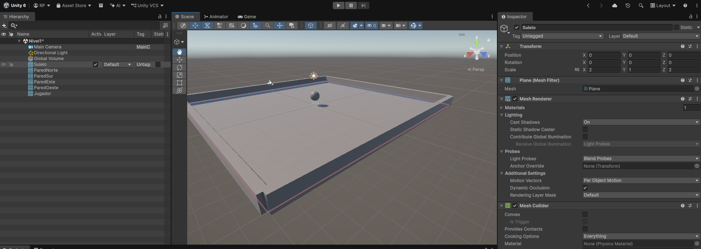{ loading=lazy }](../../assets/images/pmdm/androicilla/20261013-204554.png){ aria-label="Ampliar captura" }

    <figcaption>Ajustes de la esfera durante las primeras pruebas.</figcaption>
    </figure>

    <figure class="unity-shot" markdown="1">

    [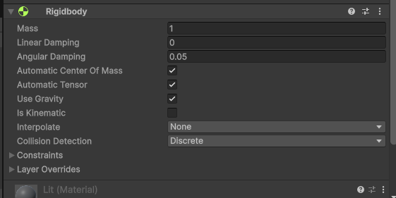{ loading=lazy }](../../assets/images/pmdm/androicilla/20261013-204711.png){ aria-label="Ampliar captura" }

    <figcaption>Comprobación del estado inicial de la escena.</figcaption>
    </figure>

    <figure class="unity-shot" markdown="1">

    [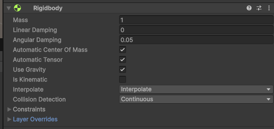{ loading=lazy }](../../assets/images/pmdm/androicilla/20261013-205101.png){ aria-label="Ampliar captura" }

    <figcaption>Prueba del movimiento antes de instalarlo en Android.</figcaption>
    </figure>

    <figure class="unity-shot" markdown="1">

    [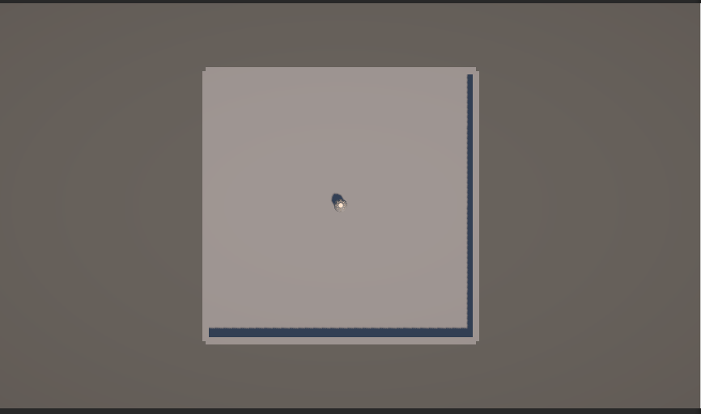{ loading=lazy }](../../assets/images/pmdm/androicilla/20261013-205351.png){ aria-label="Ampliar captura" }

    <figcaption>Revisión de los componentes y configuración.</figcaption>
    </figure>

    <figure class="unity-shot" markdown="1">

    [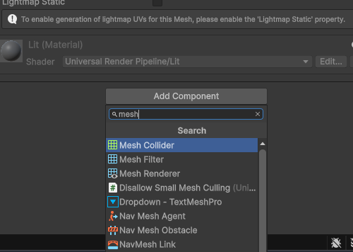{ loading=lazy }](../../assets/images/pmdm/androicilla/20261014-064226.png){ aria-label="Ampliar captura" }

    <figcaption>Estado del proyecto durante la corrección del agujero.</figcaption>
    </figure>


---

[← 5. Laberinto y materiales](05-laberinto-materiales.md) · [Volver al índice](index.md)
