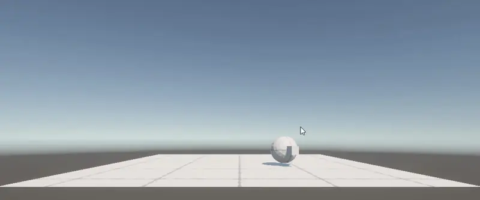

# Ejercicio 4 · Control de personaje y cámaras 3D

En este ejercicio vamos a controlar una figura en un escenario 3D. El movimiento será **tipo vehículo**: avanzar, retroceder y girar sobre sí misma. Primero utilizaremos las teclas **W, A, S y D**; después añadiremos **botones táctiles** y una cámara que pueda cambiar entre **primera y tercera persona**.

Seguimos trabajando con **Unity 6.6**, **ProBuilder** y el **Input System**. No necesitamos modelos descargados ni animaciones para entender el movimiento.

!!! info "Objetivo de la práctica"
    Crear una escena `Control3D`, controlar un personaje con `Character Controller` y cambiar el punto de vista de la cámara. El código y las siguientes fases se incorporarán a medida que los probemos en clase.

## 1. Preparar la escena Control3D

Crea una escena llamada **`Control3D`** y guarda el archivo en `Assets/Scenes`.

En la jerarquía deben aparecer:

```text
Control3D
├── Main Camera
├── Directional Light
├── Global Volume
├── Suelo
└── Jugador
    └── Frente
```

### El suelo

Crea un `Plane` como `Suelo`, con `Position (0, 0, 0)` y `Scale (2, 1, 2)`. Asegúrate de que tiene un `Mesh Collider` que actúe como suelo.

### La figura Jugador

Podemos utilizar una **Sphere de ProBuilder**, como la que estamos preparando en clase. No tiene que ser una cápsula: lo importante es que seamos capaces de distinguir su orientación y mover su controlador.

En `Jugador`:

1. Añade un **Character Controller** desde `Add Component`.
2. No añadas un `Rigidbody`: en esta actividad moveremos el objeto con `CharacterController.Move()`.
3. Si el objeto conserva un `Mesh Collider` o `Sphere Collider` adicional, elimínalo para no duplicar la colisión del propio personaje.
4. Con **Edit Collider**, comprueba que el contorno del `Character Controller` envuelve la figura y que su base toca el suelo. **ProBuilder puede situar el pivote de la malla en un lugar distinto de su centro visual**: si ocurre, ajusta `Center` y `Height` del controlador o corrige la geometría antes de continuar.

> En nuestra primera prueba usamos una esfera ProBuilder, un controlador de altura 1 y radio 0,5. Esos valores son de partida, no una garantía de que el collider esté alineado con cualquier malla.

### Indicar el frente del personaje

Añade un cubo pequeño llamado **`Frente`**, hijo de `Jugador` (no otro objeto al mismo nivel). Sus coordenadas son **locales al jugador**:

| Transform de Frente | X | Y | Z |
| --- | ---: | ---: | ---: |
| Position | 0 | 0 | 0.6 |
| Rotation | 0 | 0 | 0 |
| Scale | 0.3 | 0.3 | 0.3 |

`Frente` señala el **eje Z positivo** de `Jugador`, que será la dirección de avance. Como es una referencia visual, quita su `Mesh Collider` si ProBuilder lo ha creado.

!!! tip "Por qué es hijo de Jugador"
    Al girar o mover al personaje, `Frente` se desplazará y girará con él. Así veremos claramente hacia dónde apunta, aunque el cuerpo sea una esfera simétrica.

### Corregir la altura y el pivote de los objetos ProBuilder

En la primera prueba comprobamos que la esfera quedaba visualmente **por encima del suelo**, mientras que el pequeño cubo `Frente` se veía medio enterrado. Son dos cosas distintas: el `Character Controller` define la colisión, pero no recoloca la malla visible.

1. Selecciona **`Jugador`** y utiliza **Tools → ProBuilder → Object → Center Pivot** para colocar el origen en el centro de la geometría.
2. Como la esfera mide una unidad de diámetro, coloca su `Transform → Position` en **`(0, 0.5, 0)`**. Conserva `Rotation (0, 0, 0)` y `Scale (1, 1, 1)`.
3. Selecciona **`Frente`**. Si también es una figura de ProBuilder, aplica **Tools → ProBuilder → Object → Center Pivot** para centrar su pivote. Comprueba que sigue siendo hijo de `Jugador` y **vuelve a establecer sus coordenadas locales**: Position `(0, 0, 0.6)`, Rotation `(0, 0, 0)`, Scale `(0.3, 0.3, 0.3)`. Tras centrar un pivote, Unity puede modificar la posición mostrada sin que el objeto parezca moverse.
4. En `Character Controller`, comprueba **Center (0, 0, 0)**, **Radius 0.5** y **Height 1**. El contorno debe ajustarse a la esfera.
5. Comprueba el resultado desde una vista lateral en `Scene` antes de programar el movimiento. Si sigue elevado, revisa el pivote y la posición real de los vértices antes de cambiar el controlador.

!!! note "Centro de malla y centro de colisión no son lo mismo"
    **Center Pivot** centra el origen de la geometría de ProBuilder. El parámetro **Center** del `Character Controller` solo mueve su volumen de colisión. No se debe usar este segundo ajuste para disimular una malla colocada a otra altura.

### Comprobación antes de programar

- `Frente` aparece indentado dentro de `Jugador` en la jerarquía.
- `Jugador` tiene `Character Controller` y no tiene `Rigidbody`.
- El controlador envuelve la malla visible y queda apoyado sobre `Suelo`.
- No hay colliders sobrantes en `Frente`.
- `Main Camera` conserva la etiqueta `MainCamera`.

## 2. Movimiento con teclado: avanzar, retroceder y girar

Primero comprobaremos el movimiento con el teclado. Más adelante reutilizaremos las mismas acciones con botones táctiles.

Crea la carpeta `Assets/Scripts` si todavía no existe. Dentro crea **`MovimientoJugador.cs`** y añade el siguiente código. Utilizamos el paquete **Input System**, como en los ejercicios anteriores:

```csharp
using UnityEngine;
using UnityEngine.InputSystem;

[RequireComponent(typeof(CharacterController))]
public class MovimientoJugador : MonoBehaviour
{
    public float velocidad = 4f;
    public float velocidadGiro = 120f;
    public float gravedad = -9.81f;

    private CharacterController controlador;
    private float velocidadVertical;

    void Start()
    {
        controlador = GetComponent<CharacterController>();
    }

    void Update()
    {
        if (Keyboard.current == null) return;

        float avanzar = 0f;
        float girar = 0f;

        if (Keyboard.current.wKey.isPressed) avanzar = 1f;
        if (Keyboard.current.sKey.isPressed) avanzar = -1f;
        if (Keyboard.current.aKey.isPressed) girar = -1f;
        if (Keyboard.current.dKey.isPressed) girar = 1f;

        // Giramos alrededor del eje vertical del personaje.
        transform.Rotate(0, girar * velocidadGiro * Time.deltaTime, 0);

        // El CharacterController no aplica gravedad automáticamente.
        if (controlador.isGrounded && velocidadVertical < 0f)
            velocidadVertical = -2f;

        velocidadVertical += gravedad * Time.deltaTime;

        // Avanzar siempre significa desplazarse hacia el frente del objeto.
        Vector3 movimiento = transform.forward * (avanzar * velocidad);
        movimiento.y = velocidadVertical;
        controlador.Move(movimiento * Time.deltaTime);
    }
}
```

### Qué significa cada parte

- `transform.forward`: dirección **Z positiva local** del personaje, que cambia cuando giramos.
- `transform.Rotate(...)`: gira el personaje alrededor del eje **Y**, sin desplazarse lateralmente.
- `CharacterController.Move(...)`: mueve al personaje respetando las colisiones del controlador.
- `Time.deltaTime`: evita que el movimiento dependa de los fotogramas por segundo.
- `velocidadVertical`: aplica una gravedad sencilla, ya que `CharacterController` **no incorpora gravedad automáticamente**.

Selecciona `Jugador` y añade el script `MovimientoJugador`. Ejecuta **Play** y prueba:

| Tecla | Acción |
| --- | --- |
| W | Avanzar hacia `Frente` |
| S | Retroceder |
| A | Girar a la izquierda |
| D | Girar a la derecha |

<figure class="unity-shot" markdown="1">

[{ loading=lazy }](../assets/images/pmdm/control3d/movimiento-personaje.webp){ aria-label="Ampliar captura de la prueba de movimiento" }

<figcaption>Prueba inicial del movimiento en la vista Game. La esfera tiene una pequeña referencia frontal para distinguir su orientación. Imagen aportada durante la práctica.</figcaption>
</figure>

!!! tip "Antes de continuar"
    Comprueba que la figura está apoyada en el plano, que al girar `Frente` cambia de dirección y que al avanzar el personaje sigue mirando hacia delante. Si atraviesa el suelo, revisa las colisiones y el ajuste del `Character Controller`.

## 3. Construir una escalera

Ahora que podemos avanzar y girar, vamos a comprobar una diferencia importante entre un personaje controlado con `Character Controller` y una bola que se mueve con `Rigidbody`: **el primero puede subir peldaños pequeños automáticamente**.

No modificamos todavía `MovimientoJugador.cs`. Primero construiremos un obstáculo y comprobaremos qué ocurre.

### Paso 1. Crear los peldaños

En `Hierarchy`, crea un GameObject vacío llamado **`Escalera`**. Dentro añade cuatro cubos, usando **ProBuilder** (también puedes crear cubos convencionales y convertirlos después).

Cada peldaño tiene un ancho de **3 unidades** y un fondo de **0,8**. Lo que cambia es la altura.

| Objeto | Position (X, Y, Z) | Scale (X, Y, Z) |
| --- | --- | --- |
| `Peldaño1` | `(0, 0.1, 2)` | `(3, 0.2, 0.8)` |
| `Peldaño2` | `(0, 0.2, 2.8)` | `(3, 0.4, 0.8)` |
| `Peldaño3` | `(0, 0.3, 3.6)` | `(3, 0.6, 0.8)` |
| `Peldaño4` | `(0, 0.4, 4.4)` | `(3, 0.8, 0.8)` |

**Importante:** estas coordenadas son **locales a `Escalera`**, que debe permanecer en `Position (0,0,0)`, `Rotation (0,0,0)` y `Scale (1,1,1)`. Si ProBuilder cambia los pivotes de las piezas, centra cada uno antes de introducir los valores.

No crees cubos flotando: cada pieza parte del suelo y su cara superior está **0,2 unidades** por encima de la anterior.

### Paso 2. Plataforma de llegada

Añade otro cubo hijo de `Escalera` llamado `PlataformaSuperior`:

| Propiedad | Valor |
| --- | --- |
| Position | `(0, 0.4, 6)` |
| Scale | `(3, 0.8, 2.4)` |

La cara superior queda a **Y = 0.8**, como el último escalón. Así el personaje podrá terminar la subida sin encontrarse otro salto.

Comprueba que los cinco objetos tienen un **Collider** válido. No hace falta añadirles un `Rigidbody`: son elementos fijos del escenario.

### Paso 3. Configurar la subida

Selecciona `Jugador`, busca su componente **Character Controller** y revisa:

| Parámetro | Valor |
| --- | ---: |
| `Step Offset` | **0.3** |
| `Slope Limit` | **45** |
| `Height` | **1** |
| `Radius` | **0.5** |

`Step Offset` indica aproximadamente qué altura puede superar de forma automática. Como cada peldaño sube **0,2 unidades**, es inferior al límite de `0.3`.

### Paso 4. Probar la escalera

1. Coloca `Jugador` en **`(0, 0.5, 0)`**, mirando hacia el eje **Z positivo**, en dirección a la escalera.
2. Pulsa **Play** y mantén **W** para acercarte.
3. Comprueba que el personaje sube los cuatro escalones y llega a la plataforma.
4. Prueba a retroceder con **S**. Después gira con **A/D** para bajar mirando hacia delante.
5. Si el personaje se atasca, comprueba primero el `Collider` de cada peldaño, las dimensiones de la geometría ProBuilder y `Step Offset`. No aumentes la velocidad para intentar atravesar el obstáculo.

!!! warning "Prueba para comprender Step Offset"
    Cuando ya funcione, cambia temporalmente `Step Offset` de **0.3 a 0.1** y vuelve a probar. El personaje debería dejar de superar los peldaños de **0.2**. Recupera después **0.3**.

### Comprobación

Antes de continuar, necesitamos una **captura de Scene** donde se vean la escalera, la plataforma y el `Character Controller`. Después probaremos a modificar el suelo y configuraremos una cámara que siga al personaje.

## 4. Qué haremos después

Sin empezar otro proyecto, continuaremos con:

- **Una rampa inclinada:** comparar `Slope Limit` con `Step Offset`.
- **Cámara en tercera persona:** seguir al jugador desde atrás.
- **Cambio de cámara:** pasar a primera persona con un botón.
- **Controles táctiles:** mantener pulsados botones en Android para avanzar, retroceder y girar.


Una vez probado el movimiento, prepararemos **cuatro botones táctiles** que funcionen mientras se mantienen pulsados (`PointerDown` / `PointerUp`) y configuraremos el **cambio entre cámara de primera y tercera persona**.


---

[← Ejercicio 3 · Clasificador de animales](ejercicio-3-animales.md) · [Volver a PMDM](index.md)
