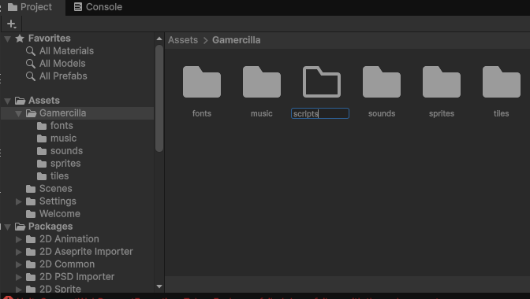
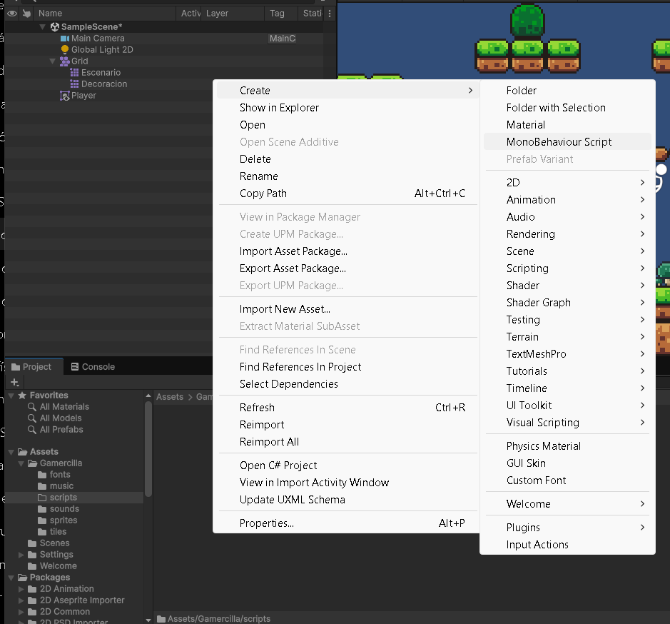
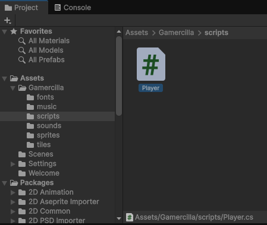

# 6. Primer script

Un script es el punto de partida para dar instrucciones a un objeto de nuestro juego. Podemos decirle a un personaje que se mueva, salte o muestre un mensaje. En esta práctica crearemos **`Player.cs`** y entenderemos su estructura antes de añadir el movimiento.

## Crear la carpeta Scripts y Player.cs

1. En **Project**, entra en **Assets → ErciGame**.
2. Haz clic con el botón derecho en su contenido y selecciona **Create → Folder**. Llámala **`Scripts`**.

!!! note "El nombre de la carpeta del juego"
    En las capturas y en los primeros pasos del proyecto aparece **Gamercilla**. Si has seguido esas páginas, utiliza **Assets/Gamercilla/Scripts**. Si tu carpeta se llama **ErciGame**, la ruta será **Assets/ErciGame/Scripts**. Continúa dentro de la carpeta de tu juego.

<figure class="unity-shot" markdown="1">

[{ loading=lazy }](../../assets/images/pmdm/unity/35-unity-crear-scripts.png){ aria-label="Ampliar imagen" }

<figcaption>Creación de la carpeta de scripts dentro de la carpeta del juego</figcaption>
</figure>

3. Entra en **Scripts** y pulsa **botón derecho → Create → MonoBehaviour Script**, como en la captura.
4. Escribe **`Player`** como nombre y confirma. Unity crea el archivo **`Player.cs`**; puede mostrarlo simplemente como Player en Project.
5. Haz doble clic para abrirlo en el editor de código que configuramos, por ejemplo Rider.

<figure class="unity-shot" markdown="1">

[{ loading=lazy }](../../assets/images/pmdm/unity/36-unity-crear-monobehaviour.png){ aria-label="Ampliar imagen" }

<figcaption>Create → MonoBehaviour Script crea un comportamiento para un objeto de Unity</figcaption>
</figure>

<figure class="unity-shot" markdown="1">

[{ loading=lazy }](../../assets/images/pmdm/unity/37-unity-player-cs.png){ aria-label="Ampliar imagen" }

<figcaption>El archivo Player.cs dentro de la carpeta Scripts</figcaption>
</figure>

## La estructura inicial

La plantilla contiene una clase y dos métodos. Para empezar, podemos dejarla así:

```csharp
using UnityEngine;

public class Player : MonoBehaviour
{
    void Start()
    {
        // Aquí prepararemos el comportamiento del jugador.
    }

    void Update()
    {
        // Aquí comprobaremos las teclas durante el juego.
    }
}
```

`using UnityEngine;` permite utilizar nombres de Unity como `MonoBehaviour` y `Rigidbody2D` sin escribir su nombre completo cada vez.

### public class Player : MonoBehaviour

Esta línea define nuestro script:

| Parte | Explicación sencilla |
| --- | --- |
| `public` | Permite que otras partes del programa accedan a esta clase. |
| `class` | Define una clase: un lugar donde agrupamos datos e instrucciones. |
| `Player` | Es el nombre de nuestra clase. El archivo debe llamarse **Player.cs**. |
| `: MonoBehaviour` | Nuestra clase hereda funciones de Unity que permiten utilizarla como componente de un objeto. |

Por ahora, podemos entender la línea completa así: **«Creo un comportamiento llamado Player que puedo añadir a un objeto de Unity»**.

Si encuentras un ejemplo llamado `PrimerScript`, la idea es la misma: esa clase iría en `PrimerScript.cs`. En nuestro juego utilizaremos **Player** y **Player.cs**.

### Las llaves { }

Las llaves delimitan un bloque: indican dónde empieza y dónde termina.

```csharp
{
    // Aquí dentro escribimos las instrucciones del bloque.
}
```

Las llaves exteriores contienen toda la clase. Dentro, **Start** y **Update** tienen sus propias llaves.

### void Start()

```csharp
void Start()
{
    // Preparación inicial.
}
```

**Start es un método**, es decir, un bloque de instrucciones con nombre. Unity lo ejecuta **una sola vez para esa instancia del componente**, cuando empieza a funcionar, antes de su primer Update.

Sirve para preparar cosas: por ejemplo, establecer las vidas iniciales, obtener el componente de físicas o mostrar un mensaje de bienvenida.

| Parte | Significado |
| --- | --- |
| `void` | El método no devuelve un resultado. |
| `()` | Este método no recibe datos como argumentos. |
| `{ }` | Aquí escribimos lo que hará. |

### void Update()

```csharp
void Update()
{
    // Comprobar las teclas del jugador.
}
```

Unity ejecuta **Update una vez por cada fotograma**, mientras el componente está habilitado y su objeto activo.

Un **fotograma** es una imagen del juego. Si funciona a 60 fotogramas por segundo, Update se ejecuta aproximadamente 60 veces en ese segundo. Sirve, por ejemplo, para comprobar continuamente si el jugador pulsa una tecla.

### Las líneas que empiezan por //

```csharp
// Esto es un comentario.
```

Son notas para las personas que leen el código. **No se ejecutan.** Puedes escribirlas en español o borrarlas sin cambiar el funcionamiento.

## Continuar con el movimiento

Guarda **Player.cs**. En [Movimiento y salto](05-movimiento-salto.md) completaremos este mismo archivo, activaremos el sistema de entrada y **arrastraremos el script al objeto Player** para poder probarlo.

Referencias: [Start](https://docs.unity3d.com/6000.0/Documentation/ScriptReference/MonoBehaviour.Start.html) y [Update](https://docs.unity3d.com/6000.0/Documentation/ScriptReference/MonoBehaviour.Update.html).
