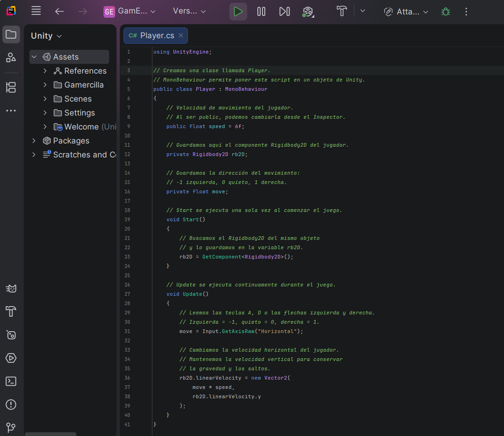
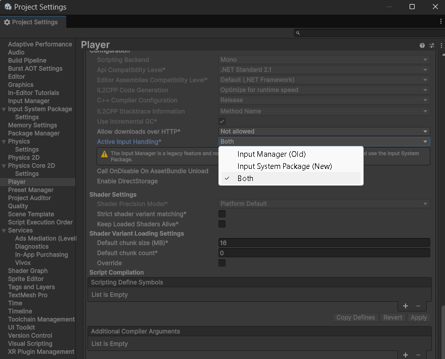
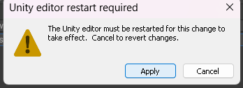
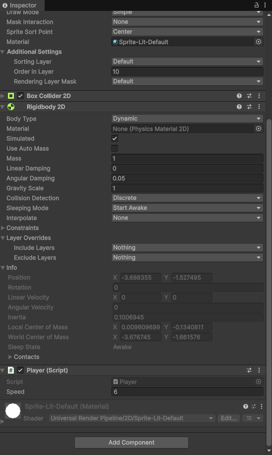
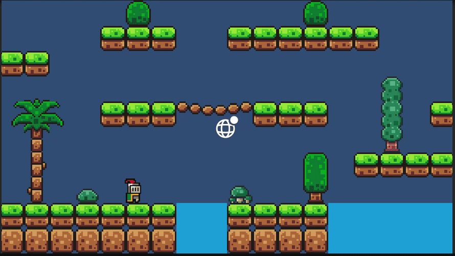

# 5. Movimiento y salto

Vamos a convertir el personaje en un objeto controlable mediante físicas 2D.

## Antes de programar

Completa primero [el escenario con Tilemap](06-tilemap-escenario.md) y [la preparación del Player y sus físicas](07-colisiones-fisicas.md). El personaje debe caer y apoyarse en el suelo al pulsar Play. Aquí utilizaremos su `Rigidbody 2D` y su `Box Collider 2D`, que ya están añadidos.

Abre **`Player.cs`**, el archivo que creamos en [Primer script](04-primer-script.md), dentro de **Assets → ErciGame → Scripts** (o **Gamercilla → Scripts**, según el nombre de tu carpeta del juego). Seguiremos trabajando en ese mismo archivo.

## Movimiento horizontal

Sustituye la plantilla inicial de **Player.cs** por este código y guarda el archivo:

```csharp
using UnityEngine;

// Creamos una clase llamada Player.
// MonoBehaviour permite poner este script en un objeto de Unity.
public class Player : MonoBehaviour
{
    // Velocidad de movimiento del jugador.
    // Al ser public, podemos cambiarla desde el Inspector.
    public float speed = 6f;

    // Guardamos aquí el componente Rigidbody2D del jugador.
    private Rigidbody2D rb2D;

    // Guardamos la dirección del movimiento:
    // -1 izquierda, 0 quieto, 1 derecha.
    private float move;

    // Start se ejecuta una sola vez cuando empieza este componente.
    void Start()
    {
        // Buscamos el Rigidbody2D del mismo objeto
        // y lo guardamos en la variable rb2D.
        rb2D = GetComponent<Rigidbody2D>();
    }

    // Update se ejecuta una vez por fotograma durante el juego.
    void Update()
    {
        // Leemos las teclas A, D o las flechas izquierda y derecha.
        // Izquierda = -1, quieto = 0, derecha = 1.
        move = Input.GetAxisRaw("Horizontal");

        // Cambiamos la velocidad horizontal del jugador.
        // Mantenemos la velocidad vertical para conservar
        // la gravedad y, más adelante, los saltos.
        rb2D.linearVelocity = new Vector2(
            move * speed,
            rb2D.linearVelocity.y
        );
    }
}
```

<figure class="unity-shot" markdown="1">

[{ loading=lazy }](../../assets/images/pmdm/unity/38-unity-player-codigo.png){ aria-label="Ampliar imagen" }

<figcaption>Player.cs abierto en Rider con el código de movimiento horizontal</figcaption>
</figure>

### Qué es rb2D y cómo mueve al jugador

**Rigidbody2D es el componente de físicas del Player.** Permite simular su movimiento, la gravedad y su respuesta a las colisiones. **`rb2D` es la variable en la que guardamos una referencia a ese componente**, para poder utilizarlo desde el script.

```csharp
rb2D = GetComponent<Rigidbody2D>();
```

`GetComponent<Rigidbody2D>()` busca el Rigidbody 2D **en el mismo objeto al que hayamos añadido el script**. Por eso Player.cs y Rigidbody 2D deben estar en el objeto Player.

| Elemento | Función en este código |
| --- | --- |
| `public float speed = 6f;` | Velocidad horizontal inicial, en unidades por segundo. `float` permite decimales y `f` indica que el número es de ese tipo. Al ser un campo público, Unity lo muestra como **Speed** en el Inspector. |
| `private Rigidbody2D rb2D;` | Referencia al componente de físicas; la utilizamos dentro de esta clase. |
| `private float move;` | Guarda la dirección que hemos leído del teclado. |
| `Input.GetAxisRaw("Horizontal")` | Con la configuración predeterminada del Input Manager, devuelve `-1` con A o flecha izquierda, `0` sin pulsar y `1` con D o flecha derecha. |
| `move * speed` | Calcula la velocidad horizontal: con Speed en 6, será `-6`, `0` o `6`. |
| `rb2D.linearVelocity` | Velocidad actual del Rigidbody 2D, con una componente horizontal **X** y otra vertical **Y**. |
| `new Vector2(move * speed, rb2D.linearVelocity.y)` | Crea la nueva velocidad: cambia X y conserva Y para que la gravedad siga funcionando. |

De momento **solo programamos el movimiento horizontal**. Más adelante añadiremos el salto.

## Activar el sistema de entrada

Este código utiliza **`Input`**, el sistema de entrada clásico de Unity. Para que funcione:

1. Guarda el código y la escena antes de cambiar la configuración.
2. Abre **Edit → Project Settings → Player**.
3. Despliega **Other Settings** y busca **Configuration → Active Input Handling**.
4. Cambia su valor a **Both**, para habilitar tanto el Input Manager clásico como el nuevo Input System.

<figure class="unity-shot" markdown="1">

[{ loading=lazy }](../../assets/images/pmdm/unity/39-unity-input-both.png){ aria-label="Ampliar imagen" }

<figcaption>Project Settings → Player: Active Input Handling en Both</figcaption>
</figure>

5. Si aparece el aviso de reinicio, pulsa **Apply**. **Unity se reiniciará** para aplicar el cambio. Espera a que vuelva a abrirse el proyecto y termine de compilar.

<figure class="unity-shot" markdown="1">

[{ loading=lazy }](../../assets/images/pmdm/unity/40-unity-reinicio-input.png){ aria-label="Ampliar imagen" }

<figcaption>Pulsa Apply para reiniciar Unity y aplicar el cambio de entrada</figcaption>
</figure>

## Añadir el script al jugador

**Crear y guardar Player.cs no aplica su comportamiento al personaje. Tenemos que añadirlo como componente al objeto Player.** Hazlo fuera de Play:

1. En **Project**, abre la carpeta **Scripts** y localiza **Player.cs**.
2. **Arrastra Player.cs desde Project hasta el objeto Player de Hierarchy.** También puedes soltarlo en el Inspector cuando Player esté seleccionado.
3. Selecciona **Player** y comprueba que aparece el componente **Player (Script)** junto a **Box Collider 2D** y **Rigidbody 2D**.
4. Comprueba que **Speed** vale **6** y que el componente está habilitado.
5. Guarda la escena con **Ctrl+S**.

<figure class="unity-shot" markdown="1">

[{ loading=lazy }](../../assets/images/pmdm/unity/41-unity-player-script-componente.png){ aria-label="Ampliar imagen" }

<figcaption>Player (Script) añadido al jugador, con Speed en 6 y Rigidbody 2D en el mismo objeto</figcaption>
</figure>

!!! important "El archivo y el componente son pasos distintos"
    El archivo contiene las instrucciones. Al **arrastrarlo al Player**, Unity crea el componente que las ejecuta para ese objeto. Añádelo una sola vez; al modificar Player.cs después, se actualiza el componente existente.

## Ejecutar y probar el movimiento

1. Pulsa **Play** en Unity.
2. Haz clic dentro de la pestaña **Game** para que reciba las teclas.
3. Prueba **A y D**, o **flecha izquierda y flecha derecha**. El jugador debe moverse a ambos lados y detenerse al soltar las teclas.
4. Comprueba que sigue apoyándose en el suelo. En esta versión todavía no salta ni cambia su animación al caminar.
5. Detén **Play** antes de continuar editando.

<figure class="unity-shot" markdown="1">

[{ loading=lazy }](../../assets/images/pmdm/unity/42-unity-prueba-movimiento.gif){ aria-label="Ampliar imagen" }

<figcaption>Prueba del movimiento horizontal del Player en Game</figcaption>
</figure>

Puedes ajustar **Speed** desde **Player (Script)** en el Inspector. Para conservar el nuevo valor, modifícalo **fuera de Play**: los cambios realizados durante la ejecución normalmente se pierden al detenerla.

Si no se mueve, comprueba que **Player (Script)** está en el objeto correcto, que **Speed** es mayor que cero, que **Active Input Handling** está en **Both**, que Game tiene el foco y que no hay errores de compilación en **Console**. Si falta Rigidbody 2D en ese mismo objeto, el script no podrá obtenerlo.

## Detectar el suelo

Crea un objeto vacío como hijo del Player:

```text
Player
└── GroundCheck
```

Colócalo justo debajo de los pies.

Después crea una `Layer` llamada:

```text
Floor
```

y asígnala al Tilemap **`Escenario`**, que contiene el suelo sólido. `Player` y `Decoracion` deben permanecer fuera de esa layer. Esta es una **Layer de físicas**, distinta de la **Sorting Layer** utilizada para ordenar los sprites.

## Añadir el salto

Sustituye el contenido de **`Player.cs`** por esta versión, que incorpora el salto; no crees un segundo script con la misma clase:

```csharp
using UnityEngine;

public class Player : MonoBehaviour
{
    public float speed = 6f;
    public float jumpForce = 6f;

    public Transform groundCheck;
    public float groundRadius = 0.1f;
    public LayerMask groundLayer;

    private Rigidbody2D rb2D;
    private float move;
    private bool isGrounded;

    void Start()
    {
        rb2D = GetComponent<Rigidbody2D>();
    }

    void Update()
    {
        move = Input.GetAxisRaw("Horizontal");

        rb2D.linearVelocity = new Vector2(
            move * speed,
            rb2D.linearVelocity.y
        );

        if (Input.GetButtonDown("Jump") && isGrounded)
        {
            rb2D.linearVelocity = new Vector2(
                rb2D.linearVelocity.x,
                jumpForce
            );
        }
    }

    private void FixedUpdate()
    {
        isGrounded = Physics2D.OverlapCircle(
            groundCheck.position,
            groundRadius,
            groundLayer
        );
    }
}
```

## Configurar el Inspector

En `Player (Script)` asigna:

```text
Ground Check  → GroundCheck
Ground Radius → 0.1
Ground Layer  → Floor
```

!!! tip
    Si el personaje no salta, comprueba primero que `GroundCheck` está asignado, que el suelo pertenece a la layer `Floor` y que `Ground Layer` apunta a esa layer.

Referencias: [Rigidbody2D.linearVelocity](https://docs.unity3d.com/6000.0/Documentation/ScriptReference/Rigidbody2D-linearVelocity.html) y [activación de los sistemas de entrada](https://docs.unity3d.com/Packages/com.unity.inputsystem@1.11/manual/Installation.html).
