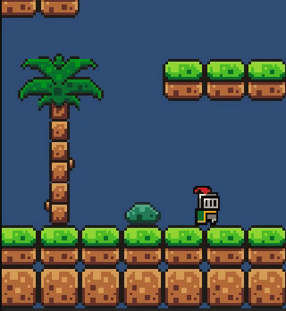
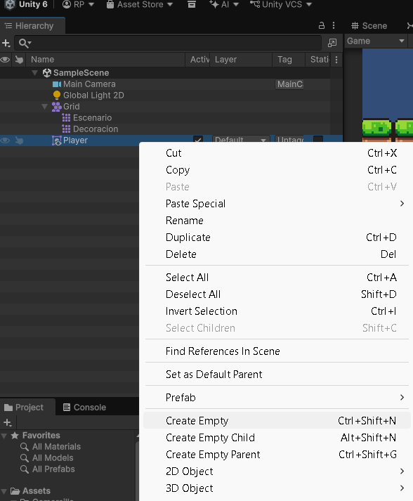
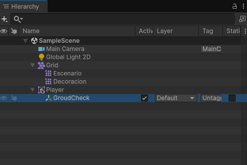
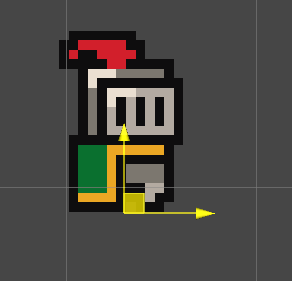
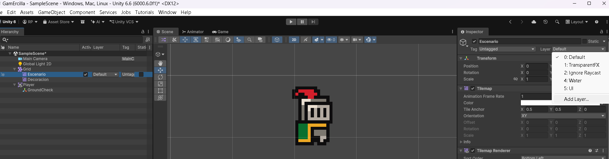
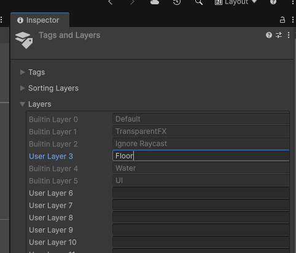
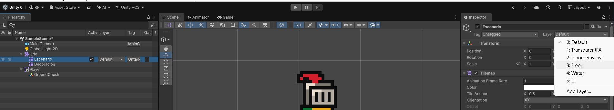
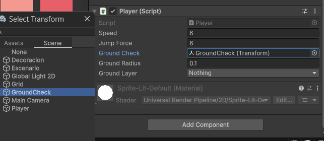
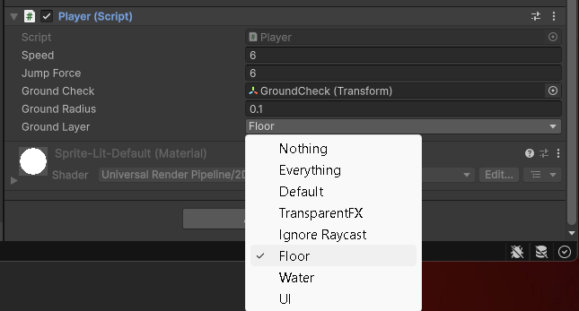
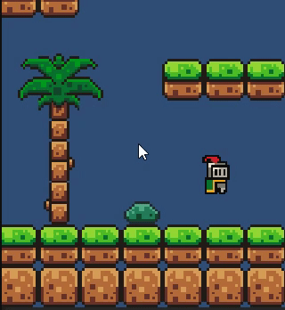

# 7. Movimiento, orientación y salto

Vamos a convertir el personaje en un objeto controlable mediante físicas 2D.

## Antes de programar

Completa primero [el escenario con Tilemap](06-tilemap-escenario.md) y [la preparación del Player y sus físicas](07-colisiones-fisicas.md). El personaje debe caer y apoyarse en el suelo al pulsar Play. Aquí utilizaremos su `Rigidbody 2D` y su `Box Collider 2D`, que ya están añadidos.

Abre **`Player.cs`**, el archivo que creamos en [Primer script](04-primer-script.md), dentro de **Assets → ErciGame → Scripts** (o **Gamercilla → Scripts**, según el nombre de tu carpeta del juego). Seguiremos trabajando en ese mismo archivo.

## Movimiento horizontal

Sustituye la plantilla inicial de **Player.cs** por este código y guarda el archivo:

```csharp
using UnityEngine;

// Creamos una clase llamada Player.
// MonoBehaviour permite poner este script en un objeto de Unity.
public class Player : MonoBehaviour
{
    // Velocidad de movimiento del jugador.
    // Al ser public, podemos cambiarla desde el Inspector.
    public float speed = 6f;

    // Guardamos aquí el componente Rigidbody2D del jugador.
    private Rigidbody2D rb2D;

    // Guardamos la dirección del movimiento:
    // -1 izquierda, 0 quieto, 1 derecha.
    private float move;

    // Start se ejecuta una sola vez cuando empieza este componente.
    void Start()
    {
        // Buscamos el Rigidbody2D del mismo objeto
        // y lo guardamos en la variable rb2D.
        rb2D = GetComponent<Rigidbody2D>();
    }

    // Update se ejecuta una vez por fotograma durante el juego.
    void Update()
    {
        // Leemos las teclas A, D o las flechas izquierda y derecha.
        // Izquierda = -1, quieto = 0, derecha = 1.
        move = Input.GetAxisRaw("Horizontal");

        // Cambiamos la velocidad horizontal del jugador.
        // Mantenemos la velocidad vertical para conservar
        // la gravedad y, más adelante, los saltos.
        rb2D.linearVelocity = new Vector2(
            move * speed,
            rb2D.linearVelocity.y
        );
    }
}
```

<figure class="unity-shot" markdown="1">

[{ loading=lazy }](../../assets/images/pmdm/unity/38-unity-player-codigo.png){ aria-label="Ampliar imagen" }

<figcaption>Player.cs abierto en Rider con el código de movimiento horizontal</figcaption>
</figure>

### Qué es rb2D y cómo mueve al jugador

**Rigidbody2D es el componente de físicas del Player.** Permite simular su movimiento, la gravedad y su respuesta a las colisiones. **`rb2D` es la variable en la que guardamos una referencia a ese componente**, para poder utilizarlo desde el script.

```csharp
rb2D = GetComponent<Rigidbody2D>();
```

`GetComponent<Rigidbody2D>()` busca el Rigidbody 2D **en el mismo objeto al que hayamos añadido el script**. Por eso Player.cs y Rigidbody 2D deben estar en el objeto Player.

| Elemento | Función en este código |
| --- | --- |
| `public float speed = 6f;` | Velocidad horizontal inicial, en unidades por segundo. `float` permite decimales y `f` indica que el número es de ese tipo. Al ser un campo público, Unity lo muestra como **Speed** en el Inspector. |
| `private Rigidbody2D rb2D;` | Referencia al componente de físicas; la utilizamos dentro de esta clase. |
| `private float move;` | Guarda la dirección que hemos leído del teclado. |
| `Input.GetAxisRaw("Horizontal")` | Con la configuración predeterminada del Input Manager, devuelve `-1` con A o flecha izquierda, `0` sin pulsar y `1` con D o flecha derecha. |
| `move * speed` | Calcula la velocidad horizontal: con Speed en 6, será `-6`, `0` o `6`. |
| `rb2D.linearVelocity` | Velocidad actual del Rigidbody 2D, con una componente horizontal **X** y otra vertical **Y**. |
| `new Vector2(move * speed, rb2D.linearVelocity.y)` | Crea la nueva velocidad: cambia X y conserva Y para que la gravedad siga funcionando. |

De momento **solo programamos el movimiento horizontal**. Más adelante añadiremos el salto.

## Activar el sistema de entrada

Este código utiliza **`Input`**, el sistema de entrada clásico de Unity. Para que funcione:

1. Guarda el código y la escena antes de cambiar la configuración.
2. Abre **Edit → Project Settings → Player**.
3. Despliega **Other Settings** y busca **Configuration → Active Input Handling**.
4. Cambia su valor a **Both**, para habilitar tanto el Input Manager clásico como el nuevo Input System.

<figure class="unity-shot" markdown="1">

[{ loading=lazy }](../../assets/images/pmdm/unity/39-unity-input-both.png){ aria-label="Ampliar imagen" }

<figcaption>Project Settings → Player: Active Input Handling en Both</figcaption>
</figure>

5. Si aparece el aviso de reinicio, pulsa **Apply**. **Unity se reiniciará** para aplicar el cambio. Espera a que vuelva a abrirse el proyecto y termine de compilar.

<figure class="unity-shot" markdown="1">

[{ loading=lazy }](../../assets/images/pmdm/unity/40-unity-reinicio-input.png){ aria-label="Ampliar imagen" }

<figcaption>Pulsa Apply para reiniciar Unity y aplicar el cambio de entrada</figcaption>
</figure>

## Añadir el script al jugador

**Crear y guardar Player.cs no aplica su comportamiento al personaje. Tenemos que añadirlo como componente al objeto Player.** Hazlo fuera de Play:

1. En **Project**, abre la carpeta **Scripts** y localiza **Player.cs**.
2. **Arrastra Player.cs desde Project hasta el objeto Player de Hierarchy.** También puedes soltarlo en el Inspector cuando Player esté seleccionado.
3. Selecciona **Player** y comprueba que aparece el componente **Player (Script)** junto a **Box Collider 2D** y **Rigidbody 2D**.
4. Comprueba que **Speed** vale **6** y que el componente está habilitado.
5. Guarda la escena con **Ctrl+S**.

<figure class="unity-shot" markdown="1">

[{ loading=lazy }](../../assets/images/pmdm/unity/41-unity-player-script-componente.png){ aria-label="Ampliar imagen" }

<figcaption>Player (Script) añadido al jugador, con Speed en 6 y Rigidbody 2D en el mismo objeto</figcaption>
</figure>

!!! important "El archivo y el componente son pasos distintos"
    El archivo contiene las instrucciones. Al **arrastrarlo al Player**, Unity crea el componente que las ejecuta para ese objeto. Añádelo una sola vez; al modificar Player.cs después, se actualiza el componente existente.

## Ejecutar y probar el movimiento

1. Pulsa **Play** en Unity.
2. Haz clic dentro de la pestaña **Game** para que reciba las teclas.
3. Prueba **A y D**, o **flecha izquierda y flecha derecha**. El jugador debe moverse a ambos lados y detenerse al soltar las teclas.
4. Comprueba que sigue apoyándose en el suelo. En esta versión todavía no salta ni cambia su animación al caminar.
5. Detén **Play** antes de continuar editando.

<figure class="unity-shot" markdown="1">

[{ loading=lazy }](../../assets/images/pmdm/unity/42-unity-prueba-movimiento.gif){ aria-label="Ampliar imagen" }

<figcaption>Prueba del movimiento horizontal del Player en Game</figcaption>
</figure>

Puedes ajustar **Speed** desde **Player (Script)** en el Inspector. Para conservar el nuevo valor, modifícalo **fuera de Play**: los cambios realizados durante la ejecución normalmente se pierden al detenerla.

Si no se mueve, comprueba que **Player (Script)** está en el objeto correcto, que **Speed** es mayor que cero, que **Active Input Handling** está en **Both**, que Game tiene el foco y que no hay errores de compilación en **Console**. Si falta Rigidbody 2D en ese mismo objeto, el script no podrá obtenerlo.

## Orientación del personaje

Cuando el jugador cambia de dirección, debe mirar hacia el lado al que se mueve. En esta práctica el sprite original mira a la derecha y el **Player tiene Scale = (1, 1, 1)**.

Añade este bloque **dentro del Update existente, justo después de leer move**:

```csharp
// ORIENTACIÓN
if (move != 0)
{
    transform.localScale = new Vector3(Mathf.Sign(move), 1, 1);
}
```

| Valor de move | Escala X | Resultado |
| --- | --- | --- |
| `1` | `1` | Mira a la derecha. |
| `-1` | `-1` | Mira a la izquierda. |
| `0` | Se conserva | Mantiene la última orientación al detenerse. |

**Mathf.Sign(move)** devuelve `-1` si el número es negativo y `1` si es cero o positivo. La condición **move != 0** evita cambiar la orientación al soltar las teclas. Y y Z se mantienen en 1. No crees otro método Update.

!!! note "La escala también afecta a los hijos y los colliders"
    Este código utiliza una escala inicial **(1, 1, 1)**. Si necesitas otro tamaño, ajusta los [Pixels Per Unit](03-assets-sprites.md#que-significa-pixels-per-unit) o adapta el código para conservar esa escala. Al crear GroundCheck en el siguiente paso, déjalo centrado en **X = 0** para que no cambie de posición al reflejar el Player.

Guarda Player.cs, espera a que Unity compile y prueba **A/D o las flechas** en Game. El personaje debe mirar hacia donde camina y conservar su orientación al detenerse.

<figure class="unity-shot" markdown="1">

[{ loading=lazy }](../../assets/images/pmdm/unity/56-unity-prueba-orientacion.gif){ aria-label="Ampliar imagen" }

<figcaption>El Player cambia su orientación al desplazarse a izquierda y derecha</figcaption>
</figure>

Si mira al lado contrario, comprueba hacia dónde mira el sprite original y si existe otro código que también modifica la escala o **SpriteRenderer.flipX**.

!!! tip "Alternativa para reflejar solo la imagen"
    `SpriteRenderer.flipX` permite invertir únicamente el sprite. En estos pasos utilizamos la **escala X del Transform**; elige un único método para controlar la orientación.

## Detectar el suelo

Para permitir el salto cuando el personaje está apoyado, necesitamos un punto de comprobación junto a sus pies y una layer que identifique las plataformas sólidas.

### Crear GroundCheck como hijo del Player

1. Detén **Play** y selecciona **Player** en **Hierarchy**.
2. Pulsa **botón derecho → Create Empty Child** para crear un objeto vacío dentro de Player. En el menú también aparece **Create Empty**: comprueba siempre que el nuevo objeto queda como hijo del jugador.
3. Renómbralo **`GroundCheck`**. Si se creó fuera, arrástralo hasta Player en Hierarchy.

<figure class="unity-shot" markdown="1">

[{ loading=lazy }](../../assets/images/pmdm/unity/43-unity-crear-groundcheck.png){ aria-label="Ampliar imagen" }

<figcaption>Menú para crear un objeto vacío: GroundCheck debe quedar dentro de Player</figcaption>
</figure>

<figure class="unity-shot" markdown="1">

[{ loading=lazy }](../../assets/images/pmdm/unity/44-unity-groundcheck-hijo.png){ aria-label="Ampliar imagen" }

<figcaption>GroundCheck aparece indentado bajo Player: es su objeto hijo</figcaption>
</figure>

4. Selecciona **GroundCheck** y utiliza la herramienta **Move** en **Scene** para bajarlo hasta los pies del personaje, cerca del borde inferior de su collider.
5. Mantén su **posición local X en 0** para que quede centrado, y Z en 0 para esta escena 2D. Ajusta Y según el tamaño de tu personaje, sin colocarlo demasiado lejos del suelo.

<figure class="unity-shot" markdown="1">

[{ loading=lazy }](../../assets/images/pmdm/unity/45-unity-groundcheck-pies.png){ aria-label="Ampliar imagen" }

<figcaption>GroundCheck situado junto a los pies del personaje</figcaption>
</figure>

**GroundCheck no necesita un collider ni un Rigidbody 2D.** Utilizaremos su posición para comprobar si hay suelo cerca. Al ser hijo del Player, se desplaza con él.

### Crear la layer Floor y asignarla al escenario

1. Selecciona **Grid → Escenario** en **Hierarchy**, el Tilemap que tiene las colisiones del suelo.
2. En la parte superior del **Inspector**, abre **Layer → Add Layer…**.

<figure class="unity-shot" markdown="1">

[{ loading=lazy }](../../assets/images/pmdm/unity/46-unity-escenario-add-layer.png){ aria-label="Ampliar imagen" }

<figcaption>Con Escenario seleccionado, abre Layer → Add Layer…</figcaption>
</figure>

3. En **Tags and Layers → Layers**, escribe **`Floor`** en una **User Layer** libre. En la captura se utiliza la 3; puedes utilizar otra que esté disponible.

<figure class="unity-shot" markdown="1">

[{ loading=lazy }](../../assets/images/pmdm/unity/47-unity-crear-floor.png){ aria-label="Ampliar imagen" }

<figcaption>Creación de Floor en una User Layer libre</figcaption>
</figure>

4. Vuelve a seleccionar **Escenario** y elige **Layer → Floor**. **Crear la layer no la asigna automáticamente al Tilemap.**
5. Comprueba que el campo **Layer de Escenario** muestra **Floor**, y guarda la escena.

<figure class="unity-shot" markdown="1">

[{ loading=lazy }](../../assets/images/pmdm/unity/48-unity-asignar-floor.png){ aria-label="Ampliar imagen" }

<figcaption>Después de crear Floor, vuelve a Escenario y selecciónala en Layer</figcaption>
</figure>

!!! important "Layer y Ground Layer son ajustes distintos"
    **Escenario pertenece a la layer Floor.** El objeto **Player** puede seguir en **Default**, igual que **Decoracion**. Más abajo seleccionaremos **Floor en Ground Layer del script del Player**: ese campo indica qué layer buscamos como suelo. No pongas al propio Player en Floor, porque la comprobación podría detectar su collider como si fuera suelo.

La **Layer** de los objetos también interviene en las físicas. Es distinta de la **Sorting Layer**, que utilizamos para ordenar qué sprites se dibujan delante.

## Añadir el salto

Sustituye el contenido de **`Player.cs`** por esta versión, que incorpora el salto; no crees un segundo script con la misma clase:

```csharp
using UnityEngine;

public class Player : MonoBehaviour
{
    public float speed = 6f;
    public float jumpForce = 6f;

    // Punto de comprobación situado junto a los pies.
    public Transform groundCheck;
    // Radio del círculo con el que buscamos el suelo.
    public float groundRadius = 0.1f;
    // Layers que consideramos suelo; seleccionaremos Floor.
    public LayerMask groundLayer;

    private Rigidbody2D rb2D;
    private float move;
    private bool isGrounded;

    void Start()
    {
        rb2D = GetComponent<Rigidbody2D>();
    }

    void Update()
    {
        move = Input.GetAxisRaw("Horizontal");

        // Conservamos la orientación añadida en el paso anterior.
        if (move != 0)
        {
            transform.localScale = new Vector3(Mathf.Sign(move), 1, 1);
        }

        rb2D.linearVelocity = new Vector2(
            move * speed,
            rb2D.linearVelocity.y
        );

        if (Input.GetButtonDown("Jump") && isGrounded)
        {
            rb2D.linearVelocity = new Vector2(
                rb2D.linearVelocity.x,
                jumpForce
            );
            // Al despegar dejamos de estar apoyados.
            isGrounded = false;
        }
    }

    private void FixedUpdate()
    {
        isGrounded = Physics2D.OverlapCircle(
            groundCheck.position,
            groundRadius,
            groundLayer
        ) != null && rb2D.linearVelocity.y <= 0.1f;
    }
}
```

### Cómo sabe el script si puede saltar

En **FixedUpdate**, `Physics2D.OverlapCircle` busca un collider dentro de un círculo centrado en **GroundCheck**, con el radio de **Ground Radius**, y solo en las layers de **Ground Layer**. Si encuentra uno y el personaje no está ascendiendo (`linearVelocity.y <= 0.1f`), `isGrounded` vale `true`. Al iniciar el salto lo ponemos en `false` para no considerar que sigue apoyado mientras despega.

En **Update**, `Input.GetButtonDown("Jump")` detecta la pulsación de salto —por defecto, la **barra espaciadora**—. Solo cambiamos la velocidad vertical cuando se pulsa y el personaje tiene suelo cerca. La velocidad horizontal se conserva.

## Configurar el Inspector para el salto

Guarda **Player.cs**, vuelve a Unity y espera a que termine de compilar. En el **Player (Script)** que ya añadimos al jugador aparecerán los nuevos campos. **No hace falta arrastrar el script otra vez.**

1. Selecciona **Player** en **Hierarchy**.
2. En **Player (Script) → Ground Check**, arrastra el objeto **GroundCheck** desde Hierarchy hasta el campo. También puedes pulsar el selector circular y elegirlo en la pestaña **Scene**.

<figure class="unity-shot" markdown="1">

[{ loading=lazy }](../../assets/images/pmdm/unity/49-unity-asignar-groundcheck.png){ aria-label="Ampliar imagen" }

<figcaption>Asigna el Transform de GroundCheck al campo Ground Check del script</figcaption>
</figure>

3. Deja **Ground Radius en 0.1** como punto de partida.
4. Abre **Ground Layer** y marca **Floor**. La primera captura de asignación muestra todavía **Nothing**: hay que completar este paso.

<figure class="unity-shot" markdown="1">

[{ loading=lazy }](../../assets/images/pmdm/unity/54-unity-ground-layer-floor.png){ aria-label="Ampliar imagen" }

<figcaption>Ground Check asignado y Floor marcado en Ground Layer del Player (Script)</figcaption>
</figure>

Comprueba estos valores:

| Campo de Player (Script) | Valor |
| --- | --- |
| **Speed** | `6` |
| **Jump Force** | `6` |
| **Ground Check** | El objeto hijo `GroundCheck` |
| **Ground Radius** | `0.1` |
| **Ground Layer** | `Floor` |

`jumpForce` es el nombre del campo en este ejemplo; su valor se utiliza como **velocidad vertical de salto**, ya que la asignamos a `linearVelocity`.

Guarda la escena con **Ctrl+S**. Para evitar que el personaje vuelque, comprueba el [bloqueo de Rotation Z](07-colisiones-fisicas.md#evitar-que-el-jugador-gire). Si se queda pegado al lateral de una plataforma, aplica el [material físico sin fricción](07-colisiones-fisicas.md#reducir-la-friccion-con-las-paredes).

## Probar el salto

Pulsa **Play**, haz clic en **Game** y combina **A/D o las flechas** con la **barra espaciadora**. El personaje debe saltar desde el suelo y volver a caer sobre una plataforma, como en el GIF.

<figure class="unity-shot" markdown="1">

[{ loading=lazy }](../../assets/images/pmdm/unity/55-unity-prueba-salto.gif){ aria-label="Ampliar imagen" }

<figcaption>Prueba del salto del Player con GroundCheck y la layer Floor configurados</figcaption>
</figure>

Si no salta, detén Play y comprueba que **Ground Check está asignado**, que **Escenario tiene Layer Floor**, que **Ground Layer incluye Floor** y que el punto de comprobación está cerca del suelo al apoyar los pies. Revisa también **Console** y los colliders del escenario. Si permite saltar cuando no está apoyado, revisa la posición y el radio de GroundCheck y que el Player no pertenezca a Floor.

Con el movimiento, la orientación y el salto funcionando, continúa con [Animaciones](08-animaciones.md).

Referencias: [Physics2D.OverlapCircle](https://docs.unity3d.com/6000.0/Documentation/ScriptReference/Physics2D.OverlapCircle.html), [Rigidbody2D.linearVelocity](https://docs.unity3d.com/6000.0/Documentation/ScriptReference/Rigidbody2D-linearVelocity.html) y [activación de los sistemas de entrada](https://docs.unity3d.com/Packages/com.unity.inputsystem@1.11/manual/Installation.html).
