# 7. Colisiones y físicas

Partimos del [mapa dibujado con Tilemap](06-tilemap-escenario.md) y de los [sprites preparados](03-assets-sprites.md). Ahora haremos que el suelo sea sólido, colocaremos al personaje y comprobaremos las físicas antes de programar su movimiento.

Un **collider** define la forma con la que un objeto colisiona. Un **Rigidbody 2D** permite que Unity simule su comportamiento físico.

## Dar colisiones al mapa

### Seleccionar el suelo y añadir Tilemap Collider 2D

En **Hierarchy**, despliega `Grid` y selecciona **`Escenario`**, el Tilemap que contiene las plataformas que pisa el jugador. En **Inspector → Add Component**, busca y añade **Tilemap Collider 2D**.

Este componente genera las formas de colisión de los tiles pintados en ese Tilemap.

<figure class="unity-shot" markdown="1">

[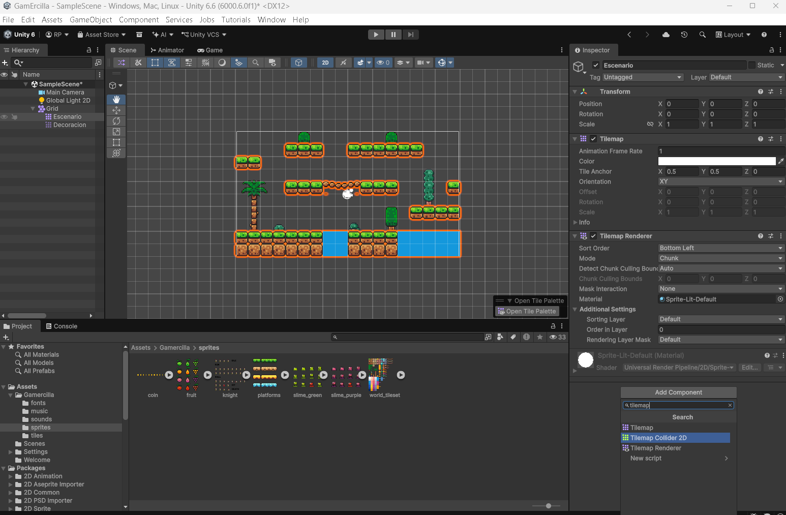{ loading=lazy }](../../assets/images/pmdm/unity/22-unity-tilemap-collider.png){ aria-label="Ampliar imagen" }

<figcaption>Selecciona Escenario y añade Tilemap Collider 2D desde Add Component</figcaption>
</figure>

!!! important "El suelo y la decoración tienen funciones distintas"
    Añade las colisiones al Tilemap **Escenario**. **Decoracion** contiene los elementos visuales y no necesita collider en esta práctica. Si pintaste una plataforma en Decoracion, corrige primero el destino del dibujo.

### Combinar las colisiones de los tiles

Con **`Escenario`** todavía seleccionado, añade **Composite Collider 2D** mediante **Add Component**. Unity añade también el **Rigidbody 2D** necesario si no existe.

<figure class="unity-shot" markdown="1">

[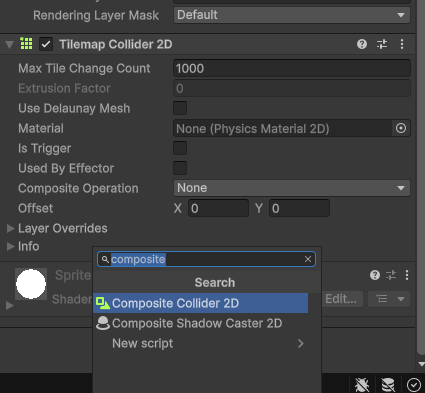{ loading=lazy }](../../assets/images/pmdm/unity/23-unity-composite-collider.png){ aria-label="Ampliar imagen" }

<figcaption>Añade Composite Collider 2D al mismo objeto Escenario</figcaption>
</figure>

En el **Rigidbody 2D del escenario**, cambia **Body Type → Static**. El suelo permanecerá inmóvil y no caerá por efecto de la gravedad.

<figure class="unity-shot" markdown="1">

[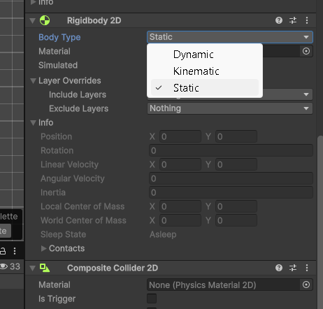{ loading=lazy }](../../assets/images/pmdm/unity/24-unity-escenario-static.png){ aria-label="Ampliar imagen" }

<figcaption>Rigidbody 2D del escenario: Body Type debe ser Static</figcaption>
</figure>

Vuelve al **Tilemap Collider 2D** y establece **Composite Operation → Merge**. Comprueba también que **Is Trigger está desactivado en el Composite Collider 2D**; con Merge, este componente controla ese ajuste.

<figure class="unity-shot" markdown="1">

[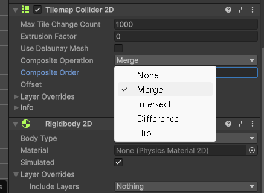{ loading=lazy }](../../assets/images/pmdm/unity/25-unity-composite-merge.png){ aria-label="Ampliar imagen" }

<figcaption>Tilemap Collider 2D: Composite Operation en Merge</figcaption>
</figure>

El Composite combina las formas de los tiles vecinos y suaviza las uniones entre ellos. Esto reduce las formas de colisión que debe procesar Unity y ayuda a evitar que el personaje se enganche en las juntas del suelo.

!!! tip "Si utilizas otra versión de Unity"
    En versiones anteriores puede aparecer **Used By Composite** en lugar de **Composite Operation → Merge**. En las capturas de esta práctica utilizamos Merge.

## Crear el Player

### Colocar un fotograma del personaje

El recurso **`knight`** debe estar preparado con **20 PPU** y recortes de **32×32 píxeles**, como explicamos en [Preparar el personaje](03-assets-sprites.md#preparar-el-personaje).

1. En **Project → Assets → Gamercilla → sprites**, despliega la flecha de `knight`.
2. Elige un sprite individual donde aparezca el personaje, por ejemplo **`knight_0`**. La hoja también contiene rótulos de animaciones: no elijas un recorte con texto.
3. Arrástralo a **Scene**, sobre una plataforma sólida y ligeramente por encima de ella, sin dejarlo dentro del suelo.
4. Renombra el objeto de **Hierarchy** como **`Player`** y conserva **Transform → Scale = (1, 1, 1)** para utilizar el tamaño definido por los PPU.

<figure class="unity-shot" markdown="1">

[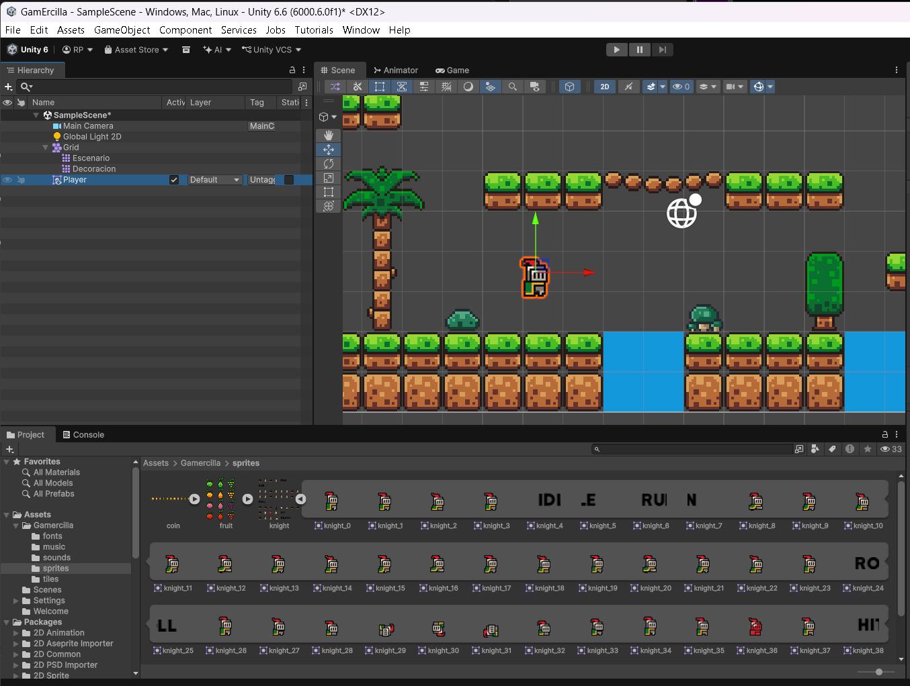{ loading=lazy }](../../assets/images/pmdm/unity/27-unity-player-escena.png){ aria-label="Ampliar imagen" }

<figcaption>Un fotograma de knight colocado en Scene y renombrado como Player</figcaption>
</figure>

### Dibujarlo por encima del escenario

Selecciona **`Player`**. En **Sprite Renderer → Additional Settings**, mantén **Sorting Layer → Default**, igual que los Tilemaps, y establece **Order in Layer → 10**.

Con los valores del mapa (`Escenario = 0`, `Decoracion = -1` y fondo `-2`), el personaje se dibujará delante. **Order in Layer controla el orden visual; no configura las colisiones.**

<figure class="unity-shot" markdown="1">

[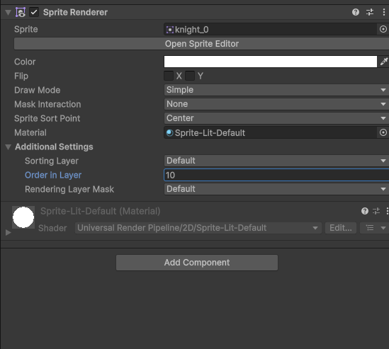{ loading=lazy }](../../assets/images/pmdm/unity/28-unity-player-order-layer.png){ aria-label="Ampliar imagen" }

<figcaption>Sprite Renderer del Player: Sorting Layer Default y Order in Layer 10</figcaption>
</figure>

### Añadir y ajustar Box Collider 2D

En **Inspector → Add Component**, añade **Box Collider 2D** al **`Player`**. Elige el componente **2D**.

<figure class="unity-shot" markdown="1">

[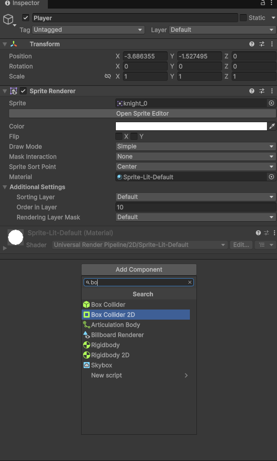{ loading=lazy }](../../assets/images/pmdm/unity/29-unity-player-box-collider.png){ aria-label="Ampliar imagen" }

<figcaption>Añade Box Collider 2D al Player</figcaption>
</figure>

Pulsa el botón **Edit Collider** del componente. En **Scene**, arrastra los tiradores del rectángulo verde para ajustarlo al cuerpo y los pies del personaje, dejando fuera el margen transparente del fotograma.

<figure class="unity-shot" markdown="1">

[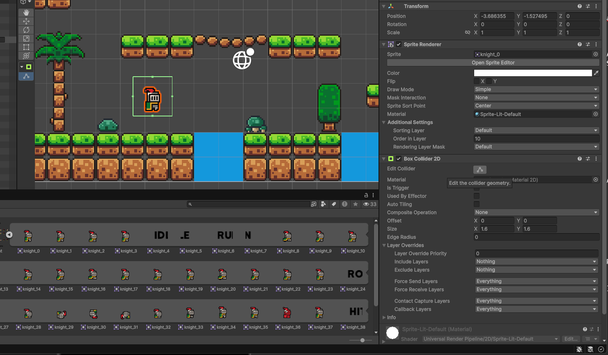{ loading=lazy }](../../assets/images/pmdm/unity/30-unity-player-edit-collider.png){ aria-label="Ampliar imagen" }

<figcaption>Edit Collider permite modificar el rectángulo de colisión en Scene</figcaption>
</figure>

No hace falta seguir cada píxel de la silueta: utiliza un rectángulo sencillo que represente el cuerpo. Vuelve a pulsar **Edit Collider** al terminar y deja **Is Trigger desactivado**.

<figure class="unity-shot" markdown="1">

[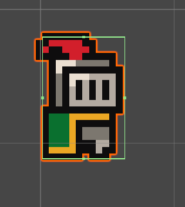{ loading=lazy }](../../assets/images/pmdm/unity/31-unity-player-collider-ajustado.png){ aria-label="Ampliar imagen" }

<figcaption>Collider ajustado al cuerpo del personaje, sin el margen transparente</figcaption>
</figure>

### Añadir Rigidbody 2D al Player

Añade **Rigidbody 2D** con **Add Component** y configura:

| Propiedad | Valor | Motivo |
| --- | --- | --- |
| **Body Type** | `Dynamic` | Permitir que el personaje se mueva y responda a las colisiones. |
| **Simulated** | Activado | Incluirlo en la simulación física. |
| **Gravity Scale** | `1` | Aplicar la gravedad para que caiga sobre el suelo. |
| **Constraints → Freeze Rotation Z** | Activado | Evitar que gire o vuelque al chocar. |

<figure class="unity-shot" markdown="1">

[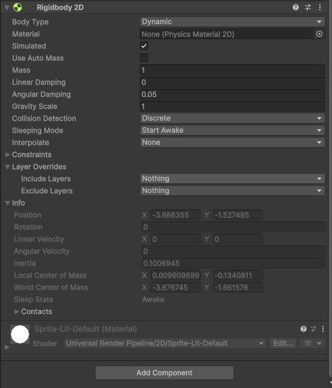{ loading=lazy }](../../assets/images/pmdm/unity/32-unity-player-rigidbody.png){ aria-label="Ampliar imagen" }

<figcaption>Rigidbody 2D del Player: Dynamic, Simulated y Gravity Scale 1; despliega Constraints para bloquear Rotation Z</figcaption>
</figure>

!!! important "Dos Rigidbody, dos comportamientos"
    El **Rigidbody 2D de Escenario es Static**. El **Rigidbody 2D de Player es Dynamic**. Comprueba qué objeto está seleccionado antes de cambiar el Body Type.

## Probar las físicas con Play

Guarda la escena con **Ctrl+S** y pulsa **Play**. El personaje debe caer por la gravedad y **quedarse apoyado sobre el suelo sólido**, como en la captura.

<figure class="unity-shot" markdown="1">

[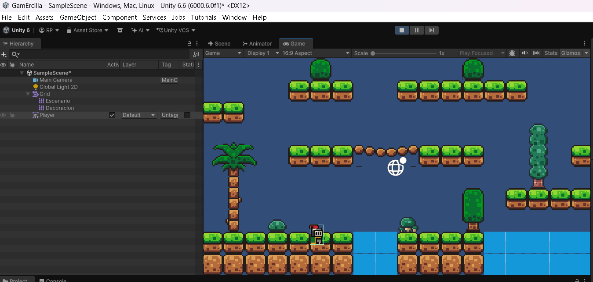{ loading=lazy }](../../assets/images/pmdm/unity/33-unity-player-prueba-play.png){ aria-label="Ampliar imagen" }

<figcaption>Prueba en Game: el Player queda apoyado en una plataforma del escenario</figcaption>
</figure>

**No necesitamos un script para impedir que atraviese el suelo:** esa respuesta la proporcionan los colliders y los Rigidbody 2D. El script que añadiremos después permitirá **mover al personaje y saltar**. Por ahora no responderá a las teclas.

Si atraviesa una plataforma, detén Play y revisa:

- La plataforma está pintada en **Escenario**, el Tilemap que tiene los componentes de colisión.
- **Tilemap Collider 2D** y **Composite Collider 2D** están habilitados, y **Composite Operation** está en **Merge**.
- **Is Trigger** está desactivado tanto en **Composite Collider 2D** del suelo como en **Box Collider 2D** del Player.
- El Player tiene **Rigidbody 2D → Dynamic**, con **Simulated** activado; el escenario está en **Static**.
- Los tiles sólidos tienen **Collider Type** distinto de `None` en sus assets Tile. Si un tile no genera forma de colisión, revisa esa propiedad.
- Las layers del suelo y del Player pueden colisionar en **Edit → Project Settings → Physics 2D → Layer Collision Matrix**, y los componentes no excluyen esas layers mediante **Layer Overrides**.

Sal de **Play** antes de seguir editando: los cambios realizados durante la ejecución normalmente se pierden al detenerla.

## Reducir la fricción con las paredes

Si, al incorporar el movimiento, el personaje se queda pegado a una pared, podemos ajustar la fricción. Es un ajuste distinto de combinar las juntas del Tilemap.

1. En **Assets → Gamercilla**, crea un **Physics Material 2D** desde **botón derecho → Create → 2D → Physics Material 2D**.
2. Llámalo **`PlayerPhysics`**.
3. Establece **Friction → 0** y **Bounciness → 0**.
4. Asígnalo al campo **Material** del **Box Collider 2D del Player**.

## Continuar con el comportamiento

Con el suelo sólido y el personaje preparado, podemos escribir [el primer script](04-primer-script.md) y después añadir [movimiento y salto](05-movimiento-salto.md), reutilizando los componentes que ya hemos configurado.

Referencias: [Tilemap Collider 2D](https://docs.unity3d.com/6000.0/Documentation/Manual/tilemaps/work-with-tilemaps/tilemap-collider-2d-reference.html) y [Rigidbody 2D de tipo Dynamic](https://docs.unity3d.com/6000.0/Documentation/Manual/2d-physics/rigidbody/body-types/dynamic/dynamic-body-type-fundamentals.html).
