# 8. Animaciones

El Player ya se mueve, cambia de orientación y salta. Ahora cambiaremos **su imagen según lo que esté haciendo**: reposo, carrera o salto. Utilizaremos el mismo Player y el mismo **Player.cs** del [paso anterior](05-movimiento-salto.md).

## 1. Crear los clips desde los sprites

Un **Animation Clip** contiene la secuencia de imágenes que se reproducirá. El **Animator Controller** decide qué clip utilizar según el estado del jugador.

1. Detén Play. En Project, crea **animations** dentro de la carpeta del juego que ya estás utilizando: **Assets → ErciGame → animations**. Si tu carpeta se llama ErciDemo o Gamercilla, utiliza esa misma; no crees otra copia del proyecto. En las capturas aparece **Gamercilla**.
2. Abre **sprites** y despliega la flecha de **knight**, que ya recortamos en celdas de **32 × 32**.
3. Selecciona los **cuatro primeros fotogramas**, desde knight_0 hasta knight_3. Puedes seleccionar el primero y pulsar Shift al seleccionar el último.

<figure class="unity-shot" markdown="1">

[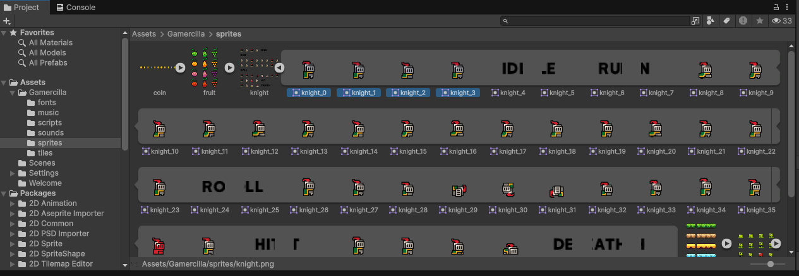{ loading=lazy }](../../assets/images/pmdm/unity/57-unity-frames-idle.png){ aria-label="Ampliar imagen" }

<figcaption>Selecciona los cuatro primeros fotogramas del personaje para idle</figcaption>
</figure>

4. Arrastra los cuatro fotogramas juntos a **Scene**. En el diálogo **Create New Animation**, entra en animations y guarda el clip como **idle.anim**.

<figure class="unity-shot" markdown="1">

[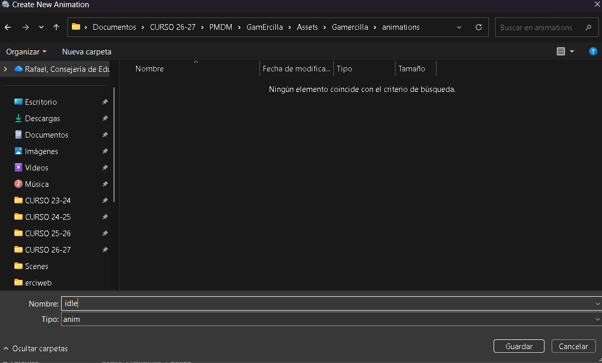{ loading=lazy }](../../assets/images/pmdm/unity/58-unity-guardar-idle.png){ aria-label="Ampliar imagen" }

<figcaption>Guarda idle.anim dentro de la carpeta animations del juego</figcaption>
</figure>

Unity crea un objeto temporal con Sprite Renderer y Animator, además del clip y un controlador. **Ese objeto no sustituye al Player que tiene el script y las físicas.** Lo eliminaremos después.

<figure class="unity-shot" markdown="1">

[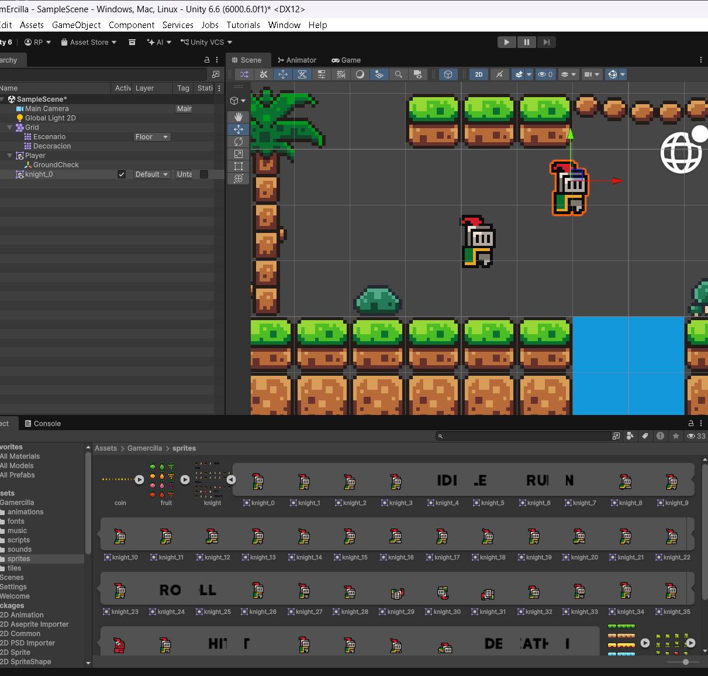{ loading=lazy }](../../assets/images/pmdm/unity/59-unity-personaje-temporal.png){ aria-label="Ampliar imagen" }

<figcaption>Al arrastrar los fotogramas, Unity crea un personaje temporal junto al Player principal</figcaption>
</figure>

Repite la selección y el arrastre con las demás secuencias. Guarda cada clip en la misma carpeta:

| Clip | Fotogramas y uso en esta práctica |
| --- | --- |
| **idle** | knight_0 a knight_3: reposo. |
| **run** | knight_8 a knight_23: carrera. |
| **jump** | knight_26 a knight_33: reutilizamos la secuencia de giro (**roll**) como animación del salto. |
| **death** | Los fotogramas de la secuencia de muerte, antes de las letras DEATH. Lo dejamos preparado para una mecánica posterior. |

Los números corresponden al recorte de las capturas. **Comprueba visualmente cada selección y su orden**: la hoja contiene celdas con letras como IDLE, RUN o DEATH, que no deben entrar en la animación.

<figure class="unity-shot" markdown="1">

[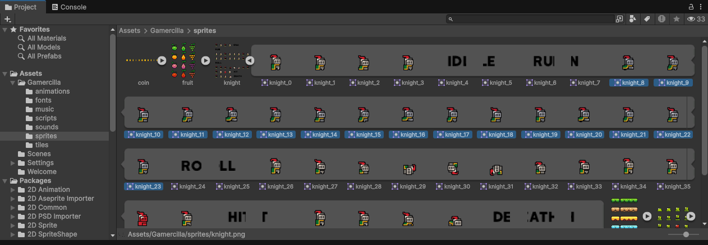{ loading=lazy }](../../assets/images/pmdm/unity/60-unity-frames-run.png){ aria-label="Ampliar imagen" }

<figcaption>Selección de los fotogramas de carrera, sin incluir las celdas con letras</figcaption>
</figure>

<figure class="unity-shot" markdown="1">

[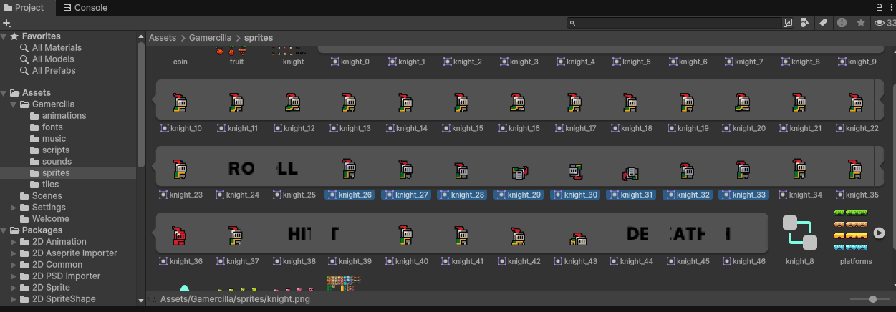{ loading=lazy }](../../assets/images/pmdm/unity/61-unity-frames-jump.png){ aria-label="Ampliar imagen" }

<figcaption>En esta práctica reutilizamos la secuencia de giro para el clip jump</figcaption>
</figure>

En un salto podríamos utilizar clips distintos para subir y caer. Aquí utilizaremos **un único clip jump durante todo el salto**. Reutilizar la secuencia de roll es una elección visual: no estamos añadiendo una acción de rodar al juego.

También puedes preparar **hit** y **attack** siguiendo el mismo procedimiento. No son necesarios para completar este paso; los utilizaremos al trabajar el combate.

<figure class="unity-shot" markdown="1">

[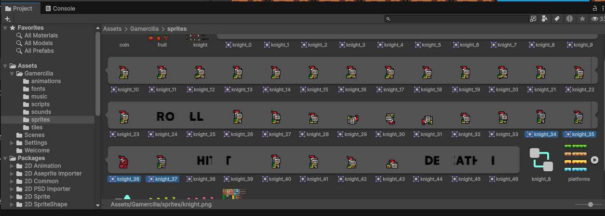{ loading=lazy }](../../assets/images/pmdm/unity/62-unity-frames-hit.png){ aria-label="Ampliar imagen" }

<figcaption>Selección de otra secuencia: los fotogramas de hit, que reservamos para más adelante</figcaption>
</figure>

## 2. Configurar la repetición

En Project, abre **animations**, selecciona cada archivo **.anim** y ajusta **Loop Time** en el Inspector:

| Clip | Loop Time | Motivo |
| --- | --- | --- |
| **idle** | Activado | Se repite mientras el jugador está quieto. |
| **run** | Activado | Se repite mientras camina. |
| **jump** | Desactivado | Se reproduce una vez y mantiene el último fotograma hasta aterrizar. |
| **death** | Desactivado | La muerte se reproduce una sola vez. |

<figure class="unity-shot" markdown="1">

[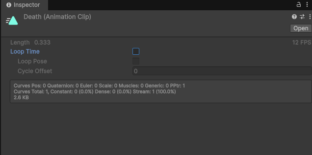{ loading=lazy }](../../assets/images/pmdm/unity/64-unity-death-loop-time.png){ aria-label="Ampliar imagen" }

<figcaption>El clip death tiene Loop Time desmarcado para reproducirse una sola vez</figcaption>
</figure>

**Loop Time se configura en el clip, no en la flecha de una transición.** Desactivarlo no elimina el objeto ni programa la muerte: eso lo haremos más adelante.

## 3. Preparar un único Animator Controller

Al crear los clips por arrastre pueden aparecer varios archivos **.controller**. Conserva el que se generó con **idle** —en las capturas se llama knight_0— y renómbralo **AnimatorController** desde Project.

Elimina únicamente los **controladores sobrantes que se crearon para los personajes temporales**. Conserva todos los clips **.anim** y cualquier controlador que utilices en otros objetos.

<figure class="unity-shot" markdown="1">

[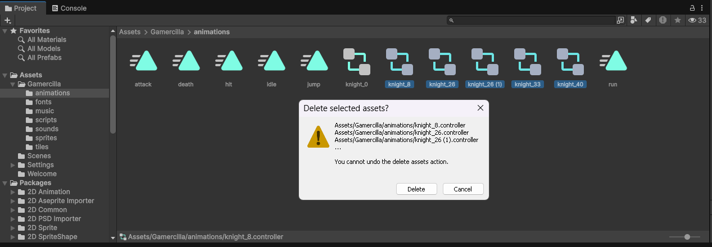{ loading=lazy }](../../assets/images/pmdm/unity/63-unity-eliminar-controladores.png){ aria-label="Ampliar imagen" }

<figcaption>Conserva el controlador de idle y elimina solo los controladores temporales que no utilizarás</figcaption>
</figure>

1. Selecciona el **Player principal** en Hierarchy: el que contiene Player (Script), Rigidbody 2D, Box Collider 2D y el hijo GroundCheck.
2. Pulsa **Add Component**, busca **Animator** y añádelo si todavía no lo tiene.

<figure class="unity-shot" markdown="1">

[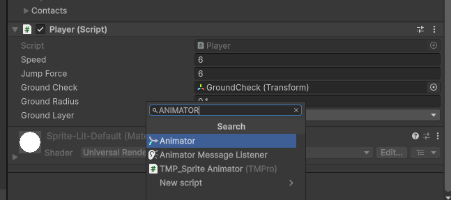{ loading=lazy }](../../assets/images/pmdm/unity/65-unity-add-animator.png){ aria-label="Ampliar imagen" }

<figcaption>Añade el componente Animator al Player principal</figcaption>
</figure>

3. Arrastra **AnimatorController** desde Project al campo **Controller** del componente Animator. También puedes utilizar el selector circular.
4. Deja **Apply Root Motion desactivado**. En esta práctica el script y Rigidbody 2D controlan la posición; los clips cambian el Sprite.

<figure class="unity-shot" markdown="1">

[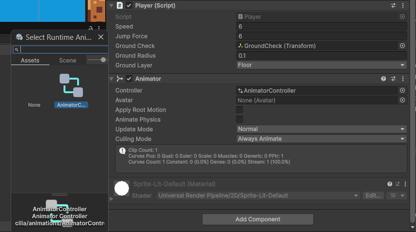{ loading=lazy }](../../assets/images/pmdm/unity/66-unity-asignar-animator-controller.png){ aria-label="Ampliar imagen" }

<figcaption>AnimatorController asignado al Animator del Player, con Apply Root Motion desactivado</figcaption>
</figure>

5. Borra de Hierarchy los personajes temporales creados al arrastrar las secuencias. **Conserva el Player principal y su GroundCheck.** No borres los archivos de animación de Project.
6. Guarda la escena fuera de Play.

## 4. Añadir los estados

Haz doble clic en **AnimatorController** para abrir la ventana **Animator**. También puedes abrirla desde **Window → Animation → Animator**.

Arrastra los clips **run** y **jump** desde Project al área central. Si idle no aparece, arrástralo también. Cada rectángulo es un **estado** que reproduce un clip; al seleccionarlo puedes comprobar su campo **Motion**.

<figure class="unity-shot" markdown="1">

[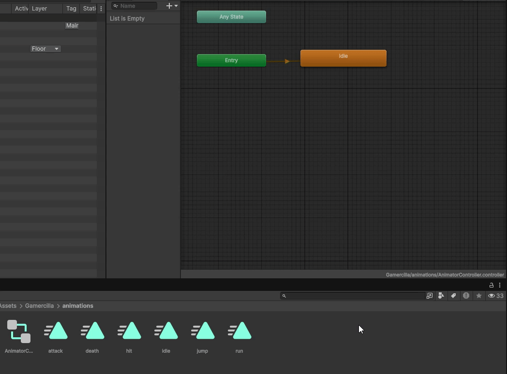{ loading=lazy }](../../assets/images/pmdm/unity/76-unity-estados-animator.gif){ aria-label="Ampliar imagen" }

<figcaption>Arrastra los clips al Animator para crear sus estados; idle es el estado inicial</figcaption>
</figure>

Establece **idle** como estado inicial: clic derecho en idle → **Set as Layer Default State**. Aparecerá en naranja y la flecha de **Entry** apuntará a él. Si ya está en naranja, no hace falta cambiarlo.

Las capturas también muestran hit, attack y death. Puedes dejarlos preparados, pero **en este paso solo conectamos idle, run y jump**. Añadir un rectángulo no hace que una animación se active por sí sola.

## 5. Cambiar entre reposo y carrera

### Crear Speed

En la esquina superior izquierda del Animator aparecen **Layers** y **Parameters**. Abre **Parameters**, pulsa **+ → Float** y escribe exactamente **Speed**.

<figure class="unity-shot" markdown="1">

[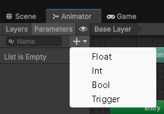{ loading=lazy }](../../assets/images/pmdm/unity/67-unity-crear-parametro-float.png){ aria-label="Ampliar imagen" }

<figcaption>En Parameters, utiliza el botón más y elige Float</figcaption>
</figure>

<figure class="unity-shot" markdown="1">

[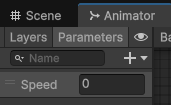{ loading=lazy }](../../assets/images/pmdm/unity/68-unity-parametro-speed.png){ aria-label="Ampliar imagen" }

<figcaption>Parámetro Speed creado: el nombre debe coincidir con el utilizado en el script</figcaption>
</figure>

Speed indicará si el jugador intenta moverse horizontalmente. Lo enviaremos desde el script con valores **0** o **1**, tanto al ir a la derecha como a la izquierda.

### Crear las transiciones

1. Clic derecho en **idle → Make Transition**; pulsa sobre **run**.

<figure class="unity-shot" markdown="1">

[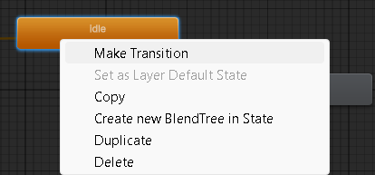{ loading=lazy }](../../assets/images/pmdm/unity/69-unity-make-transition.png){ aria-label="Ampliar imagen" }

<figcaption>Clic derecho en idle y Make Transition para conectarlo con run</figcaption>
</figure>

2. Selecciona la **flecha** para ver sus propiedades en el Inspector.
3. Desmarca **Has Exit Time**. Despliega **Settings** y establece **Transition Duration en 0**.
4. En **Conditions**, pulsa **+** y selecciona **Speed → Greater → 0.1**.

<figure class="unity-shot" markdown="1">

[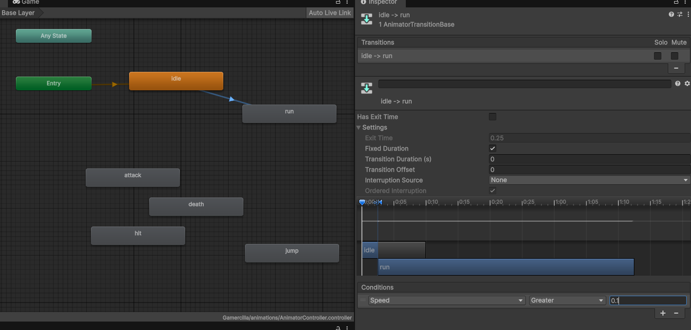{ loading=lazy }](../../assets/images/pmdm/unity/70-unity-idle-run.png){ aria-label="Ampliar imagen" }

<figcaption>idle → run: Speed Greater 0.1, Has Exit Time desactivado y duración 0</figcaption>
</figure>

Haz lo mismo desde **run → idle**, utilizando **Speed → Less → 0.1**. Desactiva Has Exit Time y pon la duración en 0 también en esta flecha.

<figure class="unity-shot" markdown="1">

[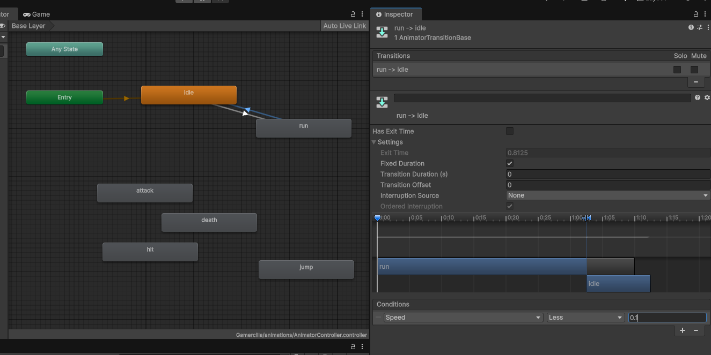{ loading=lazy }](../../assets/images/pmdm/unity/71-unity-run-idle.png){ aria-label="Ampliar imagen" }

<figcaption>run → idle: Speed Less 0.1, Has Exit Time desactivado y duración 0</figcaption>
</figure>

| Transición | Condición |
| --- | --- |
| **idle → run** | Speed **Greater 0.1**: hay movimiento horizontal. |
| **run → idle** | Speed **Less 0.1**: el jugador se ha detenido. |

Sin Has Exit Time no esperamos a un punto concreto del clip; con duración 0, el cambio de imagen es inmediato.

### Actualizar Speed desde Player.cs

Dentro de la clase Player, junto a los demás campos, añade:

```csharp
public Animator anim;
```

Dentro del **Start existente**, después de obtener rb2D:

```csharp
anim = GetComponent<Animator>();
```

Al final del **Update existente**, después del movimiento y el salto:

```csharp
anim.SetFloat("Speed", Mathf.Abs(move));
```

**anim guarda una referencia al componente Animator del mismo Player.** SetFloat cambia un parámetro del controlador; **Mathf.Abs** obtiene el valor absoluto, de modo que tanto -1 como 1 se convierten en 1. Así se reproduce run en ambas direcciones; la orientación sigue dependiendo de la escala X que ya programamos.

Guarda y espera a que Unity compile. La referencia se obtiene en Start: el campo **Anim** puede estar vacío antes de Play, pero el **Animator debe estar añadido al Player y tener su Controller asignado**.

Prueba A/D en Game: idle al detenerte y run al caminar. Detén Play antes de continuar.

## 6. Animar el salto

### Crear los parámetros

En **Parameters** añade estos dos parámetros, respetando sus mayúsculas:

| Nombre | Tipo | Valor que enviará el script |
| --- | --- | --- |
| **VerticalVelocity** | **Float** | Velocidad vertical del Rigidbody 2D: positiva al subir, negativa al caer. |
| **IsGrounded** | **Bool** | true si GroundCheck detecta suelo y el personaje no está ascendiendo. |

<figure class="unity-shot" markdown="1">

[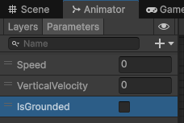{ loading=lazy }](../../assets/images/pmdm/unity/72-unity-parametros-salto.png){ aria-label="Ampliar imagen" }

<figcaption>Speed y VerticalVelocity son Float; IsGrounded es Bool</figcaption>
</figure>

### Entrar en jump

Clic derecho en **Any State → Make Transition** y pulsa **jump**. Any State permite entrar en el salto desde reposo o carrera.

Selecciona la flecha, desactiva **Has Exit Time**, pon **Transition Duration en 0** y añade **las dos condiciones**:

- **VerticalVelocity → Greater → 0.1**.
- **IsGrounded → false**.

<figure class="unity-shot" markdown="1">

[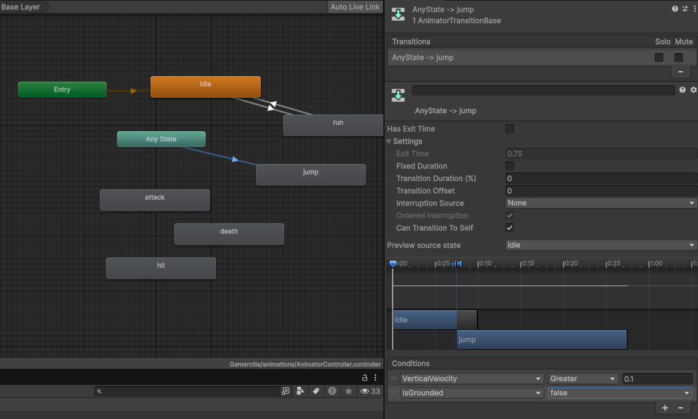{ loading=lazy }](../../assets/images/pmdm/unity/73-unity-any-state-jump.png){ aria-label="Ampliar imagen" }

<figcaption>Any State → jump: velocidad vertical positiva y sin suelo; falta desmarcar Can Transition To Self</figcaption>
</figure>

!!! important "Completar el ajuste de la captura"
    **Desmarca Can Transition To Self** en esta transición. En la imagen todavía aparece marcado: dejarlo activado permite volver a entrar en jump mientras continúa subiendo y puede reiniciar el clip repetidamente.

### Volver al suelo

Crea dos transiciones desde jump. En cada flecha añade ambas condiciones de la tabla:

| Transición | Condiciones que deben cumplirse a la vez |
| --- | --- |
| **jump → idle** | **Speed Less 0.1** e **IsGrounded true**. |
| **jump → run** | **Speed Greater 0.1** e **IsGrounded true**. |

<figure class="unity-shot" markdown="1">

[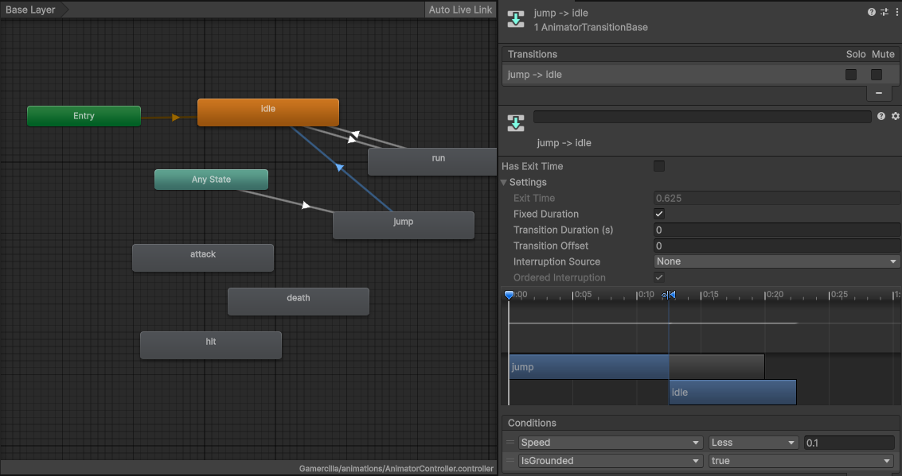{ loading=lazy }](../../assets/images/pmdm/unity/74-unity-jump-idle.png){ aria-label="Ampliar imagen" }

<figcaption>jump → idle: Speed Less 0.1 e IsGrounded true para volver al reposo al aterrizar</figcaption>
</figure>

<figure class="unity-shot" markdown="1">

[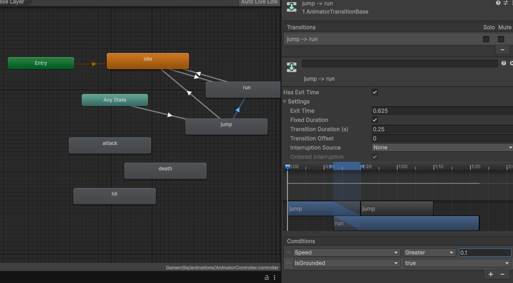{ loading=lazy }](../../assets/images/pmdm/unity/75-unity-jump-run.png){ aria-label="Ampliar imagen" }

<figcaption>jump → run: las condiciones ya están; falta quitar Has Exit Time y cambiar la duración a 0</figcaption>
</figure>

En **las dos transiciones**, desmarca **Has Exit Time** y pon **Transition Duration en 0**. La captura de jump → run muestra todavía Has Exit Time activado y duración 0.25: **corrige esos valores** para cambiar al aterrizar sin esperar al clip.

La condición IsGrounded evita volver a idle o run en el punto más alto del salto: tener una velocidad vertical cercana a cero no significa haber tocado el suelo.

!!! note "Al caer desde el borde de una plataforma"
    La entrada con VerticalVelocity Greater 0.1 solo se activa al subir. Si quieres que jump se muestre también al caer por un borde sin haber saltado, deja en Any State → jump únicamente **IsGrounded false**, manteniendo Can Transition To Self desactivado. Para la prueba de salto con la barra espaciadora utilizamos las dos condiciones indicadas arriba.

### Enviar los datos del salto

Al final de Update, junto a SetFloat de Speed, añade:

```csharp
anim.SetFloat("VerticalVelocity", rb2D.linearVelocity.y);
anim.SetBool("IsGrounded", isGrounded);
```

Utilizamos **el mismo isGrounded que permite saltar**. En el paso anterior lo pusimos en false al despegar y comprobamos el suelo sin considerar apoyado al jugador mientras asciende.

## 7. Player.cs hasta este punto

Esta versión reúne lo incorporado hasta ahora: movimiento, orientación, salto y animaciones. Si copias el código completo, **sustituye el contenido de Player.cs**; no lo añadas debajo de la clase ni crees otros Start o Update.

```csharp
using UnityEngine;

public class Player : MonoBehaviour
{
    public float speed = 6f;
    public float jumpForce = 6f;

    public Transform groundCheck;
    public float groundRadius = 0.1f;
    public LayerMask groundLayer;

    public Animator anim;

    private Rigidbody2D rb2D;
    private float move;
    private bool isGrounded;

    void Start()
    {
        rb2D = GetComponent<Rigidbody2D>();
        anim = GetComponent<Animator>();
    }

    void Update()
    {
        move = Input.GetAxisRaw("Horizontal");

        // ORIENTACIÓN: conserva la última dirección al detenerse.
        if (move != 0)
        {
            transform.localScale = new Vector3(Mathf.Sign(move), 1, 1);
        }

        // Movimiento horizontal; conserva la velocidad vertical.
        rb2D.linearVelocity = new Vector2(
            move * speed,
            rb2D.linearVelocity.y
        );

        // Salto únicamente cuando estamos apoyados.
        if (Input.GetButtonDown("Jump") && isGrounded)
        {
            rb2D.linearVelocity = new Vector2(
                rb2D.linearVelocity.x,
                jumpForce
            );
            isGrounded = false;
        }

        // Comunicamos el movimiento y el contacto con el suelo.
        anim.SetFloat("Speed", Mathf.Abs(move));
        anim.SetFloat("VerticalVelocity", rb2D.linearVelocity.y);
        anim.SetBool("IsGrounded", isGrounded);
    }

    private void FixedUpdate()
    {
        isGrounded = Physics2D.OverlapCircle(
            groundCheck.position,
            groundRadius,
            groundLayer
        ) != null && rb2D.linearVelocity.y <= 0.1f;
    }
}
```

## 8. Ejecutar y comprobar

Guarda el script y la escena. Comprueba que el Player conserva **GroundCheck asignado, Ground Layer en Floor**, las físicas del paso anterior y el Animator con **AnimatorController**.

Pulsa **Play**, haz clic en **Game** y comprueba:

1. Sin pulsar teclas, se reproduce **idle**.
2. Con A/D o las flechas, se reproduce **run** y el personaje mira hacia donde camina.
3. Con espacio desde el suelo, entra en **jump** y permanece en ese estado hasta aterrizar.
4. Al aterrizar vuelve a **idle** si no pulsas una dirección, o a **run** si sigues caminando.

Puedes seleccionar el Player y abrir Animator durante Play para observar los valores de los parámetros y el estado activo. Después, detén Play.

| Si ocurre esto… | Revisa… |
| --- | --- |
| No cambia la animación. | Animator en el Player principal, Controller asignado, Motion de cada estado y nombres de los parámetros. |
| Run solo funciona hacia la derecha. | Envía Mathf.Abs(move), para que Speed no sea negativo. |
| Jump se reinicia mientras sube. | Desmarca Can Transition To Self en Any State → jump. |
| Jump no termina al aterrizar. | GroundCheck, Floor en Escenario y Ground Layer, y ambas transiciones de salida. |
| Tarda en volver a correr. | Has Exit Time desactivado y duración 0 en jump → run. |
| La animación cambia la posición o la escala. | Los clips deben animar **Sprite Renderer → Sprite**; elimina pistas de Transform añadidas por error y deja Apply Root Motion desactivado. |
| Aparecen letras en el personaje. | Elimina del clip los fotogramas que contienen rótulos de la hoja. |

Continúa con [Objetos recogibles](10-objetos-recogibles.md).

Referencias: [componente Animator](https://docs.unity3d.com/6000.0/Documentation/Manual/class-Animator.html), [transiciones](https://docs.unity3d.com/6000.0/Documentation/Manual/class-Transition.html), [Animator.SetFloat](https://docs.unity3d.com/6000.0/Documentation/ScriptReference/Animator.SetFloat.html) y [Animator.SetBool](https://docs.unity3d.com/6000.0/Documentation/ScriptReference/Animator.SetBool.html).
