# 10. Contador de monedas en pantalla

Ya tenemos [monedas animadas que desaparecen al recogerlas](10-objetos-recogibles.md). Ahora mostraremos **recogidas / total** en la esquina superior izquierda. Por ejemplo, con dos monedas empezaremos en **0 / 2** y terminaremos en **2 / 2**.

Crearemos el texto de la interfaz, un **UIManager en el Canvas** y ampliaremos Coin.cs para avisarle de cada recogida. Conservamos los objetos y componentes del paso anterior.

## 1. Crear un texto TextMeshPro

1. Detén Play. En **Hierarchy**, pulsa el botón derecho en una zona vacía y selecciona **UI (Canvas) → Text - TextMeshPro**. Según la versión, el menú puede aparecer como **UI → Text - TextMeshPro**.

<figure class="unity-shot" markdown="1">

[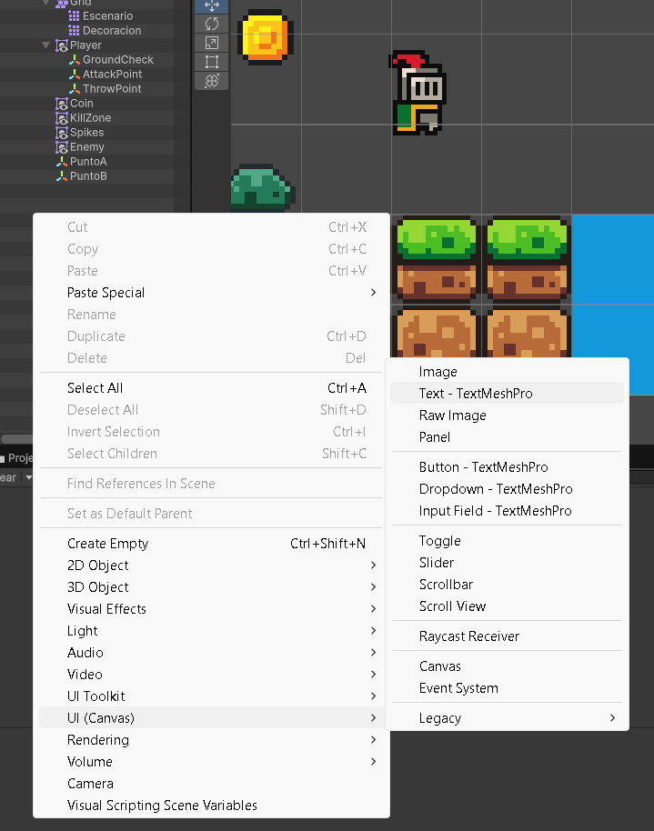{ loading=lazy }](../../assets/images/pmdm/unity/132-unity-crear-texto-tmp.png){ aria-label="Ampliar imagen" }

<figcaption>Crea el texto desde Hierarchy → UI (Canvas) → Text - TextMeshPro</figcaption>
</figure>

2. Unity crea el texto dentro de un **Canvas**; si no había ninguno, también crea el Canvas y un EventSystem. Mantén el Canvas como objeto independiente de la escena, fuera del Player.
3. Si aparece **TMP Importer**, pulsa **Import TMP Essentials**.

<figure class="unity-shot" markdown="1">

[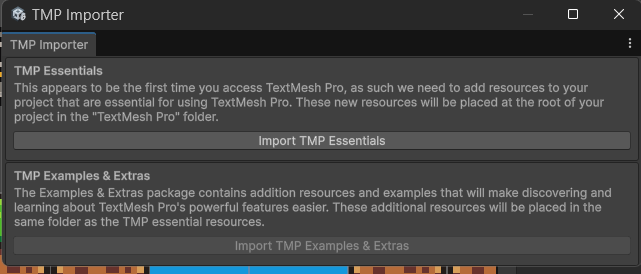{ loading=lazy }](../../assets/images/pmdm/unity/133-unity-importar-tmp-essentials.png){ aria-label="Ampliar imagen" }

<figcaption>Import TMP Essentials añade los recursos necesarios para mostrar TextMeshPro</figcaption>
</figure>

TextMeshPro utiliza esos recursos esenciales para mostrar los textos. **TMP Examples & Extras** contiene ejemplos adicionales; no hace falta importarlos para este contador.

En algunas versiones aparece una segunda confirmación al importar **TMP Essential Resources** desde el importador de Unity. Comprueba que es ese paquete y pulsa **Import Anyway** para continuar con esos recursos.

<figure class="unity-shot" markdown="1">

[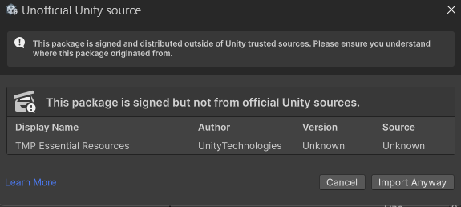{ loading=lazy }](../../assets/images/pmdm/unity/134-unity-confirmar-tmp-essentials.png){ aria-label="Ampliar imagen" }

<figcaption>Confirmación de importación de TMP Essential Resources desde el importador de Unity</figcaption>
</figure>

## 2. Seleccionar el texto y ajustar el zoom

El Canvas de una interfaz puede verse mucho más grande que el escenario en Scene. Reduce el zoom con la rueda del ratón para orientarte; puedes seleccionar Canvas en Hierarchy y pulsar **F** para encuadrarlo.

<figure class="unity-shot" markdown="1">

[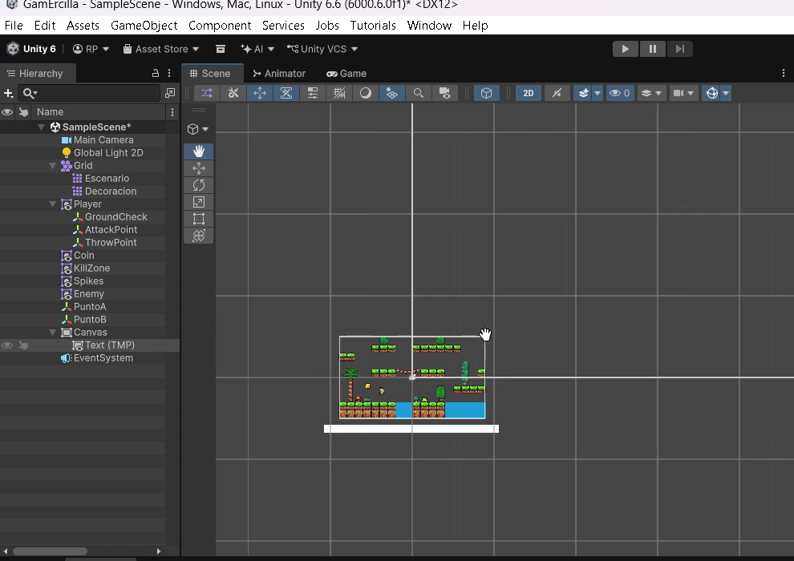{ loading=lazy }](../../assets/images/pmdm/unity/135-unity-zoom-canvas.png){ aria-label="Ampliar imagen" }

<figcaption>Reduce el zoom de Scene para localizar el Canvas y selecciona su texto desde Hierarchy</figcaption>
</figure>

Selecciona el texto hijo del Canvas y renómbralo como **TextCoins**. En el componente **TextMeshPro - Text (UI)**, escribe **0/0** como texto inicial; el script lo sustituirá al comenzar Play. El zoom de Scene solo cambia cómo lo vemos en el editor, no su tamaño en Game.

## 3. Anclarlo arriba a la izquierda

1. Con **TextCoins** seleccionado, abre **Anchor Presets**, el pequeño botón de posición de la parte superior izquierda de **Rect Transform**.
2. Mantén **Alt** y pulsa el preset de la **esquina superior izquierda**. Alt ajusta también la posición. Si mantienes **Alt + Shift**, ajustas además el pivote a esa esquina.

<figure class="unity-shot" markdown="1">

[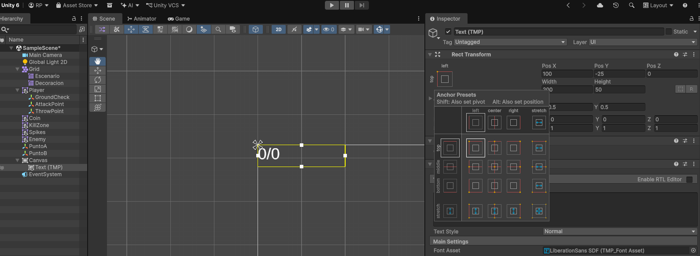{ loading=lazy }](../../assets/images/pmdm/unity/136-unity-anclar-texto-arriba-izquierda.png){ aria-label="Ampliar imagen" }

<figcaption>Anchor Presets permite anclar el texto a la esquina superior izquierda</figcaption>
</figure>

3. Comprueba **Anchor Min = (0, 1)** y **Anchor Max = (0, 1)**. Para colocar el borde del texto desde esa esquina, utiliza **Pivot = (0, 1)**.
4. Añade un pequeño margen con **Pos X positivo** y **Pos Y negativo**. Revisa el resultado en Game para que el contador no quede cortado por el borde.
5. Ajusta Width, Height y el tamaño de letra para que quepa el contador completo, y utiliza alineación del texto arriba a la izquierda.

**El anclaje de Rect Transform es lo que mantiene el texto en esa esquina cuando cambia el tamaño del Canvas.** El pivote determina desde qué punto colocamos su rectángulo.

## 4. Configurar el Canvas y distinguir el escalado

Selecciona **Canvas** en Hierarchy. Comprueba **Canvas → Render Mode = Screen Space - Overlay**, para dibujar la interfaz sobre el juego.

<figure class="unity-shot" markdown="1">

[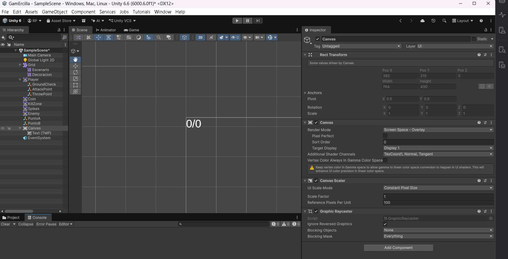{ loading=lazy }](../../assets/images/pmdm/unity/137-unity-canvas-scaler.png){ aria-label="Ampliar imagen" }

<figcaption>Canvas Scaler controla el tamaño de la interfaz; la captura muestra Constant Pixel Size</figcaption>
</figure>

En **Canvas Scaler → UI Scale Mode**, puedes establecer **Constant Physical Size**, como en nuestros apuntes. Este modo intenta mantener el tamaño físico de los elementos mediante los DPI de la pantalla; utiliza Fallback Screen DPI si ese dato no está disponible.

**Constant Physical Size no establece el anclaje.** El texto permanece arriba a la izquierda por la configuración de Rect Transform del paso anterior. La captura muestra **Constant Pixel Size**, un modo de escalado distinto.

| UI Scale Mode | Qué controla |
| --- | --- |
| **Constant Pixel Size** | Mantiene el tamaño en píxeles, con el Scale Factor indicado. |
| **Constant Physical Size** | Intenta mantener el tamaño físico según los DPI de la pantalla. |
| **Scale With Screen Size** | Escala la interfaz a partir de una resolución de referencia. |

Si quieres que toda la interfaz se adapte proporcionalmente a diferentes resoluciones, puedes usar **Scale With Screen Size**, por ejemplo con **Reference Resolution = 1920 × 1080**, **Screen Match Mode = Match Width Or Height** y **Match = 0.5**. El anclaje sigue siendo arriba a la izquierda en cualquiera de estos modos.

## 5. Crear y asignar el Tag Coin

Antes de ejecutar el contador, tenemos que identificar **todas las monedas** del nivel:

1. Selecciona una Coin en Hierarchy. En **Tag**, pulsa **Add Tag...**.

<figure class="unity-shot" markdown="1">

[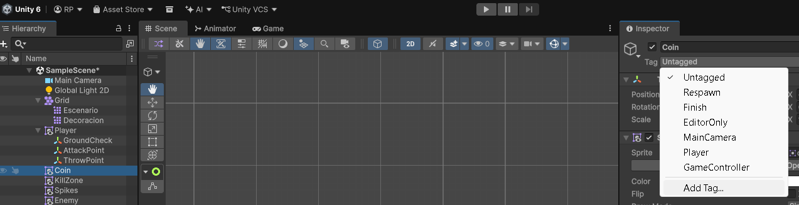{ loading=lazy }](../../assets/images/pmdm/unity/139-unity-crear-tag-coin.png){ aria-label="Ampliar imagen" }

<figcaption>Selecciona una moneda y utiliza Add Tag... para crear la etiqueta Coin</figcaption>
</figure>

2. Crea una etiqueta llamada **Coin**, con C mayúscula.
3. Vuelve a seleccionar la moneda y elige **Tag → Coin**. Crear el Tag no lo asigna automáticamente.

<figure class="unity-shot" markdown="1">

[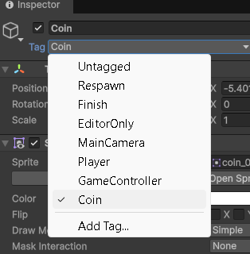{ loading=lazy }](../../assets/images/pmdm/unity/140-unity-asignar-tag-coin.png){ aria-label="Ampliar imagen" }

<figcaption>Después de crear Coin, vuelve a la moneda y asigna ese Tag</figcaption>
</figure>

4. Repite la asignación en **todas las monedas activas** del nivel. Si utilizas un prefab de moneda, establece también su Tag y revisa sus instancias.

**Tag Coin es una etiqueta; Coin.cs es el componente de comportamiento.** Compartir el nombre no los relaciona automáticamente. El Player conserva Tag Player y las monedas conservan su Circle Collider 2D con Is Trigger.

El script contará los objetos **activos** con Tag Coin al comenzar. Las monedas desactivadas o creadas después de Start no entran en ese total inicial. Para este nivel dejamos todas colocadas y activas antes de Play.

## 6. Crear UIManager.cs

En **Assets/ErciGame/Scripts**, crea un **MonoBehaviour Script** llamado **UIManager**. Ábrelo y sustituye la plantilla por este código completo:

```csharp
using TMPro;
using UnityEngine;

public class UIManager : MonoBehaviour
{
    // Referencia al texto de la interfaz. La asignaremos en el Inspector.
    public TMP_Text coinText;

    // Número de monedas que hay al empezar y número de monedas recogidas.
    private int totalCoins = 0;
    private int collectedCoins = 0;

    private void Start()
    {
        // Buscamos los objetos activos que tienen el Tag Coin.
        GameObject[] coins = GameObject.FindGameObjectsWithTag("Coin");

        // Length es la cantidad de objetos que contiene el array.
        totalCoins = coins.Length;

        // Mostramos el estado inicial, por ejemplo: 0 / 2.
        UpdateCoinText();
    }

    public void CoinCollected()
    {
        // Cada aviso de una moneda recogida suma uno al contador.
        collectedCoins++;

        // Actualizamos también el texto de la última moneda.
        UpdateCoinText();

        if (collectedCoins == totalCoins)
        {
            LoadNextLevel();
        }
    }

    private void LoadNextLevel()
    {
        // Reservado para añadir el cambio de nivel más adelante.
        // Por ahora no carga ninguna escena.
    }

    private void UpdateCoinText()
    {
        // Construimos el texto con las monedas recogidas y las totales.
        coinText.text = $"{collectedCoins} / {totalCoins}";
    }
}
```

<figure class="unity-shot" markdown="1">

[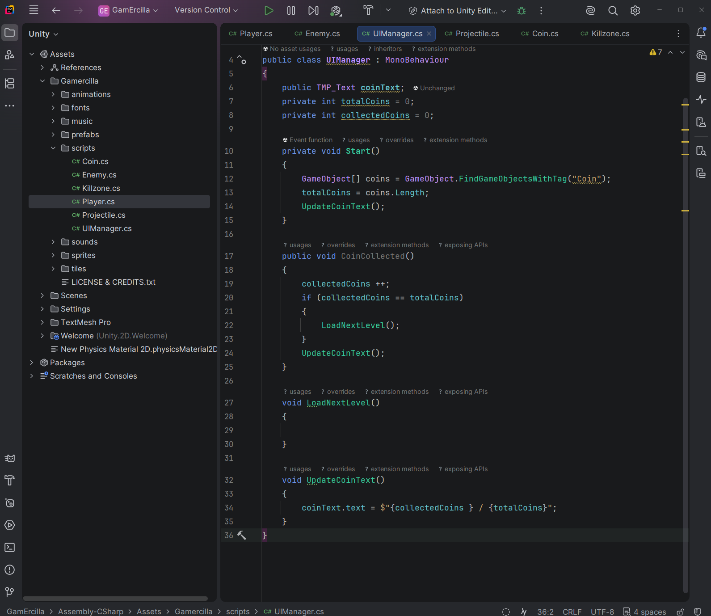{ loading=lazy }](../../assets/images/pmdm/unity/138-unity-uimanager-script.png){ aria-label="Ampliar imagen" }

<figcaption>UIManager cuenta las monedas al empezar y actualiza el texto después de cada recogida</figcaption>
</figure>

Guarda el archivo y espera a que Unity compile. **Arrastra UIManager.cs al Canvas en Hierarchy**, o hasta su Inspector, para añadir **UIManager (Script)**. Debe haber **un solo UIManager activo** en esta escena.

### Entender las variables y los métodos

| Parte | Función |
| --- | --- |
| **using TMPro** | Permite utilizar las clases de TextMeshPro. |
| **public TMP_Text coinText** | Guarda la referencia al componente de texto que asignaremos en el Inspector. |
| **totalCoins** | Guarda cuántas monedas había al empezar. |
| **collectedCoins** | Guarda cuántas hemos recogido; comienza en 0. |
| **GameObject[] coins** | Es un array, una colección de objetos del juego. |
| **FindGameObjectsWithTag("Coin")** | Busca los objetos activos con ese Tag. La etiqueta debe existir. |
| **coins.Length** | Devuelve cuántos objetos contiene el array. |
| **CoinCollected()** | Es el método público al que llamará cada moneda para comunicar una recogida. |
| **collectedCoins++** | Suma uno al contador. |
| **collectedCoins == totalCoins** | Comprueba si hemos recogido todas las monedas iniciales. |
| **UpdateCoinText()** | Actualiza el contenido mostrado en pantalla. |

La expresión **$"{collectedCoins} / {totalCoins}"** utiliza interpolación de cadenas: sustituye lo que hay entre llaves por sus valores. Si llevamos una de dos monedas, el texto será **1 / 2**.

Actualizamos el texto **antes** de llamar a LoadNextLevel para mostrar también la última recogida. **LoadNextLevel queda vacío de forma intencionada:** hemos reservado el punto donde programaremos el cambio de nivel, pero en este apartado todavía no carga otra escena.

## 7. Asignar TextCoins al UIManager

Comprueba que el texto se llama **TextCoins** y es hijo del Canvas. En la captura aparece como CoinText; el nombre puede variar porque asignaremos su referencia, no lo buscaremos por su nombre.

<figure class="unity-shot" markdown="1">

[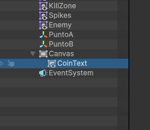{ loading=lazy }](../../assets/images/pmdm/unity/141-unity-texto-monedas-hierarchy.png){ aria-label="Ampliar imagen" }

<figcaption>Renombra el texto del Canvas como TextCoins; en esta captura se llama CoinText</figcaption>
</figure>

Selecciona **Canvas → UIManager (Script)** y **arrastra TextCoins desde Hierarchy hasta Coin Text**. Puedes usar también el selector del campo.

<figure class="unity-shot" markdown="1">

[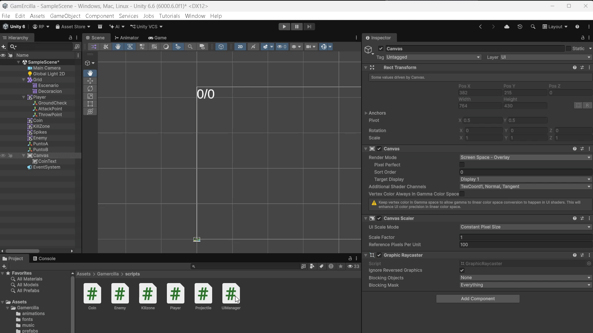{ loading=lazy }](../../assets/images/pmdm/unity/142-unity-asignar-uimanager-texto.gif){ aria-label="Ampliar imagen" }

<figcaption>Añade UIManager.cs al Canvas y arrastra el texto a su campo Coin Text</figcaption>
</figure>

El campo debe dejar de mostrar **None (TMP_Text)**. TMP_Text es el tipo del componente; TextCoins es el nombre que le damos al objeto. Crear el script y colocarlo en el Canvas no asigna esa referencia por sí solo. Guarda la escena.

## 8. Modificar Coin.cs para avisar al contador

Sustituye el contenido del **Coin.cs que ya tenemos** por esta clase completa:

```csharp
using UnityEngine;

public class Coin : MonoBehaviour
{
    private UIManager uiManager;

    // Evita contar esta moneda dos veces antes de que se elimine.
    private bool recogida = false;

    private void OnTriggerEnter2D(Collider2D collision)
    {
        if (recogida)
        {
            return;
        }

        // La moneda solo se recoge al entrar el objeto con Tag Player.
        if (collision.transform.CompareTag("Player"))
        {
            // Buscamos el componente UIManager activo de la escena.
            uiManager = FindAnyObjectByType<UIManager>();

            if (uiManager == null)
            {
                Debug.LogError("Falta un UIManager activo en el Canvas.", this);
                return;
            }

            recogida = true;

            // Primero avisamos a la interfaz; después eliminamos la moneda.
            uiManager.CoinCollected();
            Destroy(gameObject);
        }
    }
}
```

Conserva Coin (Script) en las monedas. Al modificar el archivo, sus componentes utilizan el nuevo código; no añadas un segundo Coin (Script). Si una moneda todavía no lo tenía, arrastra Coin.cs a ese objeto. Si utilizas un prefab, comprueba que incluye el componente.

| Instrucción | Qué hace |
| --- | --- |
| **private UIManager uiManager** | Guarda una referencia al componente que controla la interfaz. |
| **FindAnyObjectByType<UIManager>()** | Busca un UIManager activo de la escena; devuelve null si no encuentra ninguno. |
| **uiManager == null** | Detecta una configuración incompleta y muestra el error en Console. |
| **recogida** | Impide contar dos veces esta moneda antes de que Destroy termine de eliminarla. |
| **uiManager.CoinCollected()** | Avisa al contador para sumar uno y actualizar el texto. |
| **Destroy(gameObject)** | Elimina la moneda después de comunicar su recogida. |

Para este script basta **using UnityEngine**. No necesitamos **using Unity.VisualScripting**, porque aquí no utilizamos clases de ese paquete.

El recorrido es: **Player entra en la moneda → Coin avisa a UIManager → se actualiza el texto → desaparece Coin**. La interfaz lleva el total; cada moneda solo comunica su propia recogida.

## 9. Ejecutar y comprobar

1. Guarda el código y la escena, con al menos dos monedas activas y Tag Coin para probar.
2. Comprueba UIManager (Script) en el Canvas y **Coin Text asignado**.
3. Pulsa Play y haz clic en Game.
4. El texto inicial debe ser **0 / 2** si hay dos monedas. Al recogerlas, debe pasar a **1 / 2** y después **2 / 2**.

<figure class="unity-shot" markdown="1">

[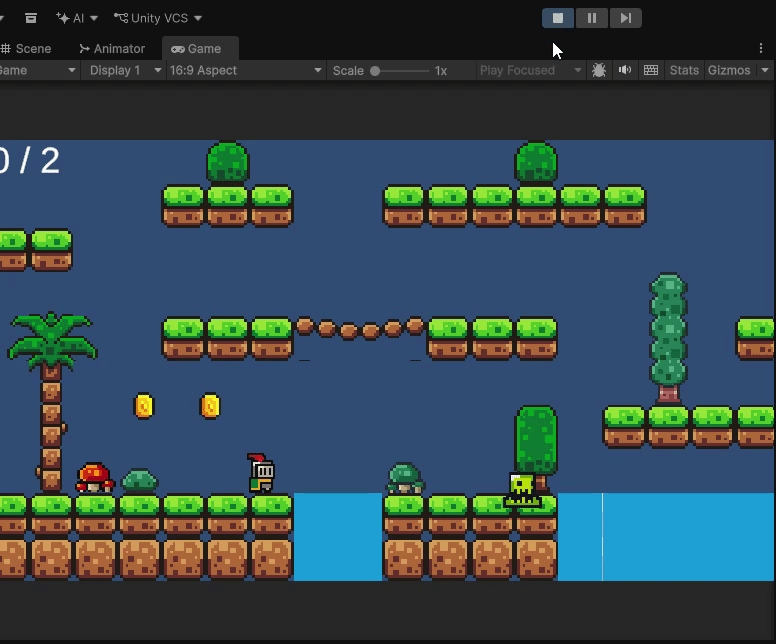{ loading=lazy }](../../assets/images/pmdm/unity/143-unity-contador-monedas-prueba.gif){ aria-label="Ampliar imagen" }

<figcaption>En Game, el contador aumenta al recoger monedas y estas desaparecen</figcaption>
</figure>

5. Cambia el tamaño de la ventana Game para comprobar el anclaje. Ajusta el margen o el escalado si el texto se recorta.
6. Detén Play y vuelve a ejecutarlo: el contador vuelve a empezar en 0 y cuenta las monedas de la escena guardada.

Cuando incorporemos la [muerte y el reinicio del nivel](10-peligros-reinicio.md), recargar la escena también restaurará las monedas y este contador. **Recogerlas todas todavía no cambia de nivel**, porque LoadNextLevel no tiene instrucciones.

### Si el contador no funciona

| Problema | Qué revisar |
| --- | --- |
| **No aparece el texto** | Canvas activo, Screen Space - Overlay, TextCoins activo, color/tamaño de letra y posición dentro de pantalla. |
| **El texto queda cortado** | Anclas arriba a la izquierda, Pivot (0, 1), márgenes, ancho del rectángulo y alineación. |
| **Se queda en 0/0** | UIManager (Script) asignado al Canvas y sin errores en Console. |
| **Muestra 0 / 0 aunque hay monedas** | Tag Coin asignado a todas las monedas activas antes de Play. |
| **Tag Coin no está definido** | Crea el Tag en Add Tag... y vuelve a asignarlo a cada moneda. |
| **Error al escribir coinText.text** | Arrastra TextCoins al campo Coin Text del UIManager. |
| **Falta un UIManager activo** | Añade el script al Canvas y comprueba que el objeto está activo. |
| **Desaparecen monedas pero el número no cambia** | Todas utilizan la versión nueva de Coin.cs y el contador pertenece al único UIManager de la escena. |
| **No pasa al siguiente nivel al llegar al total** | Es el comportamiento de esta fase: LoadNextLevel está reservado para más adelante. |

Continúa con [Peligros y reinicio del nivel](10-peligros-reinicio.md).

Referencias: [TextMeshPro](https://docs.unity3d.com/Packages/com.unity.textmeshpro@3.0/manual/index.html), [Rect Transform y anclas](https://docs.unity3d.com/Packages/com.unity.ugui@2.0/manual/UIBasicLayout.html), [Canvas Scaler](https://docs.unity3d.com/Packages/com.unity.ugui@2.0/manual/script-CanvasScaler.html), [FindGameObjectsWithTag](https://docs.unity3d.com/6000.0/Documentation/ScriptReference/GameObject.FindGameObjectsWithTag.html) y [FindAnyObjectByType](https://docs.unity3d.com/6000.0/Documentation/ScriptReference/Object.FindAnyObjectByType.html).
