# 9. Monedas y objetos recogibles

Continuamos sobre el mismo proyecto, con el Player y sus [animaciones](08-animaciones.md) funcionando. Crearemos una **moneda animada que desaparece al recogerla**. La moneda tendrá su propio Animator y su propio script **Coin.cs**.

## 1. Recortar la moneda

En **Project → carpeta del juego → sprites**, selecciona la imagen **coin**. Utiliza la misma carpeta del proyecto que en los pasos anteriores; en las capturas se llama Gamercilla.

Aplica la [configuración de pixel art](03-assets-sprites.md#configurar-sprites-de-pixel-art) con estos valores:

| Propiedad del Inspector | Valor |
| --- | --- |
| **Texture Type** | Sprite (2D and UI) |
| **Sprite Mode** | Multiple |
| **Pixels Per Unit** | 16 |
| **Filter Mode** | Point (no filter) |
| **Compression** | None |

<figure class="unity-shot" markdown="1">

[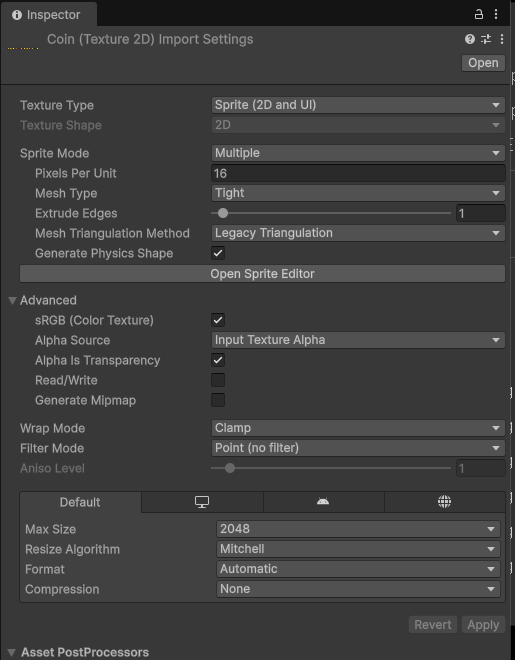{ loading=lazy }](../../assets/images/pmdm/unity/77-unity-coin-importacion.png){ aria-label="Ampliar imagen" }

<figcaption>coin: Sprite Multiple, Pixels Per Unit 16, filtro Point y compresión None</figcaption>
</figure>

Pulsa **Apply** en el Inspector y abre **Open Sprite Editor**. En **Slice**, selecciona **Type → Grid By Cell Size**, establece **Pixel Size X = 16, Y = 16**, pulsa **Slice** y después **Apply** en Sprite Editor.

<figure class="unity-shot" markdown="1">

[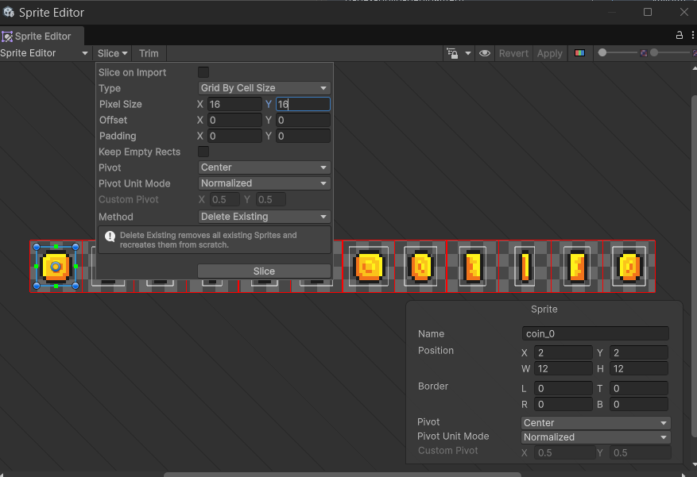{ loading=lazy }](../../assets/images/pmdm/unity/78-unity-coin-slice.png){ aria-label="Ampliar imagen" }

<figcaption>Recorta coin con Grid By Cell Size y Pixel Size 16 × 16; pulsa Slice y después Apply</figcaption>
</figure>

Los **16 Pixels Per Unit** determinan la escala del sprite en el mundo; las celdas de **16 × 16** determinan cómo recortamos los fotogramas. Son ajustes distintos, como vimos al preparar los recursos.

## 2. Crear la animación y el objeto Coin

1. Vuelve a Project y despliega la flecha de **coin**.
2. Selecciona todos sus fotogramas, en orden. En estas capturas van de **coin_0 a coin_11**.

<figure class="unity-shot" markdown="1">

[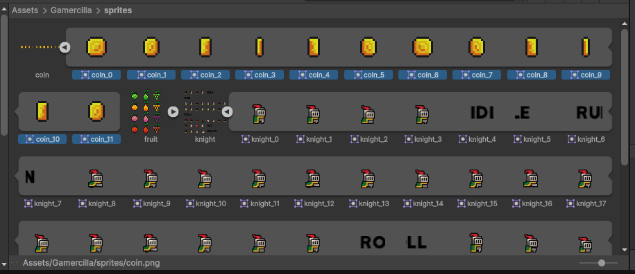{ loading=lazy }](../../assets/images/pmdm/unity/79-unity-coin-fotogramas.png){ aria-label="Ampliar imagen" }

<figcaption>Selecciona todos los fotogramas de la moneda, desde coin_0 hasta coin_11</figcaption>
</figure>

3. Arrastra la selección completa a **Scene**.
4. Guarda la nueva animación como **coin.anim** dentro de la carpeta **animations** que ya creamos.

<figure class="unity-shot" markdown="1">

[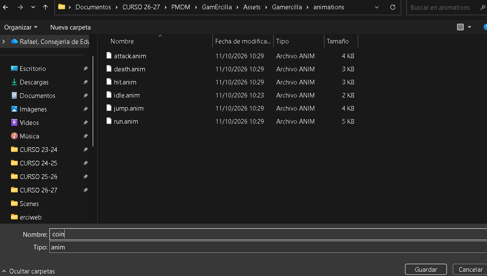{ loading=lazy }](../../assets/images/pmdm/unity/80-unity-guardar-coin.png){ aria-label="Ampliar imagen" }

<figcaption>Guarda el clip coin.anim en la carpeta animations que ya utilizamos</figcaption>
</figure>

5. Renombra el objeto que aparece en **Hierarchy** como **Coin** y sitúalo en un lugar alcanzable por el jugador.

<figure class="unity-shot" markdown="1">

[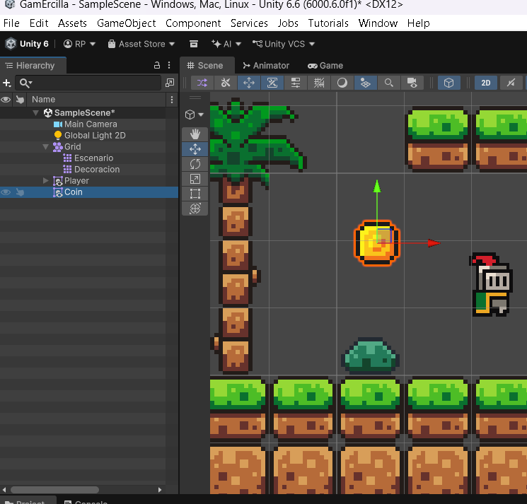{ loading=lazy }](../../assets/images/pmdm/unity/81-unity-coin-escena.png){ aria-label="Ampliar imagen" }

<figcaption>Objeto Coin situado en el escenario y separado del Player</figcaption>
</figure>

Selecciona **coin.anim** en Project y comprueba que **Loop Time está activado**, para repetir el giro mientras la moneda exista.

El arrastre también crea un **Animator Controller para la moneda**, que puede llamarse coin_0. Consérvalo y comprueba que está asignado a **Coin → Animator → Controller**, con el estado coin como estado inicial. Este controlador pertenece a la moneda; el Player conserva su AnimatorController con idle, run y jump. Deja **Apply Root Motion desactivado**.

## 3. Añadir el área de recogida

1. Selecciona **Coin** en Hierarchy.
2. Pulsa **Add Component → Circle Collider 2D**.

<figure class="unity-shot" markdown="1">

[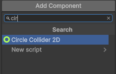{ loading=lazy }](../../assets/images/pmdm/unity/82-unity-circle-collider.png){ aria-label="Ampliar imagen" }

<figcaption>Añade Circle Collider 2D desde Add Component de Coin</figcaption>
</figure>

3. Pulsa **Edit Collider** y ajusta el centro y el radio para que el círculo rodee la moneda. Después sal del modo de edición.
4. Marca **Is Trigger**.

<figure class="unity-shot" markdown="1">

[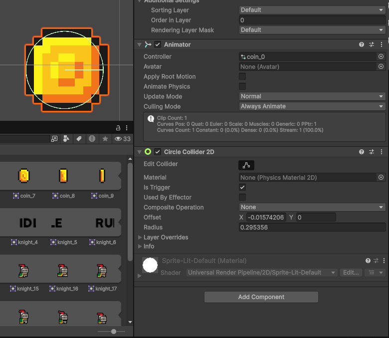{ loading=lazy }](../../assets/images/pmdm/unity/83-unity-coin-trigger.png){ aria-label="Ampliar imagen" }

<figcaption>Ajusta el círculo con Edit Collider y marca Is Trigger en la moneda</figcaption>
</figure>

Un **trigger** permite detectar que otro collider entra en esa zona sin formar una pared sólida. El círculo se mantiene estable mientras se animan las imágenes de la moneda.

El Player ya tiene un **Rigidbody 2D de tipo Dynamic** y un **Box Collider 2D**, de modo que puede activar el trigger de Coin. La moneda puede permanecer fija con su collider, sin añadirle un Rigidbody dinámico. Mantén Coin en **Layer Default**, separada del suelo Floor que utiliza GroundCheck.

## 4. Identificar al jugador con Tag

Selecciona el **Player principal** en Hierarchy y, en la parte superior del Inspector, elige **Tag → Player**.

<figure class="unity-shot" markdown="1">

[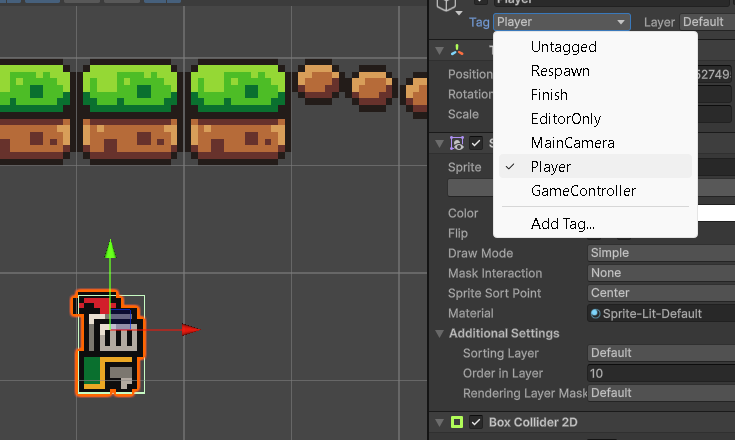{ loading=lazy }](../../assets/images/pmdm/unity/87-unity-player-tag.png){ aria-label="Ampliar imagen" }

<figcaption>Selecciona el Player principal y establece Tag en Player</figcaption>
</figure>

**Llamar Player al objeto no le asigna ese Tag.** El script comprobará la etiqueta, no el nombre de Hierarchy. El **Tag Player** identifica al personaje; **Layer** y **Sorting Layer** siguen cumpliendo las funciones que ya configuramos.

En este tutorial el collider está en el mismo objeto Player que recibe el Tag. Si después separas los colliders en objetos hijos, revisa qué objeto está entrando en el trigger.

## 5. Crear Coin.cs

En la carpeta **Scripts** del juego, crea un **MonoBehaviour Script** llamado **Coin**, como hicimos con Player.cs. Ábrelo y sustituye todo su contenido por esta clase completa:

<figure class="unity-shot" markdown="1">

[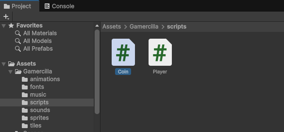{ loading=lazy }](../../assets/images/pmdm/unity/84-unity-coin-script.png){ aria-label="Ampliar imagen" }

<figcaption>Coin.cs creado dentro de la carpeta scripts del juego</figcaption>
</figure>

```csharp
using UnityEngine;

public class Coin : MonoBehaviour
{
    private void OnTriggerEnter2D(Collider2D collision)
    {
        if (collision.transform.CompareTag("Player"))
        {
            Destroy(gameObject);
        }
    }
}
```

<figure class="unity-shot" markdown="1">

[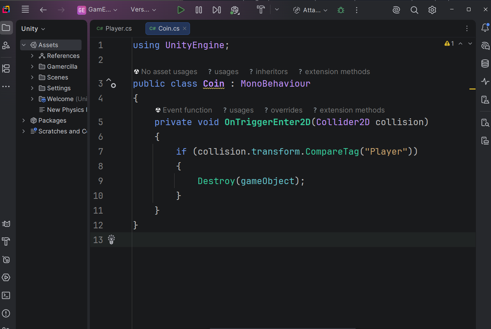{ loading=lazy }](../../assets/images/pmdm/unity/85-unity-coin-codigo.png){ aria-label="Ampliar imagen" }

<figcaption>Coin.cs detecta al Player y elimina el objeto que contiene este script</figcaption>
</figure>

| Instrucción | Qué hace |
| --- | --- |
| **OnTriggerEnter2D** | Unity llama a este método cuando otro collider 2D entra en el trigger. |
| **Collider2D collision** | Recibe el collider del otro objeto, el que ha entrado en la moneda. |
| **collision.transform.CompareTag("Player")** | Comprueba si ese objeto tiene el Tag Player. |
| **Destroy(gameObject)** | Elimina el objeto donde está este script: la moneda. |

Guarda el archivo. **Coin.cs debe contener la clase Coin**, con sus llaves y using UnityEngine; el método se escribe dentro de esa clase. Unity llamará al método cuando ocurra el contacto.

## 6. Añadir el script y probar

Crear el archivo es el primer paso. Para aplicar su comportamiento a la moneda:

1. Vuelve a Unity y espera a que termine de compilar.
2. Arrastra **Coin.cs desde Project hasta Coin en Hierarchy**, o hasta su Inspector.
3. Selecciona Coin y comprueba que tiene **Sprite Renderer, Animator, Circle Collider 2D y Coin (Script)**.

<figure class="unity-shot" markdown="1">

[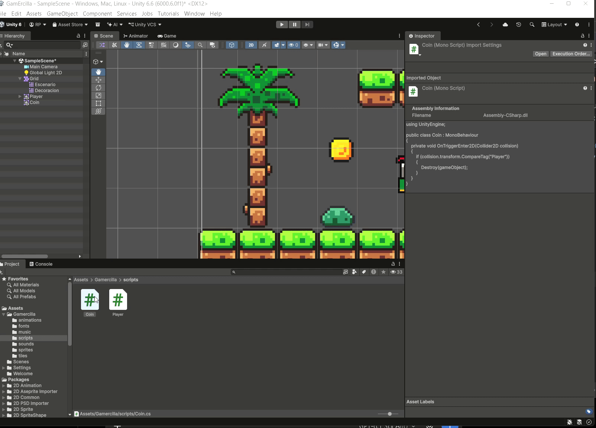{ loading=lazy }](../../assets/images/pmdm/unity/86-unity-asignar-coin-script.gif){ aria-label="Ampliar imagen" }

<figcaption>Arrastra Coin.cs desde Project hasta Coin en Hierarchy para añadir el comportamiento</figcaption>
</figure>

4. Comprueba Is Trigger en la moneda y Tag Player en el jugador. El collider del Player debe conservar **Is Trigger desactivado** para apoyarse en el escenario.
5. Guarda la escena con **Ctrl+S**, pulsa **Play** y haz clic en **Game**.
6. Acércate o salta hasta tocar la moneda: su imagen gira mientras está en la escena y desaparece al recogerla.

<figure class="unity-shot" markdown="1">

[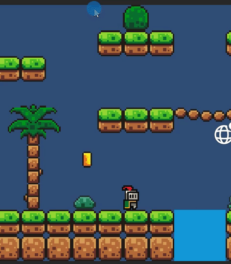{ loading=lazy }](../../assets/images/pmdm/unity/88-unity-recoger-moneda.gif){ aria-label="Ampliar imagen" }

<figcaption>Prueba en Game: la moneda desaparece cuando el Player entra en su trigger</figcaption>
</figure>

En este paso recoger la moneda **solo la elimina**. El contador, el sonido o la puntuación se añadirán como mejoras posteriores.

### Colocar más monedas

Puedes duplicar Coin con **Ctrl+D** y mover las copias por Scene. Si vas a reutilizarla, crea una carpeta **Prefabs**, arrastra el Coin configurado desde Hierarchy hasta ella y coloca instancias de ese prefab en el mapa. Así reutilizas su animación, collider y script. Las monedas son objetos independientes de los Tilemaps.

### Si no desaparece

Detén Play y revisa que **Coin (Script) está en Coin**, que Circle Collider 2D tiene **Is Trigger activado**, que el objeto Player tiene **Tag Player** y que conserva Rigidbody 2D y Box Collider 2D. Comprueba también los errores de **Console** y que las layers de ambos objetos pueden interactuar en **Project Settings → Physics 2D**.

Continúa con [Peligros y reinicio del nivel](10-peligros-reinicio.md).

Referencias: [OnTriggerEnter2D](https://docs.unity3d.com/6000.0/Documentation/ScriptReference/MonoBehaviour.OnTriggerEnter2D.html), [CompareTag](https://docs.unity3d.com/6000.0/Documentation/ScriptReference/Component.CompareTag.html) y [Destroy](https://docs.unity3d.com/6000.0/Documentation/ScriptReference/Object.Destroy.html).
