# 10. Peligros y reinicio del nivel

Ya podemos recoger [monedas](10-objetos-recogibles.md). Ahora añadiremos una **zona de caída debajo del mapa** y **obstáculos que hacen morir al Player**. El peligro detectará el contacto y llamará a **Player.Morir()**. El jugador detendrá sus controles, reproducirá su animación de muerte y reiniciará el nivel al terminarla.

## 1. Crear la zona de caída

1. Detén Play. En **Hierarchy**, pulsa el botón derecho y elige **2D Object → Sprites → Square**.

<figure class="unity-shot" markdown="1">

[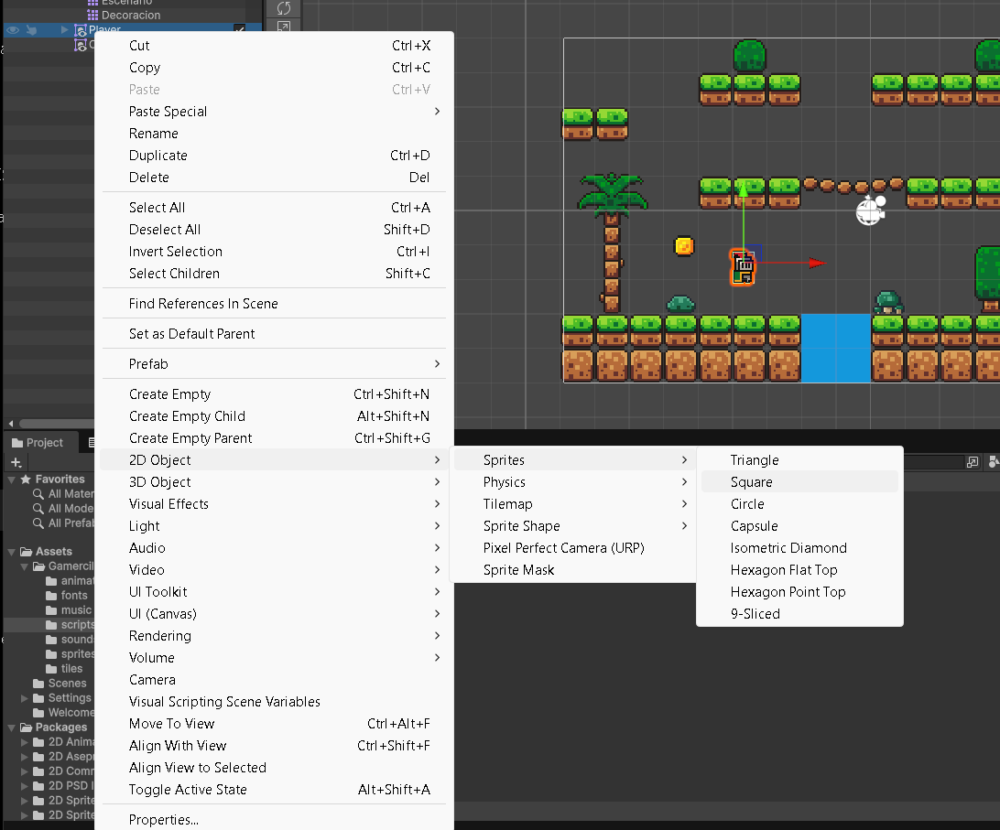{ loading=lazy }](../../assets/images/pmdm/unity/89-unity-crear-killzone.png){ aria-label="Ampliar imagen" }

<figcaption>Crea el cuadrado desde Hierarchy → 2D Object → Sprites → Square</figcaption>
</figure>

2. Renombra el objeto como **Killzone**.
3. Comprueba que es un objeto independiente: **debe quedar fuera del Player**, para que no se mueva con él. Si se ha creado como hijo, arrástralo al nivel raíz de Hierarchy.

<figure class="unity-shot" markdown="1">

[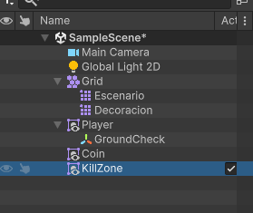{ loading=lazy }](../../assets/images/pmdm/unity/90-unity-killzone-hierarchy.png){ aria-label="Ampliar imagen" }

<figcaption>La zona de caída es un objeto independiente del Player y del Grid</figcaption>
</figure>

4. Muévelo **por debajo de las plataformas más bajas** y amplía su escala X para cubrir todo el ancho por el que puede caer el jugador. Dale altura suficiente para detectar la caída.

<figure class="unity-shot" markdown="1">

[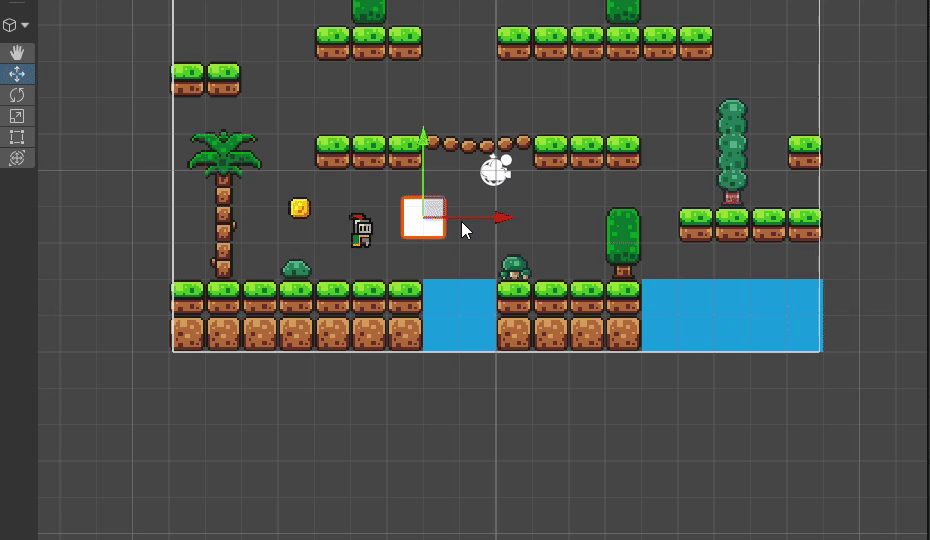{ loading=lazy }](../../assets/images/pmdm/unity/91-unity-ajustar-killzone.gif){ aria-label="Ampliar imagen" }

<figcaption>Mueve y amplía el cuadrado para cubrir la zona situada debajo del mapa</figcaption>
</figure>

5. Añade **Box Collider 2D** si todavía no lo tiene.
6. Usa **Edit Collider** para revisar la zona y marca **Is Trigger**.

<figure class="unity-shot" markdown="1">

[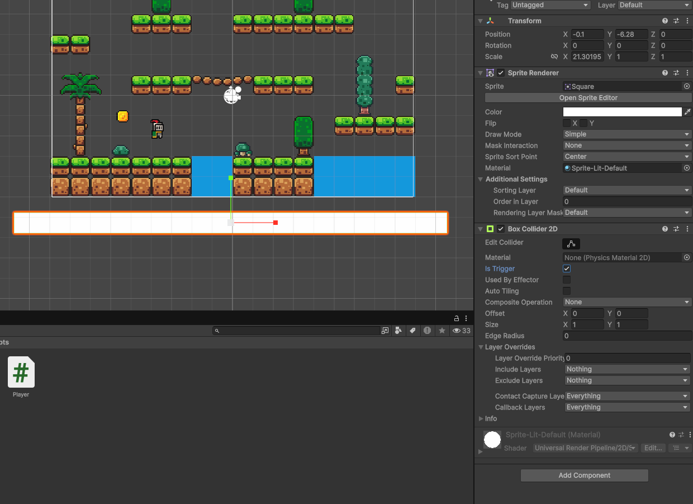{ loading=lazy }](../../assets/images/pmdm/unity/92-unity-killzone-trigger.png){ aria-label="Ampliar imagen" }

<figcaption>Killzone extendida bajo el nivel, con Box Collider 2D e Is Trigger activado</figcaption>
</figure>

La zona debe detectar al jugador después de caer por un hueco. Ajusta su posición según tu mapa; los números de la captura son un ejemplo. Mantén **Layer Default** para que GroundCheck no la considere suelo.

Puedes dejar el cuadrado blanco visible durante la configuración. Si quieres ocultarlo en Game, **desactiva solo Sprite Renderer**: el objeto y su Box Collider 2D deben seguir activos.

## 2. Preparar la escena para recargarla

Guarda la escena con **Ctrl+S**. Si todavía no tiene un archivo guardado, utiliza **Save As** para darle un nombre y guardarla en la carpeta Scenes del proyecto.

En **Unity 6**, abre **File → Build Profiles → Platforms → Scene List**. Pulsa **Add Open Scenes** o arrastra la escena guardada desde Project, y comprueba que su casilla de inclusión está marcada. Si un perfil de compilación utiliza una lista propia mediante **Override Global Scene List**, incluye también la escena en la lista que usa ese perfil.

**SceneManager.LoadScene necesita que la escena que cargamos esté incluida en la lista de escenas de la compilación.** Esta configuración sirve tanto para la zona de caída como para los pinchos que añadiremos después.

## 3. Controlar la muerte desde Player.cs { #muerte-player }

Trabajamos sobre **Player.cs**, que ya tiene movimiento, salto y Animator. Conserva ese código: añadiremos un estado y dos métodos dentro de la misma clase, sin crear otro Start ni otro Update.

### Declarar el estado muerto

Junto a las variables de Player.cs, añade:

```csharp
// false: el jugador puede actuar. true: ya ha comenzado su muerte.
private bool muerto = false;
```

**bool** guarda uno de dos valores: true o false. **muerto es una variable nuestra**, no una propiedad que Unity añada automáticamente. La dejamos privada porque Player controla su propio estado.

Al principio de tu **Update**, antes de leer teclas o modificar la velocidad, coloca:

```csharp
void Update()
{
    // Salimos de Update mientras el jugador está muerto.
    if (muerto)
    {
        return;
    }

    // Debajo continúa el código que ya tenemos:
    // entrada, movimiento, orientación, salto y parámetros del Animator.
}
```

Este fragmento muestra **dónde insertar la comprobación**; no sustituyas el resto de Update por los comentarios. **return** termina esta llamada al método, de modo que las teclas ya no producen movimiento ni saltos. Más adelante también bloqueará el ataque, porque lo añadiremos dentro del mismo Update.

### Crear Morir()

Añade este método dentro de la clase Player y fuera de Update:

```csharp
public void Morir()
{
    // Si otro peligro ya inició la muerte, no volvemos a iniciarla.
    if (muerto)
    {
        return;
    }

    // Cambiamos el estado: Update dejará de procesar los controles.
    muerto = true;

    // Detenemos la velocidad horizontal y vertical en este instante.
    rb2D.linearVelocity = Vector2.zero;

    // Limpiamos los valores de movimiento del Animator.
    // Así la transición de salto no reutiliza una velocidad anterior.
    anim.SetFloat("Speed", 0f);
    anim.SetFloat("VerticalVelocity", 0f);

    // Iniciamos la animación de muerte mediante el trigger Death.
    anim.SetTrigger("Death");
}
```

| Instrucción | Explicación |
| --- | --- |
| **public void Morir()** | Permite que otros componentes, como Killzone, pidan al jugador que muera. |
| **if (muerto) / return** | Evita iniciar varias veces la muerte al tocar varios peligros. |
| **muerto = true** | Recuerda el nuevo estado y bloquea los controles desde Update. |
| **rb2D.linearVelocity = Vector2.zero** | Pone a cero la velocidad del Rigidbody 2D que guardamos en Start. |
| **SetFloat** | Deja los parámetros de movimiento a cero antes de activar la muerte. |
| **anim.SetTrigger("Death")** | Activa el parámetro Death del Animator del Player. |

**rb2D es una referencia al componente Rigidbody 2D del jugador**. Ese componente gestiona su velocidad y las físicas; no es otro personaje. La animación sigue funcionando aunque salgamos de nuestro Update. También sigue actuando la gravedad: poner la velocidad a cero una vez no desactiva las físicas.

### Configurar la animación de muerte

Reutiliza el clip **death** preparado en [Animaciones](08-animaciones.md). Comprueba que **Loop Time está desactivado**. Abre el Animator Controller del Player y arrastra el clip si todavía falta su estado.

1. En **Parameters**, pulsa **+ → Trigger**.

<figure class="unity-shot" markdown="1">

[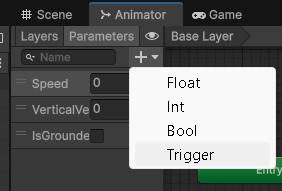{ loading=lazy }](../../assets/images/pmdm/unity/98-unity-crear-trigger-death.png){ aria-label="Ampliar imagen" }

<figcaption>En Parameters, crea un parámetro de tipo Trigger para la muerte</figcaption>
</figure>

2. Llámalo **Death**, con D mayúscula: debe coincidir exactamente con el texto de SetTrigger.

<figure class="unity-shot" markdown="1">

[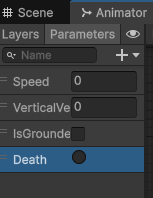{ loading=lazy }](../../assets/images/pmdm/unity/99-unity-parametro-death.png){ aria-label="Ampliar imagen" }

<figcaption>El parámetro Death utiliza D mayúscula, igual que anim.SetTrigger("Death")</figcaption>
</figure>

3. Haz clic derecho en **Any State → Make Transition** y une la transición al estado **death**.
4. Selecciona la flecha. Añade la condición **Death**, desmarca **Has Exit Time**, pon **Transition Duration = 0** y desmarca **Can Transition To Self**.

<figure class="unity-shot" markdown="1">

[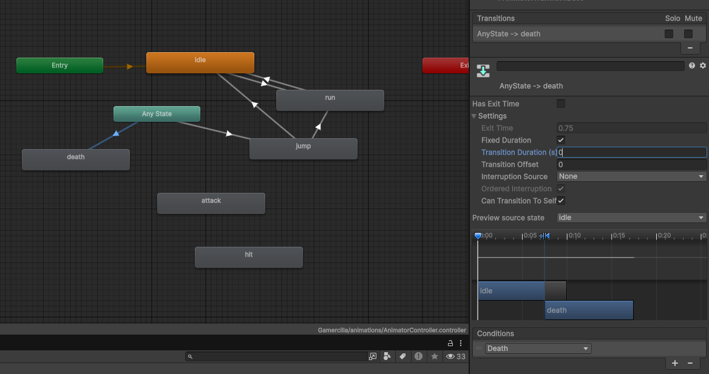{ loading=lazy }](../../assets/images/pmdm/unity/100-unity-transicion-death.png){ aria-label="Ampliar imagen" }

<figcaption>Any State → death usa Death como condición; desactiva también Can Transition To Self</figcaption>
</figure>

5. Deja el estado death **sin transiciones de salida**. El nivel se recargará al terminar el clip.

El nombre del **parámetro** es Death; el nombre del **clip o estado** puede ser death, como en la captura. Son elementos diferentes. Las transiciones de movimiento y salto se conservan; Morir limpia VerticalVelocity para que Any State → jump no interrumpa la muerte.

### Reiniciar cuando termina la animación

Al principio del archivo Player.cs, junto a using UnityEngine, añade:

```csharp
using UnityEngine.SceneManagement;
```

Dentro de Player añade también:

```csharp
// Este método se llamará desde el último fotograma de death.
public void ReiniciarNivel()
{
    // Recargamos la escena activa para recuperar su estado inicial.
    SceneManager.LoadScene(SceneManager.GetActiveScene().name);
}
```

1. Guarda Player.cs y espera a que Unity compile sin errores.
2. Selecciona **Player** en Hierarchy y abre **Window → Animation → Animation**.
3. Selecciona su clip **death** y coloca el cursor en el último fotograma.
4. Pulsa **Add Animation Event** y selecciona el marcador creado.
5. En el Inspector, en **Function**, elige **ReiniciarNivel()** del componente Player.

El **Animation Event** llama a ese método en el momento indicado del clip. Player.cs y Animator deben estar en el mismo objeto Player. No añadas un evento que destruya al jugador antes de reiniciar.

La secuencia es: **contacto con un peligro → Morir() → animación death → evento ReiniciarNivel() → recarga de la escena**. Por eso Morir no carga la escena inmediatamente: necesitamos tiempo para ver la animación.

Al recargar, **el Player vuelve a su posición guardada y las monedas recogidas vuelven a aparecer**. La escena debe estar incluida en Scene List, como acabamos de preparar.

## 4. Crear Killzone.cs

En la misma carpeta **Scripts** donde están Player.cs y Coin.cs, crea un **MonoBehaviour Script** llamado **Killzone**.

<figure class="unity-shot" markdown="1">

[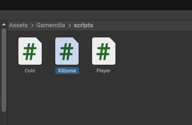{ loading=lazy }](../../assets/images/pmdm/unity/93-unity-killzone-script.png){ aria-label="Ampliar imagen" }

<figcaption>Crea Killzone.cs en la misma carpeta scripts que Coin.cs y Player.cs</figcaption>
</figure>

Ábrelo y sustituye su contenido por:

```csharp
using UnityEngine;

public class Killzone : MonoBehaviour
{
    // Unity llama a este método cuando otro collider entra en el trigger.
    private void OnTriggerEnter2D(Collider2D collision)
    {
        // Solo reaccionamos si el objeto que entra tiene el Tag Player.
        if (collision.transform.CompareTag("Player"))
        {
            // Buscamos el componente Player en ese mismo objeto.
            Player player = collision.GetComponent<Player>();

            // Si lo tiene, le pedimos que inicie su proceso de muerte.
            if (player != null)
            {
                player.Morir();
            }
        }
    }
}
```

<figure class="unity-shot" markdown="1">

[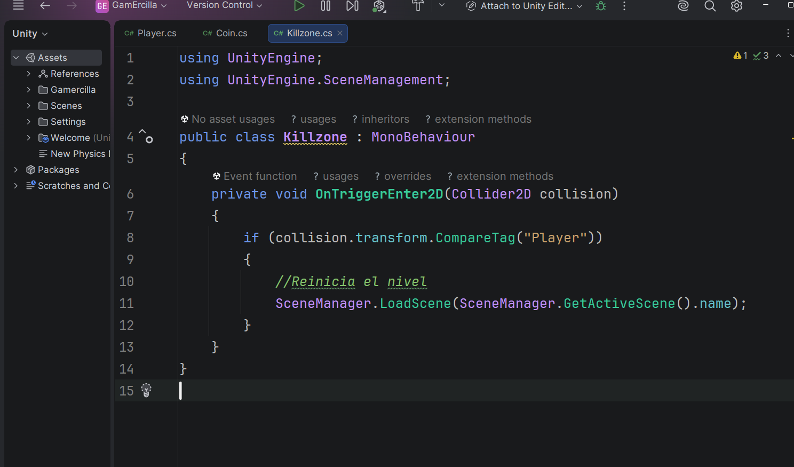{ loading=lazy }](../../assets/images/pmdm/unity/94-unity-killzone-codigo.png){ aria-label="Ampliar imagen" }

<figcaption>Captura de la versión inicial: ahora sustituimos la recarga directa por Player.Morir(), como en el código anterior</figcaption>
</figure>

El archivo se llama **Killzone.cs** y su clase **Killzone**, con la misma escritura. En Hierarchy, el objeto de la captura aparece como KillZone; el nombre del objeto puede variar, pero el del archivo y el de la clase deben coincidir.

| Instrucción | Función |
| --- | --- |
| **OnTriggerEnter2D(Collider2D collision)** | Unity avisa de la entrada; collision es el collider del objeto que acaba de entrar. |
| **CompareTag("Player")** | Comprueba su Tag para ignorar monedas y otros objetos. |
| **Player player** | Declara una variable que guardará una referencia al componente Player. |
| **collision.GetComponent<Player>()** | Busca ese componente en el mismo GameObject que tiene el collider. |
| **if (player != null)** | Comprueba que encontró el script antes de llamar a su método. |
| **player.Morir()** | Pide al jugador que muera; Player decide cómo animar la muerte y cuándo reiniciar. |

El **Tag Player y Player (Script) deben estar en el mismo objeto que tiene el collider del jugador**. La variable player apunta a ese componente: no crea otro jugador. Killzone ya no necesita using UnityEngine.SceneManagement porque la recarga la hace Player.

## 5. Asignar el script y probar la caída

1. Guarda Killzone.cs y espera a que Unity compile.
2. Arrastra **Killzone.cs desde Project hasta Killzone en Hierarchy**.

<figure class="unity-shot" markdown="1">

[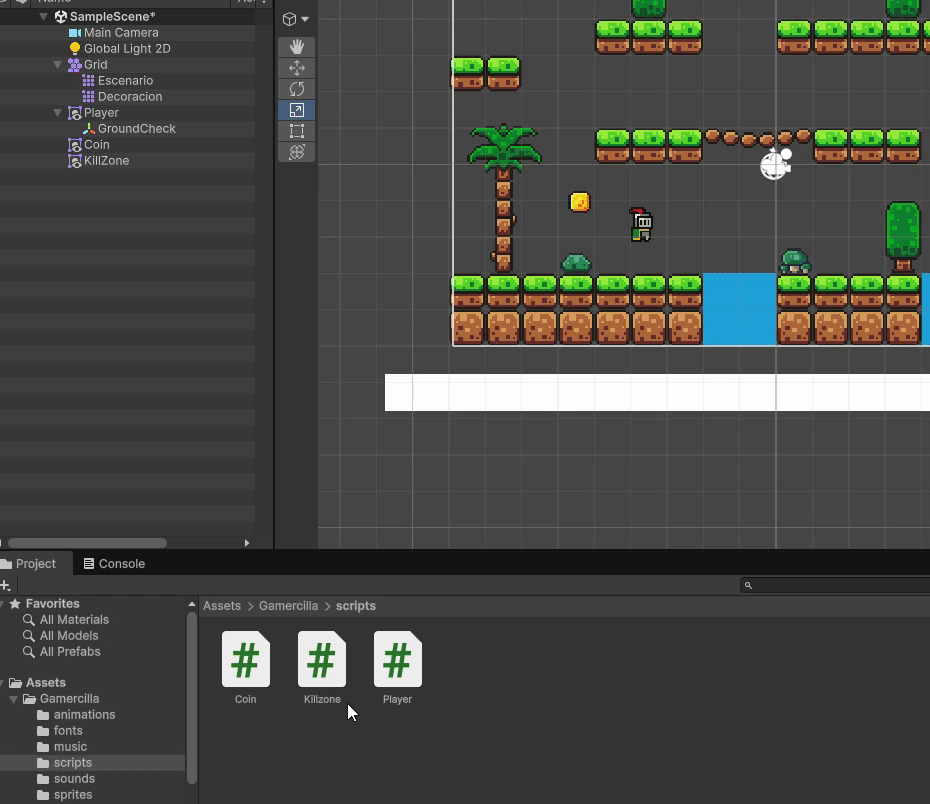{ loading=lazy }](../../assets/images/pmdm/unity/95-unity-asignar-killzone-script.gif){ aria-label="Ampliar imagen" }

<figcaption>Arrastra Killzone.cs al objeto de la zona de caída</figcaption>
</figure>

3. Selecciona la zona y comprueba **Box Collider 2D → Is Trigger** y el componente **Killzone (Script)**.
4. El Player debe conservar **Tag Player**, Rigidbody 2D Dynamic y su collider, como configuramos al recoger monedas.
5. Guarda la escena, pulsa Play y haz clic en Game.
6. Deja caer al jugador por un hueco: al entrar en la zona inferior, debe comenzar la muerte y después reiniciarse el nivel. Si cae fuera de cámara, quizá no veas la animación; el reinicio debe producirse igualmente.

<figure class="unity-shot" markdown="1">

[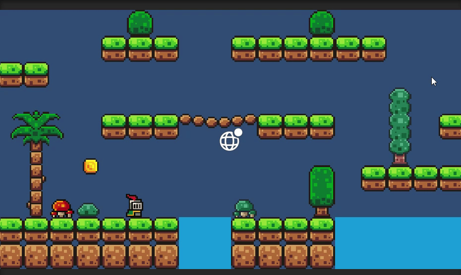{ loading=lazy }](../../assets/images/pmdm/unity/101-unity-muerte-player.gif){ aria-label="Ampliar imagen" }

<figcaption>Prueba la animación de muerte del Player al tocar el peligro</figcaption>
</figure>

Comprueba que durante la muerte ya no responde a A, D, las flechas ni al salto. Al llegar al evento del clip, el nivel se reinicia.

## 6. Añadir pinchos u otros obstáculos

1. Detén Play y abre **sprites** en Project.
2. Elige un sprite de pinchos u otro elemento que vayas a utilizar como peligro y arrástralo a Scene.
3. Renombra el objeto como **Spikes** y colócalo sobre una plataforma.

<figure class="unity-shot" markdown="1">

[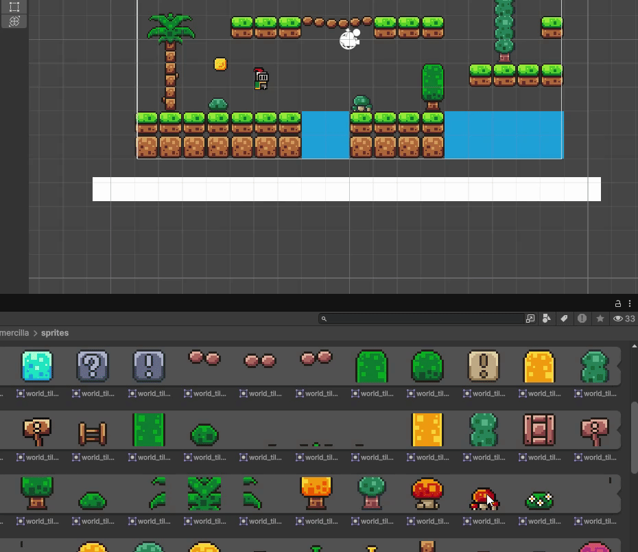{ loading=lazy }](../../assets/images/pmdm/unity/96-unity-obstaculo-escena.gif){ aria-label="Ampliar imagen" }

<figcaption>Arrastra un elemento de sprites a Scene; en la captura se utiliza una seta como obstáculo</figcaption>
</figure>

En las capturas utilizamos **una seta como obstáculo**. El funcionamiento es el mismo si eliges pinchos: la imagen establece su aspecto y el trigger establece la zona de contacto.

4. Selecciona Spikes y añade **Box Collider 2D**.
5. Pulsa **Edit Collider** para ajustar el área de contacto y marca **Is Trigger**. Deja el objeto en **Layer Default**; el suelo sólido sigue perteneciendo a Floor.

<figure class="unity-shot" markdown="1">

[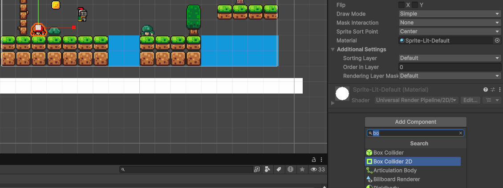{ loading=lazy }](../../assets/images/pmdm/unity/97-unity-obstaculo-collider.png){ aria-label="Ampliar imagen" }

<figcaption>Añade Box Collider 2D al obstáculo, ajusta su forma y activa Is Trigger</figcaption>
</figure>

### Crear Spikes.cs

En Scripts, crea un **MonoBehaviour Script** llamado **Spikes**. Utilizaremos el mismo método que en Killzone, dentro de una clase con el nombre del nuevo archivo:

```csharp
using UnityEngine;

public class Spikes : MonoBehaviour
{
    // Unity llama a este método cuando otro collider entra en el trigger.
    private void OnTriggerEnter2D(Collider2D collision)
    {
        // Solo reaccionamos si el objeto que entra tiene el Tag Player.
        if (collision.transform.CompareTag("Player"))
        {
            // Buscamos el componente Player en ese mismo objeto.
            Player player = collision.GetComponent<Player>();

            // Si lo tiene, le pedimos que inicie su proceso de muerte.
            if (player != null)
            {
                player.Morir();
            }
        }
    }
}
```

Guarda y vuelve a Unity. **Arrastra Spikes.cs al objeto Spikes** para añadirlo como componente. Comprueba que **Spikes (Script)** aparece junto al collider, guarda la escena y prueba el contacto con el personaje.

Si prefieres reutilizar el comportamiento ya creado, puedes asignar **Killzone.cs al obstáculo** en lugar de crear Spikes.cs. Añade **uno de los dos scripts** al objeto: ambos llaman a Player.Morir().

## 7. Comprobar el conjunto

| Objeto | Componentes y ajustes que debemos comprobar |
| --- | --- |
| **Player** | Tag Player, Rigidbody 2D Dynamic, Box Collider 2D con Is Trigger desactivado y Player (Script), además del Animator con Death y el evento ReiniciarNivel(). |
| **Coin** | Animator de la moneda, Circle Collider 2D con Is Trigger activado y Coin (Script). |
| **Killzone** | Zona bajo el mapa, Box Collider 2D con Is Trigger activado y Killzone (Script). |
| **Spikes** | Obstáculo sobre una plataforma, Box Collider 2D con Is Trigger activado y Spikes (Script), o Killzone (Script) si lo reutilizas. |

Prueba una recogida, una caída y el contacto con el obstáculo. Después de cada reinicio, comprueba que el jugador vuelve al comienzo y las monedas se restauran.

### Si el nivel no se reinicia

Revisa **Console**, la inclusión de la escena en **Scene List**, el **Tag Player**, la asignación del script al peligro y **Is Trigger** en su collider. Para recibir eventos de trigger 2D, al menos uno de los objetos necesita Rigidbody 2D: en este proyecto lo lleva el Player. Comprueba también que las layers pueden interactuar en **Project Settings → Physics 2D**.

Si reproduce la muerte pero no reinicia, revisa el **Animation Event** del último fotograma: debe llamar a ReiniciarNivel() en el Player. Si no aparece la animación, comprueba el parámetro Death, su condición y la asignación del Animator Controller.

Si el nivel se reinicia nada más empezar, revisa la posición inicial del Player y el tamaño de los triggers: el personaje debe comenzar fuera de la zona de caída y de los obstáculos.

Continúa con [Crear un enemigo y su patrulla](11-enemigo-patrulla.md).

Referencias: [SceneManager.LoadScene](https://docs.unity3d.com/6000.0/Documentation/ScriptReference/SceneManagement.SceneManager.LoadScene.html), [Scene List en Unity 6](https://docs.unity3d.com/6000.0/Documentation/Manual/build-profile-scene-list.html), [Animation Events](https://docs.unity3d.com/6000.0/Documentation/Manual/script-AnimationWindowEvent.html) y [eventos de trigger 2D](https://docs.unity3d.com/6000.0/Documentation/ScriptReference/MonoBehaviour.OnTriggerEnter2D.html).
