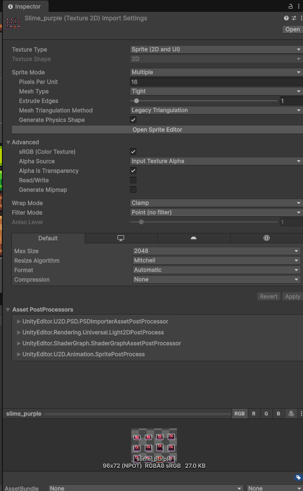
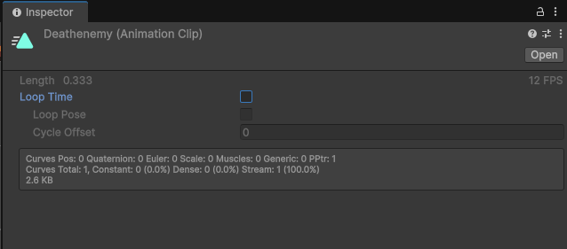
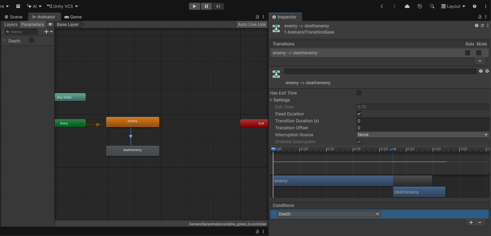
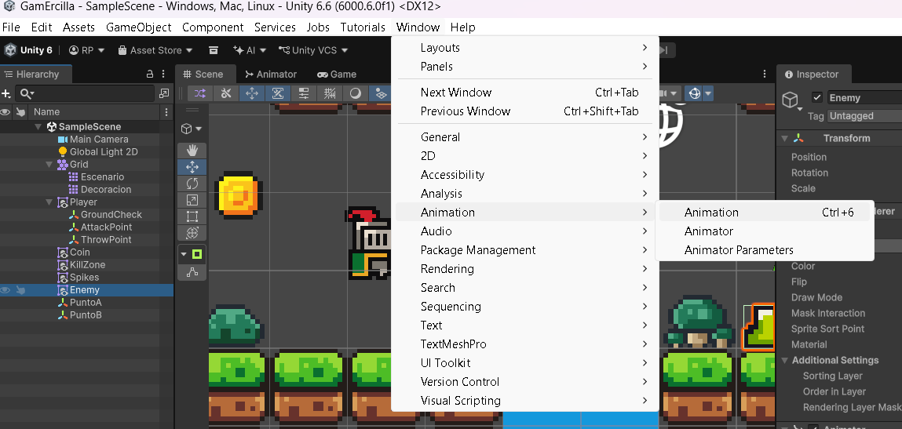
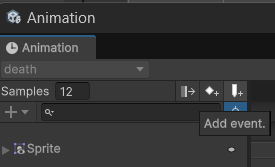
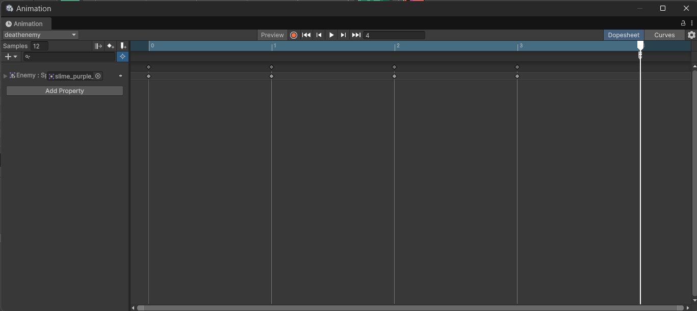
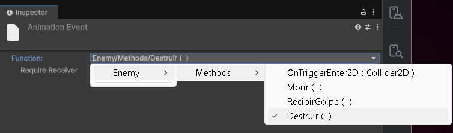
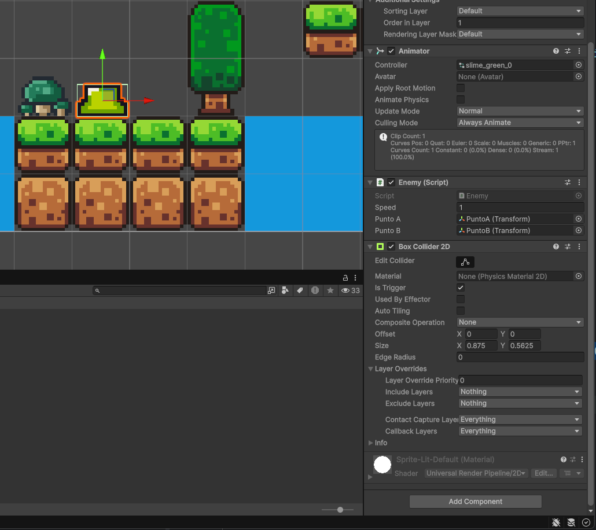

# 13. Ataque y enemigos

Después de [crear el enemigo y su patrulla](11-enemigo-patrulla.md), añadiremos el combate. Conservamos Player.Morir(), su animación y el reinicio del nivel preparados en [Peligros y reinicio](10-peligros-reinicio.md). Ahora programaremos el ataque y la muerte del enemigo.

Al terminar tendremos:

- una animación de ataque para el Player;
- una zona de ataque delante del personaje;
- detección de enemigos mediante una `Layer`;
- una animación de muerte para el enemigo;
- eliminación del enemigo cuando termina la animación;
- muerte del Player al tocar un enemigo;
- la patrulla que ya tenemos se detendrá cuando muera el enemigo.

---

## 1. Crear la animación de ataque

Si ya preparaste **attack** en [Animaciones](08-animaciones.md), reutiliza ese clip. Si todavía no existe, selecciona `Player` y abre:

```text
Window
→ Animation
→ Animation
```

Crea la animación:

```text
attack.anim
```

Añade los frames correspondientes al ataque.

Como el ataque debe reproducirse una sola vez, selecciona el clip `attack` en **Project** y comprueba que:

```text
Loop Time: desactivado
```

### Añadir el estado al Animator

Abre:

```text
Window
→ Animation
→ Animator
```

Añade el estado `attack`.

En **Parameters** crea:

```text
Trigger → attack
```

La transición de entrada queda:

```text
idle → attack
Condition: attack
Has Exit Time: desactivado
Transition Duration: 0
```

La transición de vuelta:

```text
attack → idle
Has Exit Time: activado
Transition Duration: 0
Conditions: ninguna
```

De esta forma el código inicia el ataque y, cuando termina la animación, el Animator vuelve a `idle`.

En `Player.cs`:

```csharp
if (Input.GetKeyDown(KeyCode.X))
{
    anim.SetTrigger("attack");
}
```

!!! warning "Mayúsculas y minúsculas"
    El parámetro se llama `attack`. El texto utilizado en `SetTrigger()` debe coincidir exactamente con el nombre creado en el Animator.

---

## 2. Crear el punto de ataque

Para decidir desde qué posición comprobamos si hay un enemigo, crea un objeto vacío como hijo del Player:

```text
Player
├── GroundCheck
└── AttackPoint
```

Selecciona `AttackPoint` y colócalo delante del personaje, aproximadamente en la zona que alcanza el golpe.

No necesita ningún componente adicional. Utilizaremos únicamente su posición.

En `Player.cs` añade:

```csharp
public Transform attackPoint;
public float attackRadius = 0.5f;
public LayerMask enemyLayer;
```

Después selecciona `Player` y, en el Inspector:

```text
Attack Point  → AttackPoint
Attack Radius → ajustarlo al alcance del golpe
Enemy Layer   → Enemy
```

---

## 3. Crear la Layer Enemy

Necesitamos distinguir a los enemigos del resto de objetos del escenario.

Selecciona el objeto que hará de enemigo:

```text
Layer
→ Add Layer...
```

Crea:

```text
Enemy
```

Vuelve a seleccionar el enemigo y asígnale:

```text
Layer: Enemy
```

El enemigo también necesita un `Collider2D`. Por ejemplo:

```text
Box Collider 2D
```

La `Layer` se utilizará como filtro para que el ataque no detecte el suelo, monedas u otros objetos.

---

## 4. Detectar un enemigo dentro del alcance

Amplía el código que ejecutamos al pulsar ++x++:

```csharp
if (Input.GetKeyDown(KeyCode.X))
{
    anim.SetTrigger("attack");

    Collider2D enemyCollider = Physics2D.OverlapCircle(
        attackPoint.position,
        attackRadius,
        enemyLayer
    );

    if (enemyCollider != null)
    {
        Enemy enemy = enemyCollider.GetComponent<Enemy>();

        if (enemy != null)
        {
            enemy.Morir();
        }
    }
}
```

`Physics2D.OverlapCircle()` comprueba si existe un `Collider2D` dentro de un círculo.

En este caso recibe:

```text
attackPoint.position → centro del círculo
attackRadius         → radio del círculo
enemyLayer           → objetos que queremos detectar
```

Por tanto, solo nos interesa un collider que pertenezca a la `Layer Enemy`.

---

## 5. Ver la zona de ataque

Para poder ajustar el alcance desde la escena, añade al final de `Player.cs`:

```csharp
private void OnDrawGizmosSelected()
{
    if (attackPoint != null)
    {
        Gizmos.DrawWireSphere(
            attackPoint.position,
            attackRadius
        );
    }
}
```

No hay que llamar manualmente a `OnDrawGizmosSelected()`. Unity lo ejecuta automáticamente cuando el objeto está seleccionado.

Para verlo:

1. Selecciona `Player`.
2. Comprueba que **Gizmos** está activado en la ventana **Scene**.
3. Modifica `Attack Radius` desde el Inspector hasta obtener el alcance que necesites.
4. Si el círculo aparece desplazado, mueve el objeto `AttackPoint`.

---

## 6. Preparar la muerte y detener la patrulla

Abre **Enemy.cs**, que ya está asignado al enemigo. Conserva speed, los puntos, objetivo, animator y el recorrido. Dentro de la clase, junto a sus variables, añade:

```csharp
// Evita repetir la muerte y permite detener la patrulla.
private bool muerto = false;
private Collider2D enemyCollider;
```

En el **Start que ya tenemos**, añade esta línea para guardar el collider del propio enemigo:

```csharp
enemyCollider = GetComponent<Collider2D>();
```

Al principio de su **Update**, antes de MoveTowards, añade:

```csharp
if (muerto)
{
    return;
}
```

Ahora añade estos métodos dentro de la clase y fuera de Start y Update:

```csharp
public void Morir()
{
    // Otro golpe no debe volver a iniciar la muerte.
    if (muerto)
    {
        return;
    }

    muerto = true;

    // El enemigo deja de detectar contactos y de recibir nuevos golpes.
    enemyCollider.enabled = false;

    // Iniciamos su animación; todavía no eliminamos el objeto.
    animator.SetTrigger("Death");
}

// Lo llamará el evento del último fotograma de deathenemy.
public void Destruir()
{
    Destroy(gameObject);
}
```

**Morir() inicia el proceso**: cambia el estado, bloquea la patrulla y activa la animación. **Destruir() elimina el objeto cuando esa animación ha terminado**. Si destruyéramos al enemigo dentro de Morir, desaparecería antes de mostrarla.

Si ya tenías una versión anterior de estos métodos, **sustitúyela**, sin declarar dos Morir ni dos Destruir. Más abajo tienes Enemy.cs completo con la patrulla y el contacto integrados.

---

## 7. Crear la animación deathenemy { #muerte-enemigo }

1. Detén Play y despliega la imagen del enemigo en **Project → sprites**. Debe estar recortada, con **16 Pixels Per Unit**, **Point (no filter)** y **Compression None**, como en [Crear un enemigo y su patrulla](11-enemigo-patrulla.md).

<figure class="unity-shot" markdown="1">

[{ loading=lazy }](../../assets/images/pmdm/unity/124-unity-sprites-muerte-enemigo.png){ aria-label="Ampliar imagen" }

<figcaption>Prepara los sprites de muerte del mismo enemigo; la captura muestra slime_purple</figcaption>
</figure>

2. Selecciona **los cuatro últimos sprites**, que forman su muerte, en el orden en el que deben reproducirse. Las capturas utilizan slime_purple; si tu Enemy utiliza slime_green, elige sus fotogramas equivalentes.
3. Como al crear las animaciones anteriores, arrástralos juntos a Scene y guarda el clip como **deathenemy.anim** en **Animations**.
4. Unity puede crear un objeto y un controlador adicionales. Conserva **el Enemy original y su controlador de patrulla**; elimina el objeto temporal y su controlador sobrante, conservando deathenemy.anim.
5. Selecciona el clip **deathenemy.anim en Project** y desmarca **Loop Time**: la muerte se reproduce una sola vez.

<figure class="unity-shot" markdown="1">

[{ loading=lazy }](../../assets/images/pmdm/unity/127-unity-deathenemy-loop-time.png){ aria-label="Ampliar imagen" }

<figcaption>En deathenemy, desmarca Loop Time para reproducir la muerte una sola vez</figcaption>
</figure>

6. Abre el controlador del **Enemy original** y arrastra deathenemy.anim para añadir su estado. Mantén **enemy** como estado inicial, conectado a Entry.
7. En **Parameters**, crea un **Trigger** llamado **Death**, con D mayúscula. Si ya existe, reutilízalo.
8. Crea **Make Transition** desde **enemy** hasta **deathenemy** y selecciona la flecha.

| Ajuste de la transición | Valor |
| --- | --- |
| **Condition** | Death |
| **Has Exit Time** | Desactivado |
| **Transition Duration** | 0 |

<figure class="unity-shot" markdown="1">

[{ loading=lazy }](../../assets/images/pmdm/unity/125-unity-transicion-deathenemy.png){ aria-label="Ampliar imagen" }

<figcaption>La transición enemy → deathenemy utiliza el trigger Death, sin Has Exit Time y con duración 0</figcaption>
</figure>

No añadas una transición de vuelta a enemy. Al terminar la muerte, eliminaremos ese objeto mediante un evento.

**deathenemy es el nombre del clip y del estado; Death es el parámetro que activa la transición.** El código debe conservar animator.SetTrigger("Death"). Si tenías el clip anterior EnemyDeath.anim, puedes renombrarlo a deathenemy y ajustar el nombre del estado; reutiliza su contenido.

## 8. Añadir el evento que llama a Destruir()

1. Selecciona **Enemy en Hierarchy**, el objeto que tiene Animator y Enemy (Script).
2. Abre **Window → Animation → Animation**.

<figure class="unity-shot" markdown="1">

[{ loading=lazy }](../../assets/images/pmdm/unity/128-unity-abrir-animation-enemigo.png){ aria-label="Ampliar imagen" }

<figcaption>Selecciona el Enemy original y abre Window → Animation → Animation</figcaption>
</figure>

3. En el desplegable de clips de la ventana Animation, selecciona **deathenemy**. No basta con seleccionar el rectángulo del estado en Animator.
4. Lleva el cursor de la línea de tiempo **al final del clip**, después de que se hayan mostrado los cuatro sprites.
5. Pulsa el botón **Add Event / Add Animation Event**.

<figure class="unity-shot" markdown="1">

[{ loading=lazy }](../../assets/images/pmdm/unity/126-unity-animation-add-event.png){ aria-label="Ampliar imagen" }

<figcaption>Este botón añade el evento: para el enemigo selecciona primero el clip deathenemy</figcaption>
</figure>

<figure class="unity-shot" markdown="1">

[{ loading=lazy }](../../assets/images/pmdm/unity/129-unity-deathenemy-evento-final.png){ aria-label="Ampliar imagen" }

<figcaption>Coloca el evento al final del clip deathenemy, después de sus cuatro fotogramas</figcaption>
</figure>

6. Selecciona el marcador del evento. En **Inspector → Function**, elige **Enemy → Methods → Destruir()**.

<figure class="unity-shot" markdown="1">

[{ loading=lazy }](../../assets/images/pmdm/unity/130-unity-evento-destruir-enemigo.png){ aria-label="Ampliar imagen" }

<figcaption>En Function, selecciona Enemy → Methods → Destruir(), como muestra la captura</figcaption>
</figure>

**Selecciona Destruir(), no Morir().** Morir ya se ejecutó al recibir el golpe. Volver a llamarlo desde el evento no eliminaría el enemigo y, con la comprobación de muerto, saldría inmediatamente.

El método Destruir debe ser **public**, estar dentro de Enemy.cs y ese script debe estar en **el mismo GameObject que reproduce la animación**. Guarda el clip y comprueba que el evento aparece en su línea de tiempo.

La secuencia queda: **golpe → Enemy.Morir() → trigger Death → clip deathenemy → evento Destruir() → eliminación del enemigo**. La muerte del Player sigue siendo independiente: su evento llama a ReiniciarNivel().

---

## 9. Configurar el collider del enemigo

1. Selecciona **Enemy** y comprueba que tiene **Box Collider 2D**. Si ya lo añadiste al crear la Layer Enemy, reutilízalo; no añadas otro.
2. Pulsa **Edit Collider** y ajusta el rectángulo a su cuerpo.
3. Marca **Is Trigger**.

<figure class="unity-shot" markdown="1">

[{ loading=lazy }](../../assets/images/pmdm/unity/113-unity-enemy-contacto-trigger.png){ aria-label="Ampliar imagen" }

<figcaption>Ajusta el Box Collider 2D del Enemy y activa Is Trigger para detectar al Player</figcaption>
</figure>

El collider delimita la zona de contacto. Is Trigger permite detectar la entrada del jugador sin empujarlo físicamente. **Al menos uno de los objetos necesita Rigidbody 2D**: el Player ya lo tiene, con Body Type Dynamic.

## 10. Hacer que Enemy mate al Player

Añade este método dentro de **Enemy.cs**, fuera de Update y Morir:

```csharp
private void OnTriggerEnter2D(Collider2D collision)
{
    // Un enemigo que ya está muriendo no debe matar al jugador.
    if (muerto)
    {
        return;
    }

    // Solo reaccionamos al objeto que tiene el Tag Player.
    if (collision.transform.CompareTag("Player"))
    {
        // Buscamos Player.cs en el mismo objeto que tiene ese collider.
        Player player = collision.GetComponent<Player>();

        if (player != null)
        {
            // Player decide cómo animar su muerte y reiniciar el nivel.
            player.Morir();
        }
    }
}
```

| Parte | Función |
| --- | --- |
| **OnTriggerEnter2D** | Unity avisa cuando un collider entra en el trigger del enemigo. |
| **collision** | Es el collider del objeto que acaba de entrar. |
| **if (muerto) / return** | Ignora el contacto si el enemigo ya está muriendo. |
| **CompareTag("Player")** | Comprueba que el contacto corresponde al jugador. |
| **GetComponent<Player>()** | Obtiene su componente Player, sin crear otro personaje. |
| **if (player != null)** | Comprueba que se encontró el componente antes de utilizarlo. |
| **player.Morir()** | Pide al Player que inicie la muerte que ya programamos. |

El **Player debe tener Tag Player**, su collider, Rigidbody 2D y Player (Script) en el mismo objeto. Conserva su variable muerto, la comprobación inicial de Update, Morir() y el evento ReiniciarNivel() de [Peligros y reinicio](10-peligros-reinicio.md#muerte-player).

**El contacto con el enemigo se gestiona en Enemy.cs.** Si conservabas la versión anterior de OnTriggerEnter2D en Player.cs que buscaba Enemy y llamaba a Morir, elimina ese método: este contacto ya lo detecta el enemigo. Killzone y Spikes siguen utilizando sus propios scripts.

---

## 11. Ajustar AttackPoint al cambio de dirección

Continuamos con la orientación mediante **la escala X del Transform**, que añadimos en [Movimiento, orientación y salto](05-movimiento-salto.md#orientacion-del-personaje):

```csharp
if (move != 0)
{
    transform.localScale = new Vector3(Mathf.Sign(move), 1, 1);
}
```

Como **AttackPoint es hijo del Player**, también se refleja al cambiar el signo de X. Colócalo delante del personaje, con posición local X positiva cuando el sprite original mira a la derecha. GroundCheck debe seguir centrado en X = 0.

No inviertas además la posición local de AttackPoint ni apliques SpriteRenderer.flipX: reflejarlo dos veces dejaría el punto de ataque en el lado equivocado. Conserva un único bloque de orientación en Update.

Prueba a caminar a izquierda y derecha y comprueba el círculo de ataque con el Player seleccionado.

---

## 12. Player.cs completo

El script final reúne el movimiento, salto, animaciones, orientación, ataque, muerte y reinicio. En Morir también limpiamos el trigger attack: un ataque pendiente no debe interrumpir la muerte. Mantén el evento ReiniciarNivel() en el clip death del Player:

```csharp
using UnityEngine;
using UnityEngine.SceneManagement;

public class Player : MonoBehaviour
{
    public float speed = 6f;
    public float jumpForce = 6f;

    public Transform groundCheck;
    public float groundRadius = 0.1f;
    public LayerMask groundLayer;

    public Transform attackPoint;
    public float attackRadius = 0.5f;
    public LayerMask enemyLayer;

    private Rigidbody2D rb2D;
    public Animator anim;

    private float move;
    private bool isGrounded;
    private bool muerto = false;

    void Start()
    {
        rb2D = GetComponent<Rigidbody2D>();
        anim = GetComponent<Animator>();
    }

    void Update()
    {
        if (muerto)
            return;

        move = Input.GetAxisRaw("Horizontal");

        rb2D.linearVelocity = new Vector2(
            move * speed,
            rb2D.linearVelocity.y
        );

        if (Input.GetButtonDown("Jump") && isGrounded)
        {
            rb2D.linearVelocity = new Vector2(
                rb2D.linearVelocity.x,
                jumpForce
            );
            isGrounded = false;
        }

        anim.SetFloat("Speed", Mathf.Abs(move));
        anim.SetFloat("VerticalVelocity", rb2D.linearVelocity.y);
        anim.SetBool("IsGrounded", isGrounded);

        if (move != 0)
        {
            transform.localScale = new Vector3(Mathf.Sign(move), 1, 1);
        }

        if (Input.GetKeyDown(KeyCode.X))
        {
            anim.SetTrigger("attack");

            Collider2D enemyCollider = Physics2D.OverlapCircle(
                attackPoint.position,
                attackRadius,
                enemyLayer
            );

            if (enemyCollider != null)
            {
                Enemy enemy = enemyCollider.GetComponent<Enemy>();

                if (enemy != null)
                {
                    enemy.Morir();
                }
            }
        }
    }

    private void FixedUpdate()
    {
        isGrounded = Physics2D.OverlapCircle(
            groundCheck.position,
            groundRadius,
            groundLayer
        ) != null && rb2D.linearVelocity.y <= 0.1f;
    }

    public void Morir()
    {
        if (muerto)
            return;

        muerto = true;

        rb2D.linearVelocity = Vector2.zero;
        anim.SetFloat("Speed", 0f);
        anim.SetFloat("VerticalVelocity", 0f);
        anim.ResetTrigger("attack");
        anim.SetTrigger("Death");
    }

    public void ReiniciarNivel()
    {
        SceneManager.LoadScene(SceneManager.GetActiveScene().name);
    }

    private void OnDrawGizmosSelected()
    {
        if (attackPoint != null)
        {
            Gizmos.DrawWireSphere(
                attackPoint.position,
                attackRadius
            );
        }
    }
}
```

---

## 13. Enemy.cs completo

El enemigo patrulla, puede recibir el ataque y se elimina al terminar su animación de muerte:

```csharp
using UnityEngine;

public class Enemy : MonoBehaviour
{
    public float speed = 1f;

    public Transform puntoA;
    public Transform puntoB;

    private Transform objetivo;
    private Animator animator;
    private Collider2D enemyCollider;

    private bool muerto = false;

    void Start()
    {
        animator = GetComponent<Animator>();
        enemyCollider = GetComponent<Collider2D>();

        objetivo = puntoB;
    }

    void Update()
    {
        if (muerto)
            return;

        transform.position = Vector2.MoveTowards(
            transform.position,
            objetivo.position,
            speed * Time.deltaTime
        );

        if (Vector2.Distance(transform.position, objetivo.position) < 0.1f)
        {
            if (objetivo == puntoA)
            {
                objetivo = puntoB;
            }
            else
            {
                objetivo = puntoA;
            }
        }
    }

    private void OnTriggerEnter2D(Collider2D collision)
    {
        // Un enemigo que ya está muriendo no debe matar al jugador.
        if (muerto)
        {
            return;
        }

        // Solo reaccionamos al objeto que tiene el Tag Player.
        if (collision.transform.CompareTag("Player"))
        {
            // Buscamos Player.cs en el mismo objeto que tiene ese collider.
            Player player = collision.GetComponent<Player>();

            if (player != null)
            {
                // Player decide cómo animar su muerte y reiniciar el nivel.
                player.Morir();
            }
        }
    }

    public void Morir()
    {
        if (muerto)
            return;

        muerto = true;

        enemyCollider.enabled = false;
        animator.SetTrigger("Death");
    }

    public void Destruir()
    {
        Destroy(gameObject);
    }
}
```

---

## 14. Configuración final

### Player

```text
Player
├── Sprite Renderer
├── Rigidbody 2D
├── Box Collider 2D
├── Animator
├── Player (Script)
├── GroundCheck
└── AttackPoint
```

En `Player (Script)`:

```text
Ground Check  → GroundCheck
Ground Layer  → Floor
Attack Point  → AttackPoint
Enemy Layer   → Enemy
```

### Enemy

```text
Enemy
├── Sprite Renderer
├── Box Collider 2D
│   └── Is Trigger: activado
├── Animator
└── Enemy (Script)
```

En `Enemy (Script)`:

```text
Punto A → PuntoA
Punto B → PuntoB
```

Y el objeto debe pertenecer a:

```text
Layer: Enemy
```

---

## Comprobación

Antes de continuar, comprueba:

- [ ] El Player reproduce `attack` al pulsar ++x++.
- [ ] `attack` vuelve a `idle` al terminar.
- [ ] `AttackPoint` está situado delante del personaje.
- [ ] El círculo de ataque se ve al seleccionar el Player.
- [ ] El enemigo pertenece a la `Layer Enemy`.
- [ ] El enemigo tiene un `Collider2D`.
- [ ] El golpe solo afecta al enemigo cuando está dentro del radio.
- [ ] El enemigo reproduce `deathenemy` antes de desaparecer.
- [ ] El `Animation Event` llama a `Destruir()`.
- [ ] El enemigo no empuja al Player.
- [ ] El Player muere al entrar en contacto con el enemigo.
- [ ] El Player deja de aceptar movimiento cuando comienza su muerte.
- [ ] El evento ReiniciarNivel() del Player recarga la escena al terminar death.
- [ ] El enemigo patrulla entre `PuntoA` y `PuntoB`.
- [ ] El enemigo deja de moverse cuando comienza `deathenemy`.
- [ ] `AttackPoint` cambia de lado cuando cambia la orientación del Player.

Continúa con [Proyectiles y vida de los enemigos](12_proyectiles_y_vida_enemigos_unity.md).

Referencias: [OnTriggerEnter2D](https://docs.unity3d.com/6000.0/Documentation/ScriptReference/MonoBehaviour.OnTriggerEnter2D.html) y [Animation Events](https://docs.unity3d.com/6000.0/Documentation/Manual/script-AnimationWindowEvent.html).
