# 11. Crear un enemigo y su patrulla

Ya recogemos monedas y controlamos la [muerte y el reinicio del Player](10-peligros-reinicio.md). Ahora crearemos un enemigo animado y lo moveremos entre dos puntos. En la siguiente página añadiremos el contacto y el ataque.

## 1. Preparar los sprites del enemigo

1. Detén Play. En **Project → sprites**, selecciona la imagen del enemigo; en este ejemplo usamos el slime.
2. Revisa los ajustes de importación:

| Propiedad | Valor |
| --- | --- |
| **Texture Type** | Sprite (2D and UI) |
| **Sprite Mode** | Multiple |
| **Pixels Per Unit** | 16 |
| **Filter Mode** | Point (no filter) |
| **Compression** | None |

3. Pulsa **Apply** en el Inspector y abre **Sprite Editor**.
4. En **Slice**, elige **Type → Automatic**. Esta vez Unity detecta los recortes de la imagen; no usamos Grid By Cell Size.
5. Pulsa **Slice** y después **Apply** en Sprite Editor.

<figure class="unity-shot" markdown="1">

[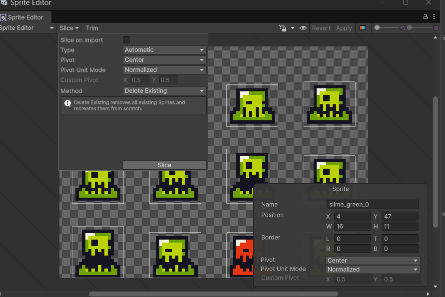{ loading=lazy }](../../assets/images/pmdm/unity/102-unity-enemy-slice-auto.png){ aria-label="Ampliar imagen" }

<figcaption>En Sprite Editor, el slime se recorta con Type Automatic: pulsa Slice y Apply</figcaption>
</figure>

Con 16 Pixels Per Unit, 16 píxeles representan una unidad de Unity. Comprueba los rectángulos generados y corrige cualquier recorte que una dos fotogramas o deje parte del enemigo fuera. Si los fotogramas quedan a distintas alturas, revisa sus pivotes antes de animarlos.

## 2. Crear la animación y el objeto Enemy

1. Despliega la imagen en Project y selecciona **los recortes que forman su animación**, en el orden de reproducción.
2. Arrástralos juntos a Scene.
3. Guarda el clip como **enemy.anim** en la carpeta **Animations** que ya tenemos dentro de Assets/ErciGame. No crees otra carpeta de animaciones.

<figure class="unity-shot" markdown="1">

[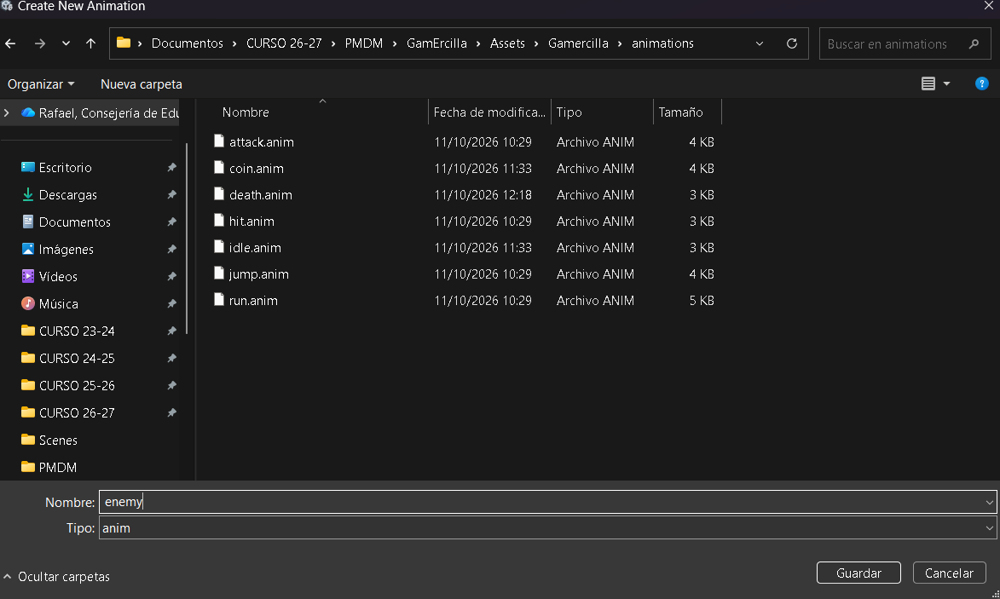{ loading=lazy }](../../assets/images/pmdm/unity/103-unity-guardar-enemy-animacion.png){ aria-label="Ampliar imagen" }

<figcaption>Guarda enemy.anim junto a las animaciones que ya hemos creado</figcaption>
</figure>

<figure class="unity-shot" markdown="1">

[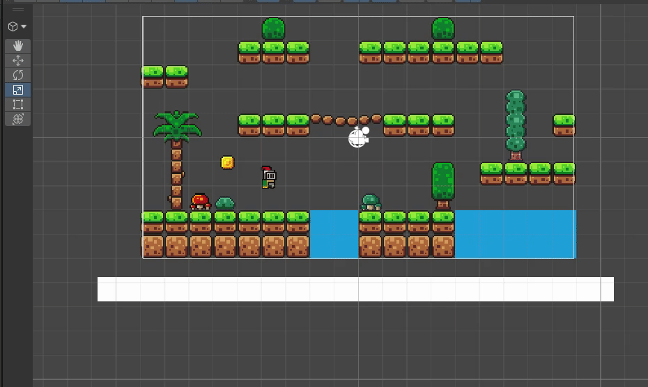{ loading=lazy }](../../assets/images/pmdm/unity/104-unity-crear-enemy-animacion.gif){ aria-label="Ampliar imagen" }

<figcaption>Arrastra los fotogramas del enemigo a Scene para crear su animación</figcaption>
</figure>

Las capturas muestran el proyecto Gamercilla y carpetas en minúscula; utiliza las carpetas equivalentes de tu proyecto.

4. Renombra el objeto creado en Hierarchy como **Enemy**.

<figure class="unity-shot" markdown="1">

[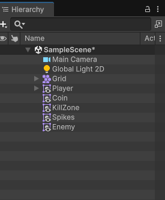{ loading=lazy }](../../assets/images/pmdm/unity/105-unity-enemy-hierarchy.png){ aria-label="Ampliar imagen" }

<figcaption>El objeto animado aparece en Hierarchy con el nombre Enemy</figcaption>
</figure>

5. Comprueba que tiene **Sprite Renderer** y **Animator**, con el controlador generado para este enemigo. Conserva este controlador: el del Player corresponde a otro personaje.
6. Selecciona enemy.anim y activa **Loop Time** para que se repita durante la patrulla.
7. En Sprite Renderer, usa la misma **Sorting Layer** que el escenario y establece **Order in Layer = 1**. Con el escenario en 0 y el Player en 10, el enemigo se dibuja sobre el mapa y por debajo del jugador.
8. Colócalo sobre la plataforma por la que se moverá.

**Order in Layer organiza el dibujo**. La propiedad Layer, que utilizaremos en el combate, sirve para filtrar objetos y colisiones: no son la misma configuración.

## 3. Crear PuntoA y PuntoB

1. En Hierarchy, pulsa el botón derecho en una zona vacía y elige **Create Empty**.

<figure class="unity-shot" markdown="1">

[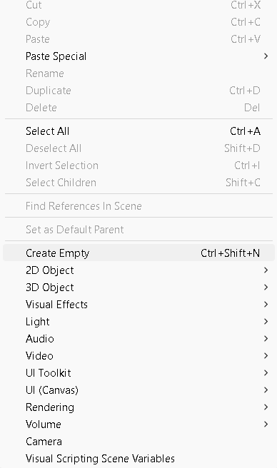{ loading=lazy }](../../assets/images/pmdm/unity/106-unity-crear-puntos-patrulla.png){ aria-label="Ampliar imagen" }

<figcaption>Create Empty crea cada uno de los destinos de la patrulla</figcaption>
</figure>

2. Llámalo **PuntoA**. Repite para crear **PuntoB**.
3. Comprueba que ambos son objetos independientes en el nivel raíz de la escena, **fuera del Enemy y del Player**. Si fueran hijos del enemigo, sus destinos se moverían con él.

<figure class="unity-shot" markdown="1">

[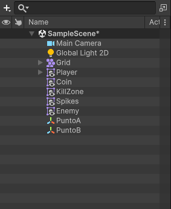{ loading=lazy }](../../assets/images/pmdm/unity/107-unity-puntos-patrulla-hierarchy.png){ aria-label="Ampliar imagen" }

<figcaption>PuntoA y PuntoB permanecen fuera del Enemy como objetos independientes</figcaption>
</figure>

4. Coloca PuntoA y PuntoB en los extremos del recorrido, a la altura que debe tener **el centro del Enemy**, no debajo de sus pies. Para esta patrulla horizontal, conserva la misma Y en ambos puntos y usa **Z = 0** en Enemy y en los puntos.

<figure class="unity-shot" markdown="1">

[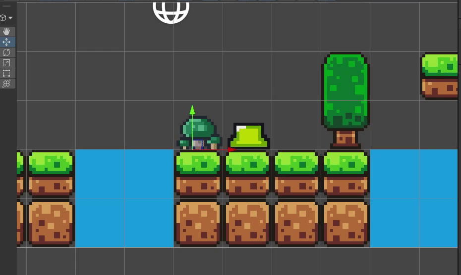{ loading=lazy }](../../assets/images/pmdm/unity/108-unity-colocar-puntos-patrulla.gif){ aria-label="Ampliar imagen" }

<figcaption>Coloca PuntoA y PuntoB a la altura del Enemy, en los extremos de su recorrido</figcaption>
</figure>

Puedes usar el Enemy como referencia para situarlos. Déjalo inicialmente en PuntoA o entre los dos puntos; el primer destino será PuntoB.

La patrulla que vamos a programar mueve el Transform directamente y **no busca suelo ni esquiva obstáculos**. Elige un tramo continuo de plataforma, con los extremos alejados de los bordes, para que el enemigo no atraviese huecos.

## 4. Crear Enemy.cs

En **Scripts**, crea un **MonoBehaviour Script** llamado **Enemy** y ábrelo.

<figure class="unity-shot" markdown="1">

[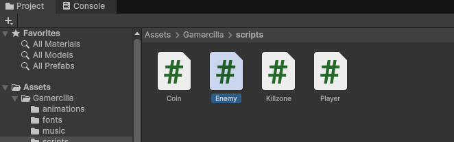{ loading=lazy }](../../assets/images/pmdm/unity/109-unity-enemy-script.png){ aria-label="Ampliar imagen" }

<figcaption>Crea Enemy.cs dentro de la carpeta Scripts del proyecto</figcaption>
</figure>

El archivo se llama Enemy.cs y la clase Enemy. Sustituye el contenido de la plantilla por este código completo:

```csharp
using UnityEngine;

public class Enemy : MonoBehaviour
{
    // Velocidad en unidades de Unity por segundo. Se ajusta en el Inspector.
    public float speed = 1f;

    // Posiciones fijas que asignaremos arrastrando los objetos de la escena.
    public Transform puntoA;
    public Transform puntoB;

    // Guarda hacia cuál de los dos puntos nos dirigimos ahora.
    private Transform objetivo;

    // Guardamos el Animator para utilizarlo después en el combate.
    private Animator animator;

    void Start()
    {
        animator = GetComponent<Animator>();

        // El primer destino será PuntoB.
        objetivo = puntoB;
    }

    void Update()
    {
        // Avanzamos desde la posición actual hacia el objetivo.
        // deltaTime adapta el avance al tiempo entre fotogramas.
        transform.position = Vector2.MoveTowards(
            transform.position,
            objetivo.position,
            speed * Time.deltaTime
        );

        // Si estamos a menos de 0.1 unidades del destino, cambiamos de punto.
        if (Vector2.Distance(transform.position, objetivo.position) < 0.1f)
        {
            if (objetivo == puntoA)
            {
                objetivo = puntoB;
            }
            else
            {
                objetivo = puntoA;
            }
        }
    }
}
```

<figure class="unity-shot" markdown="1">

[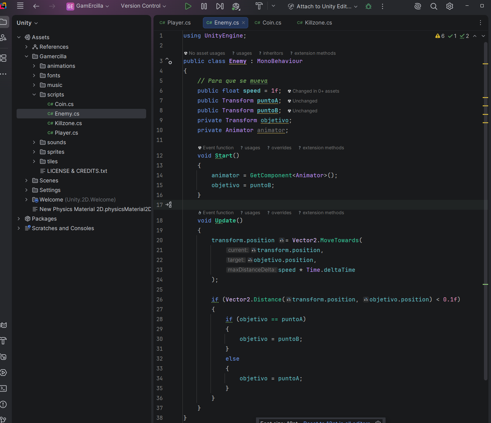{ loading=lazy }](../../assets/images/pmdm/unity/110-unity-enemy-codigo.png){ aria-label="Ampliar imagen" }

<figcaption>Enemy.cs alterna el objetivo entre puntoA y puntoB al llegar a cada extremo</figcaption>
</figure>

### Entender el movimiento

| Parte | Qué hace |
| --- | --- |
| **speed = 1f** | Establece una velocidad inicial de una unidad por segundo. Debe ser positiva. |
| **Transform puntoA / puntoB** | Guarda referencias a los Transform de los objetos vacíos, que contienen sus posiciones. |
| **objetivo** | Recuerda el destino actual; comienza con PuntoB. |
| **GetComponent<Animator>()** | Guarda el Animator del propio Enemy; lo usaremos más adelante para su muerte. |
| **Vector2.MoveTowards** | Calcula una nueva posición más cercana al destino, sin sobrepasarlo. |
| **speed * Time.deltaTime** | Calcula cuánto avanzar en este fotograma según el tiempo transcurrido. |
| **Vector2.Distance(...) < 0.1f** | Comprueba si el enemigo está suficientemente cerca del destino. |
| **if / else** | Alterna el objetivo: después de A va a B, y después de B vuelve a A. |

Por ejemplo, con speed = 1 y un fotograma de 0.02 segundos, el paso será de 0.02 unidades. **deltaTime evita que se mueva más rápido simplemente porque el juego dibuje más fotogramas**.

Por ahora guardamos animator en Start, pero Update solo utiliza el movimiento. La animación enemy se reproduce porque es el estado inicial del controlador, no porque este script la active en cada fotograma.

## 5. Asignar el script y los puntos

1. Guarda Enemy.cs y espera a que Unity compile.
2. **Arrastra Enemy.cs desde Project hasta Enemy en Hierarchy**, para añadirlo como componente.
3. Selecciona Enemy. En **Enemy (Script)**, asigna **Punto A → PuntoA** y **Punto B → PuntoB**, arrastrando los objetos de Hierarchy o usando el selector de cada campo.

<figure class="unity-shot" markdown="1">

[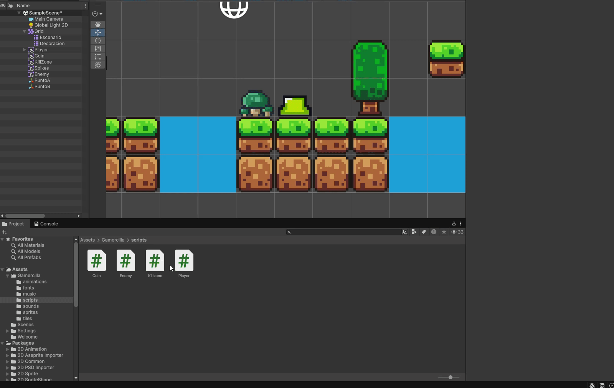{ loading=lazy }](../../assets/images/pmdm/unity/111-unity-asignar-enemy-script.gif){ aria-label="Ampliar imagen" }

<figcaption>Añade Enemy.cs al enemigo y asigna PuntoA y PuntoB en su Inspector</figcaption>
</figure>

4. Comprueba **Speed = 1**, guarda la escena y pulsa Play.

<figure class="unity-shot" markdown="1">

[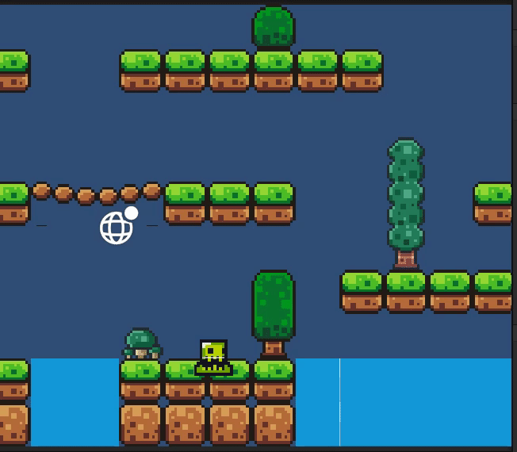{ loading=lazy }](../../assets/images/pmdm/unity/112-unity-enemy-patrulla.gif){ aria-label="Ampliar imagen" }

<figcaption>En Play, el enemigo patrulla entre los dos puntos asignados</figcaption>
</figure>

El enemigo debe avanzar hacia PuntoB, regresar a PuntoA y repetir el recorrido mientras se reproduce su animación.

### Si no se mueve como esperabas

- **NullReferenceException:** revisa que los dos campos Punto A y Punto B estén asignados en el componente del Enemy.
- **No avanza:** comprueba que Speed es mayor que 0, que el script está habilitado y que los puntos no tienen la misma posición.
- **Los destinos cambian con el enemigo:** saca PuntoA y PuntoB de su jerarquía de hijos.
- **Se mueve en diagonal o atraviesa huecos:** iguala las alturas Y y sitúa los extremos sobre un tramo continuo.
- **Se ve detrás del suelo:** revisa la Sorting Layer y Order in Layer del Sprite Renderer.

Continúa con [Ataque y enemigos](11-ataque-enemigos.md). Allí ampliaremos este mismo Enemy.cs para detenerlo y reproducir su muerte cuando reciba un golpe.

Referencias: [Vector2.MoveTowards](https://docs.unity3d.com/6000.0/Documentation/ScriptReference/Vector2.MoveTowards.html) y [Time.deltaTime](https://docs.unity3d.com/6000.0/Documentation/ScriptReference/Time-deltaTime.html).
