# 14. Proyectiles y vida de los enemigos

Después de [Ataque y enemigos](11-ataque-enemigos.md), el enemigo ya patrulla, mata al Player al tocarlo y reproduce **deathenemy** antes de desaparecer. Ahora lanzaremos un proyectil al pulsar **C** y haremos que el enemigo necesite **dos golpes** para morir.

Conservamos los scripts y la escena: ampliaremos Player y Enemy, y crearemos Projectile.cs. El código utiliza las físicas 2D de **Unity 6**.

## 1. Preparar el sprite del proyectil

1. Detén Play. En **Project → sprites**, selecciona la imagen que utilizarás como proyectil. En las capturas elegimos una fruta.
2. Revisa sus propiedades antes de arrastrarla a Scene:

| Propiedad | Valor |
| --- | --- |
| **Texture Type** | Sprite (2D and UI) |
| **Sprite Mode** | Multiple |
| **Pixels Per Unit** | 16 |
| **Filter Mode** | Point (no filter) |
| **Compression** | None |

<figure class="unity-shot" markdown="1">

[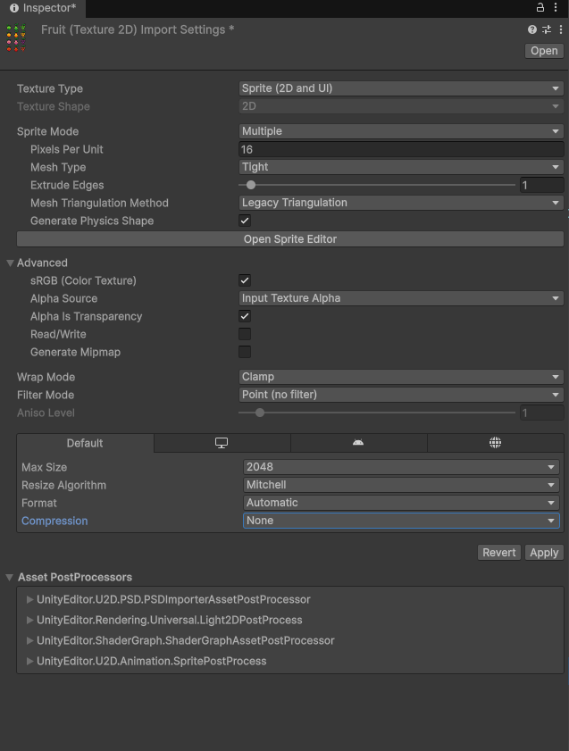{ loading=lazy }](../../assets/images/pmdm/unity/114-unity-proyectil-importacion.png){ aria-label="Ampliar imagen" }

<figcaption>Antes de crear el proyectil, configura Pixels Per Unit 16, Point y Compression None</figcaption>
</figure>

3. Pulsa **Apply** en el Inspector y abre **Sprite Editor**.
4. En **Slice**, selecciona **Type → Automatic**, pulsa **Slice** y después **Apply**.

<figure class="unity-shot" markdown="1">

[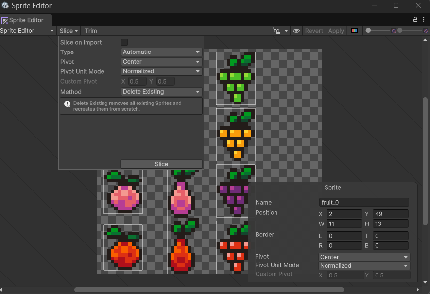{ loading=lazy }](../../assets/images/pmdm/unity/115-unity-proyectil-slice-auto.png){ aria-label="Ampliar imagen" }

<figcaption>Recorta la hoja de frutas con Automatic: pulsa Slice y después Apply</figcaption>
</figure>

5. Despliega la imagen en Project y arrastra **un solo recorte** de la fruta a Scene. No arrastres toda la hoja ni varios sprites: este proyectil usará una imagen fija.
6. Renombra el objeto como **Projectile**.

<figure class="unity-shot" markdown="1">

[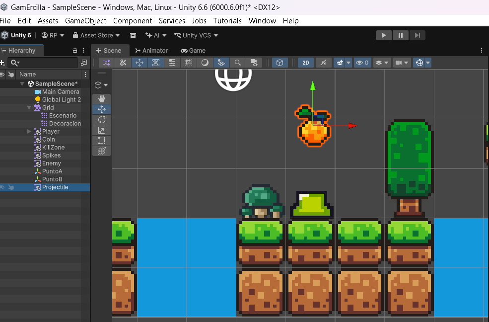{ loading=lazy }](../../assets/images/pmdm/unity/116-unity-proyectil-escena.png){ aria-label="Ampliar imagen" }

<figcaption>Arrastra un recorte de la fruta a Scene y llama Projectile al objeto</figcaption>
</figure>

Unity crea un GameObject con Transform y Sprite Renderer. El primero guarda posición, rotación y escala; el segundo dibuja el sprite.

## 2. Añadir Rigidbody 2D y Circle Collider 2D

Selecciona Projectile y utiliza **Add Component** para añadir:

| Componente | Para qué sirve | Ajustes |
| --- | --- | --- |
| **Rigidbody 2D** | Permite moverlo mediante su velocidad y participar en las físicas 2D. | Body Type **Dynamic**, **Gravity Scale = 0** y Simulated activado. |
| **Circle Collider 2D** | Define una zona circular para detectar el contacto con enemigos y escenario. | Ajusta **Edit Collider / Radius** al sprite y activa **Is Trigger**. |

<figure class="unity-shot" markdown="1">

[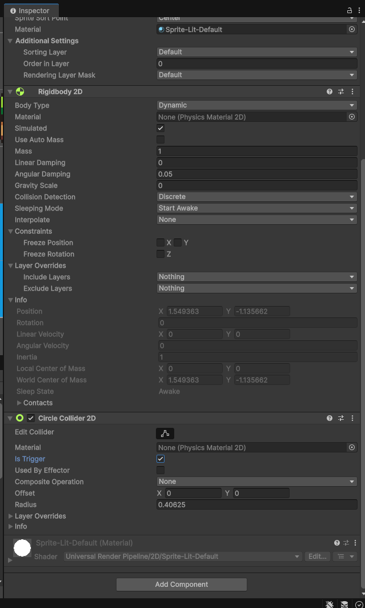{ loading=lazy }](../../assets/images/pmdm/unity/117-unity-proyectil-fisicas.png){ aria-label="Ampliar imagen" }

<figcaption>Projectile utiliza Rigidbody 2D con gravedad 0 y Circle Collider 2D con Is Trigger</figcaption>
</figure>

**Gravity Scale = 0** evita que caiga. **Is Trigger** permite detectar el contacto sin que el proyectil empuje físicamente al enemigo. El script decidirá qué hacer al tocar algo. Un collider por sí solo no proporciona movimiento: Rigidbody y Collider cumplen funciones distintas.

Mantén Projectile en **Layer Default**. El Tilemap sólido conserva Floor y los enemigos conservan Enemy. No cambies el Tag del proyectil a Player.

## 3. Crear y asignar Projectile.cs

En **Scripts**, crea un **MonoBehaviour Script** llamado **Projectile**, abre Projectile.cs y sustituye la plantilla por:

```csharp
using UnityEngine;

public class Projectile : MonoBehaviour
{
    // Velocidad en unidades de Unity por segundo.
    public float speed = 8f;

    private Rigidbody2D rb2D;

    void Awake()
    {
        // Guardamos el Rigidbody antes de que Player llame a Lanzar().
        rb2D = GetComponent<Rigidbody2D>();
    }

    public void Lanzar(float direccion)
    {
        // 1: derecha. -1: izquierda. La velocidad vertical es cero.
        rb2D.linearVelocity = new Vector2(direccion * speed, 0f);
    }
}
```

<figure class="unity-shot" markdown="1">

[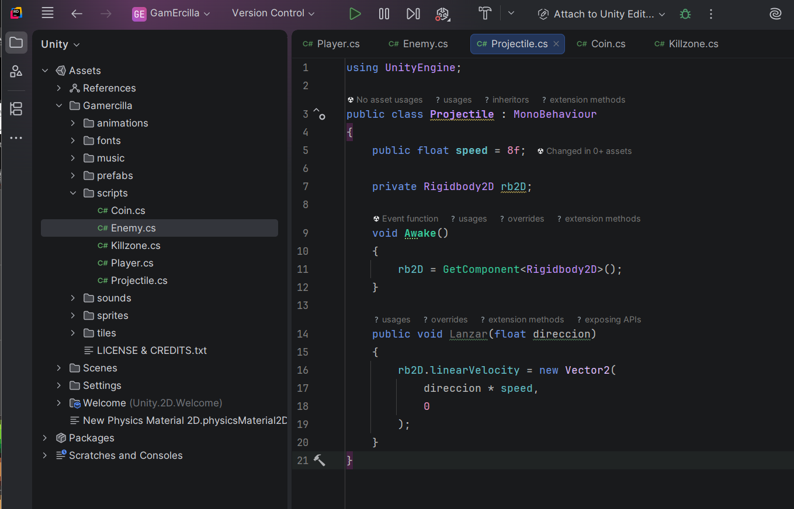{ loading=lazy }](../../assets/images/pmdm/unity/121-unity-projectile-script.png){ aria-label="Ampliar imagen" }

<figcaption>Projectile.cs guarda el Rigidbody en Awake y cambia su velocidad en Lanzar</figcaption>
</figure>

Guarda el archivo, espera a que Unity compile y **arrastra Projectile.cs al objeto Projectile de Hierarchy**. Comprueba que aparece **Projectile (Script)** junto al Rigidbody y al collider.

**Lanzar recibe la dirección:** 1 para derecha y -1 para izquierda. Con speed = 8, establece una velocidad horizontal de 8 o -8 unidades por segundo.

Guardamos rb2D en **Awake**, porque el Player llamará a Lanzar inmediatamente después de crear la copia. Awake se ejecuta al crear el objeto activo; Start puede no haberse ejecutado todavía en ese momento.

## 4. Guardar el proyectil como prefab

Un **prefab es una plantilla reutilizable de un GameObject**: guarda sus componentes, propiedades y posibles hijos como un recurso del proyecto. Cada copia creada a partir de esa plantilla es una **instancia**.

En nuestro caso, el prefab guardará el sprite, Rigidbody 2D, Circle Collider 2D y Projectile (Script). Así cada lanzamiento puede crear un proyectil preparado, sin configurar sus componentes otra vez.

1. Dentro de **Assets/ErciGame**, crea **Prefabs** si no existe.

<figure class="unity-shot" markdown="1">

[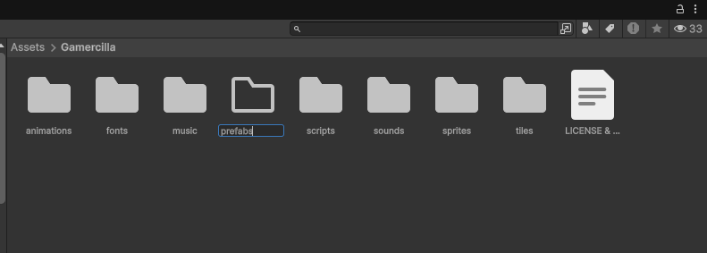{ loading=lazy }](../../assets/images/pmdm/unity/118-unity-carpeta-prefabs.png){ aria-label="Ampliar imagen" }

<figcaption>Crea Prefabs dentro de la carpeta del proyecto, junto a Scripts y Animations</figcaption>
</figure>

2. Arrastra **Projectile desde Hierarchy hasta Prefabs en Project**.

<figure class="unity-shot" markdown="1">

[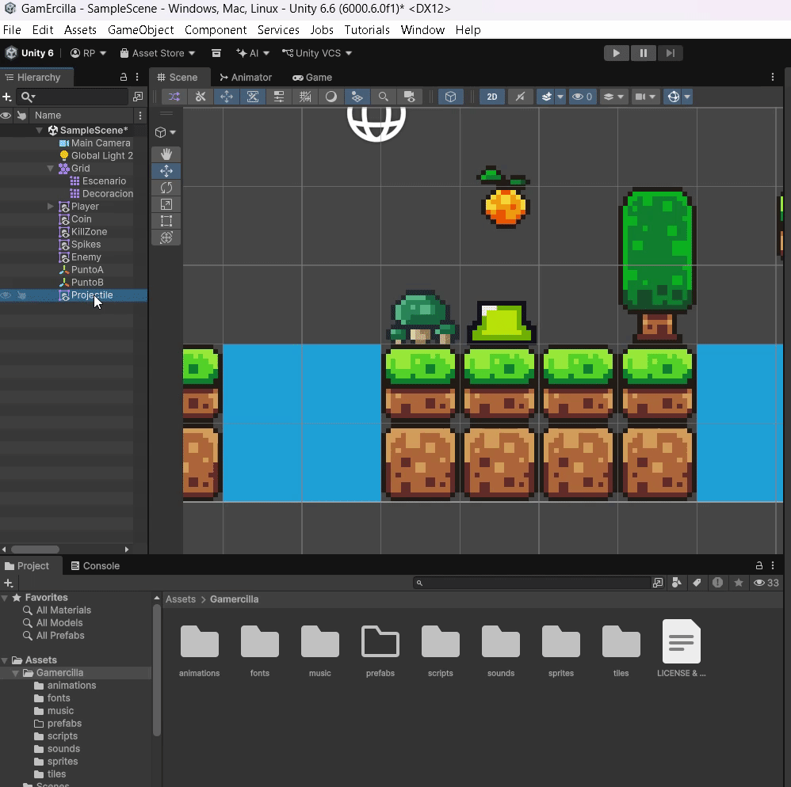{ loading=lazy }](../../assets/images/pmdm/unity/120-unity-crear-prefab-proyectil.gif){ aria-label="Ampliar imagen" }

<figcaption>Arrastra Projectile desde Hierarchy a Prefabs para guardar la plantilla reutilizable</figcaption>
</figure>

3. Selecciona el prefab en Project y comprueba que tiene **Projectile (Script)** y **Speed = 8**, además del Rigidbody con gravedad 0 y del collider con Is Trigger.

<figure class="unity-shot" markdown="1">

[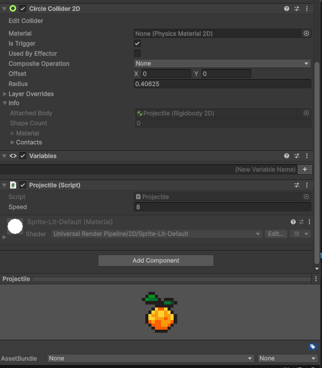{ loading=lazy }](../../assets/images/pmdm/unity/123-unity-prefab-projectile-componente.png){ aria-label="Ampliar imagen" }

<figcaption>El recurso Projectile debe conservar Projectile (Script), su collider y el Rigidbody</figcaption>
</figure>

4. Elimina **solo la instancia Projectile de Hierarchy**. Conserva el recurso Projectile en Project: el Player creará sus copias al pulsar C.

Si olvidaste añadir el script antes de crear el prefab, **abre el prefab con doble clic o con Open Prefab**, añade Projectile.cs al objeto raíz y guarda. No hace falta arrastrarlo otra vez a Scene. Cambiar solo una instancia de la escena no garantiza que el recurso utilizado para lanzar contenga ese componente.

## 5. Crear ThrowPoint

1. Selecciona Player en Hierarchy, pulsa el botón derecho y crea un **Empty Object como hijo**.
2. Llámalo **ThrowPoint** y colócalo delante del personaje, a la altura desde la que saldrá el proyectil.

<figure class="unity-shot" markdown="1">

[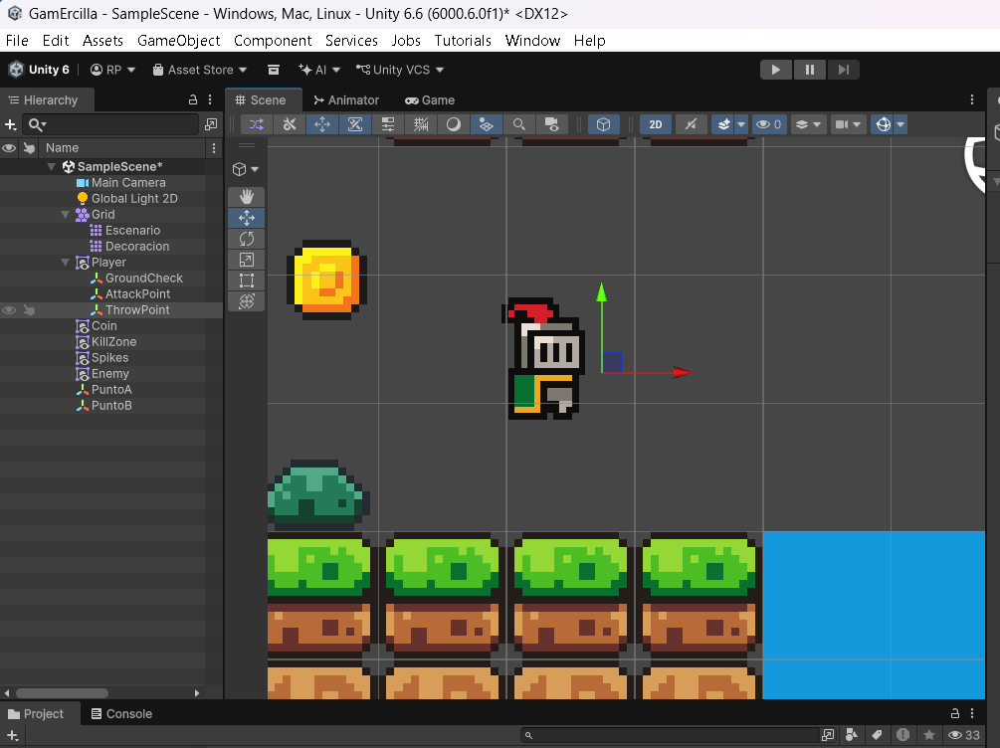{ loading=lazy }](../../assets/images/pmdm/unity/119-unity-throwpoint-player.png){ aria-label="Ampliar imagen" }

<figcaption>ThrowPoint es un objeto vacío hijo del Player y se coloca delante de él</figcaption>
</figure>

ThrowPoint utiliza únicamente su Transform. El Player conserva GroundCheck y AttackPoint; añadimos este nuevo punto para el lanzamiento.

Con el sprite original mirando a la derecha, usa una **posición local X positiva**. Como ThrowPoint es hijo del Player, cambiar la escala X del jugador también lo lleva al otro lado. No inviertas su X por segunda vez. Ajusta su posición para que el proyectil no nazca dentro del suelo o de una pared.

## 6. Asignar el prefab y el punto al Player

Junto a las variables de Player.cs, añade:

```csharp
// Recurso del que crearemos cada copia del proyectil.
public GameObject projectilePrefab;

// Objeto hijo del Player que indica dónde debe aparecer.
public Transform throwPoint;
```

Guarda y vuelve a Unity. Selecciona **Player → Player (Script)** y completa los campos:

| Campo | Qué arrastrar |
| --- | --- |
| **Projectile Prefab** | El recurso **Projectile de Project → Prefabs**. |
| **Throw Point** | El objeto **ThrowPoint de Hierarchy**, hijo del Player. |

<figure class="unity-shot" markdown="1">

[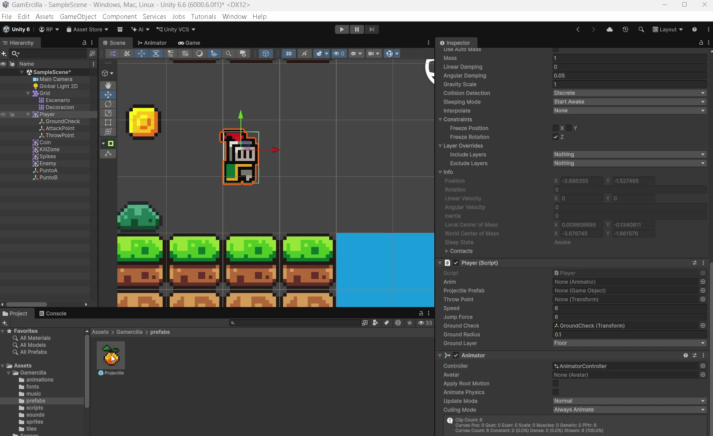{ loading=lazy }](../../assets/images/pmdm/unity/122-unity-asignar-prefab-throwpoint.png){ aria-label="Ampliar imagen" }

<figcaption>Arrastra el prefab desde Project y ThrowPoint desde Hierarchy a los campos del Player</figcaption>
</figure>

**Los dos campos deben quedar asignados**, sin None. Arrastrar el sprite de la fruta a Projectile Prefab no sirve: necesitamos el GameObject del prefab con su script y sus físicas. Guarda la escena después de asignarlos.

## 7. Lanzar hacia donde mira el jugador

En Player.cs añade:

```csharp
// El sprite original mira a la derecha.
private float ultimaDireccion = 1f;
```

En el **bloque de orientación que ya existe en Update**, incorpora la dirección:

```csharp
if (move != 0)
{
    // Conservamos la última dirección cuando el jugador se detiene.
    ultimaDireccion = Mathf.Sign(move);
    transform.localScale = new Vector3(Mathf.Sign(move), 1, 1);
}
```

No crees otro bloque de orientación. No podemos utilizar move directamente para lanzar: cuando el personaje está quieto vale 0 y el proyectil no avanzaría.

En Update, **después de la comprobación if (muerto)**, añade:

```csharp
if (Input.GetKeyDown(KeyCode.C))
{
    LanzarObjeto();
}
```

Así tampoco puede lanzar mientras reproduce su muerte. Añade el método siguiente **dentro de Player, pero fuera de Update**:

```csharp
private void LanzarObjeto()
{
    // Creamos una copia del prefab en la posición de ThrowPoint.
    GameObject projectile = Instantiate(
        projectilePrefab,
        throwPoint.position,
        Quaternion.identity
    );

    // Obtenemos el script de esa copia y le indicamos la dirección.
    projectile.GetComponent<Projectile>().Lanzar(ultimaDireccion);
}
```

| Instrucción | Función |
| --- | --- |
| **Instantiate(...)** | Crea una instancia del prefab indicado. |
| **throwPoint.position** | Utiliza la posición del punto en la escena. |
| **Quaternion.identity** | Crea la copia sin rotación. |
| **GetComponent<Projectile>()** | Obtiene el componente que asignamos al prefab. |
| **Lanzar(ultimaDireccion)** | Establece su velocidad hacia la última dirección del jugador. |

## 8. Añadir vida al enemigo

Abre Enemy.cs y añade **public int vida = 2;** junto a sus variables. Conserva su patrulla, su contacto con Player, muerto, Morir y Destruir del capítulo anterior.

Añade este método dentro de Enemy:

```csharp
public void RecibirGolpe()
{
    // Ignoramos golpes si la muerte ya ha comenzado.
    if (muerto)
    {
        return;
    }

    // Cada impacto resta una vida.
    vida--;

    if (vida <= 0)
    {
        // Reutilizamos la muerte: detener, animar y después destruir.
        Morir();
    }
}
```

Con Vida = 2 en el Inspector, **el primer golpe deja 1 vida** y el enemigo sigue patrullando. **El segundo deja 0 y llama a Morir()**. El proyectil comunicará el impacto; Enemy decidirá cuándo morir según su vida.

No sustituyas Morir por un método que solo active Death. La versión del capítulo anterior comprueba muerto, detiene la patrulla y desactiva el collider. El evento final de **deathenemy debe seguir llamando a Destruir()**, como explicamos en [la animación de muerte del enemigo](11-ataque-enemigos.md#muerte-enemigo).

## 9. Detectar impactos y limpiar el proyectil

Ahora que Enemy tiene RecibirGolpe, **sustituye Projectile.cs por este código completo**. Añade la detección de enemigos y Floor, y elimina los proyectiles que no impactan al cabo de tres segundos.

```csharp
using UnityEngine;

public class Projectile : MonoBehaviour
{
    public float speed = 8f;

    private Rigidbody2D rb2D;
    private bool consumido = false;

    void Awake()
    {
        // Instantiate ejecuta Awake antes de devolver la copia activa.
        rb2D = GetComponent<Rigidbody2D>();
    }

    void Start()
    {
        // Limpieza: desaparece aunque no llegue a tocar ningún objeto.
        Destroy(gameObject, 3f);
    }

    public void Lanzar(float direccion)
    {
        rb2D.linearVelocity = new Vector2(direccion * speed, 0f);
    }

    private void OnTriggerEnter2D(Collider2D collision)
    {
        // Destroy elimina al final del fotograma: evitamos otro impacto.
        if (consumido)
        {
            return;
        }

        Enemy enemigo = collision.GetComponent<Enemy>();

        if (enemigo != null)
        {
            consumido = true;
            enemigo.RecibirGolpe();
            Destroy(gameObject);
            return;
        }

        // Reutilizamos Floor, la Layer del Tilemap sólido del escenario.
        if (collision.gameObject.layer == LayerMask.NameToLayer("Floor"))
        {
            consumido = true;
            Destroy(gameObject);
        }
    }
}
```

**OnTriggerEnter2D** recibe el collider del objeto que entra en contacto. Si tiene Enemy, llama a RecibirGolpe y destruye el proyectil. Si pertenece a Floor, destruye el proyectil sin quitar vida a nadie.

La variable **consumido** impide que un proyectil procese dos impactos durante el mismo fotograma, porque Destroy no elimina el objeto inmediatamente en esa línea. **Destroy(gameObject, 3f)** programa su limpieza aunque no llegue a tocar nada.

Guarda y comprueba que el **prefab** conserva Projectile (Script). Para detectar al Enemy, su collider y Enemy.cs deben estar en el mismo GameObject, como lo hemos configurado.

## 10. Aplicar la vida al ataque cuerpo a cuerpo

En el ataque con X de Player.cs, donde tenemos:

```csharp
enemy.Morir();
```

sustitúyelo por:

```csharp
enemy.RecibirGolpe();
```

Ahora **X y C comparten el mismo sistema de vida**. El Player conserva Morir() para su propia muerte; esa llamada no se cambia.

??? example "Player.cs completo al terminar este apartado"

    ```csharp
    using UnityEngine;
    using UnityEngine.SceneManagement;

    public class Player : MonoBehaviour
    {
        public float speed = 6f;
        public float jumpForce = 6f;

        public Transform groundCheck;
        public float groundRadius = 0.1f;
        public LayerMask groundLayer;

        public Transform attackPoint;
        public float attackRadius = 0.5f;
        public LayerMask enemyLayer;

        public GameObject projectilePrefab;
        public Transform throwPoint;
        private float ultimaDireccion = 1f;

        private Rigidbody2D rb2D;
        public Animator anim;

        private float move;
        private bool isGrounded;
        private bool muerto = false;

        void Start()
        {
            rb2D = GetComponent<Rigidbody2D>();
            anim = GetComponent<Animator>();
        }

        void Update()
        {
            if (muerto)
                return;

            move = Input.GetAxisRaw("Horizontal");

            rb2D.linearVelocity = new Vector2(
                move * speed,
                rb2D.linearVelocity.y
            );

            if (Input.GetButtonDown("Jump") && isGrounded)
            {
                rb2D.linearVelocity = new Vector2(
                    rb2D.linearVelocity.x,
                    jumpForce
                );
                isGrounded = false;
            }

            anim.SetFloat("Speed", Mathf.Abs(move));
            anim.SetFloat("VerticalVelocity", rb2D.linearVelocity.y);
            anim.SetBool("IsGrounded", isGrounded);

            if (move != 0)
            {
                ultimaDireccion = Mathf.Sign(move);
                transform.localScale = new Vector3(Mathf.Sign(move), 1, 1);
            }

            if (Input.GetKeyDown(KeyCode.X))
            {
                anim.SetTrigger("attack");

                Collider2D enemyCollider = Physics2D.OverlapCircle(
                    attackPoint.position,
                    attackRadius,
                    enemyLayer
                );

                if (enemyCollider != null)
                {
                    Enemy enemy = enemyCollider.GetComponent<Enemy>();

                    if (enemy != null)
                    {
                        enemy.RecibirGolpe();
                    }
                }
            }
            if (Input.GetKeyDown(KeyCode.C))
            {
                LanzarObjeto();
            }
        }

        private void LanzarObjeto()
        {
            GameObject projectile = Instantiate(
                projectilePrefab,
                throwPoint.position,
                Quaternion.identity
            );

            projectile.GetComponent<Projectile>().Lanzar(ultimaDireccion);
        }

        private void FixedUpdate()
        {
            isGrounded = Physics2D.OverlapCircle(
                groundCheck.position,
                groundRadius,
                groundLayer
            ) != null && rb2D.linearVelocity.y <= 0.1f;
        }

        public void Morir()
        {
            if (muerto)
                return;

            muerto = true;

            rb2D.linearVelocity = Vector2.zero;
            anim.SetFloat("Speed", 0f);
            anim.SetFloat("VerticalVelocity", 0f);
            anim.ResetTrigger("attack");
            anim.SetTrigger("Death");
        }

        public void ReiniciarNivel()
        {
            SceneManager.LoadScene(SceneManager.GetActiveScene().name);
        }

        private void OnDrawGizmosSelected()
        {
            if (attackPoint != null)
            {
                Gizmos.DrawWireSphere(
                    attackPoint.position,
                    attackRadius
                );
            }
        }
    }
    ```

## 11. Ejecutar y comprobar

1. Guarda el código y la escena. Revisa que Console no tenga errores de compilación.
2. Comprueba **Vida = 2** en Enemy (Script), los dos puntos de patrulla y el Box Collider 2D con Is Trigger.
3. En Player (Script), revisa **Projectile Prefab** y **Throw Point**.
4. Pulsa Play y haz clic en Game. Lanza con **C** mirando a derecha e izquierda, también después de detenerte.

<figure class="unity-shot" markdown="1">

[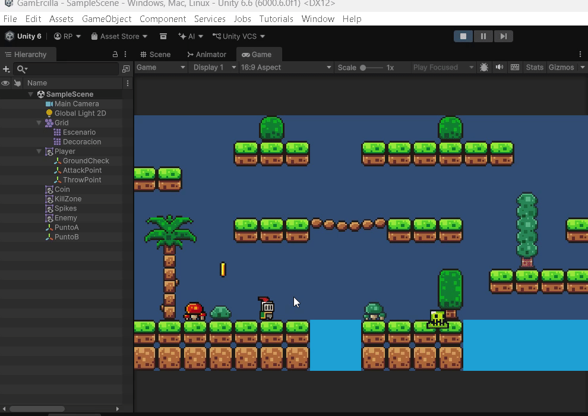{ loading=lazy }](../../assets/images/pmdm/unity/131-unity-proyectil-matar-enemigo.gif){ aria-label="Ampliar imagen" }

<figcaption>Prueba en Game el lanzamiento de proyectiles y la muerte del enemigo</figcaption>
</figure>

5. Con dos impactos, el enemigo debe detenerse, reproducir deathenemy una vez y desaparecer por el evento Destruir.
6. Comprueba que el proyectil desaparece al tocar Floor o después de tres segundos sin impacto.
7. Toca al enemigo con el Player: debe morir, dejar de aceptar teclas y reiniciar el nivel al terminar su animación.

### Si algo falla

| Problema | Qué revisar |
| --- | --- |
| **No se crea el proyectil** | Campo Projectile Prefab asignado, tecla C dentro del Update del Player y foco en Game. |
| **NullReferenceException al lanzar** | Throw Point asignado; Projectile (Script) y Rigidbody 2D en el objeto raíz del prefab. |
| **El proyectil cae** | Gravity Scale = 0 en el Rigidbody del prefab. |
| **Sale por el lado incorrecto al estar quieto** | ultimaDireccion solo cambia cuando move es distinto de 0; ThrowPoint es hijo del Player. |
| **No detecta el impacto** | Is Trigger, Rigidbody 2D activo y layers que puedan interactuar en Project Settings → Physics 2D. |
| **La vida no coincide con el ejemplo** | El Inspector puede conservar un valor anterior; establece Vida = 2 antes de Play. |
| **El enemigo sigue patrullando al morir** | La comprobación de muerto debe ser la primera instrucción de su Update. |
| **Reproduce la muerte y se queda en escena** | Evento final en deathenemy con Function Destruir(), no Morir(), y Enemy.cs junto a Animator. |
| **No aparece la animación de muerte** | Trigger Death con D mayúscula, condición Death en enemy → deathenemy, Loop Time desactivado y Animator Controller correcto. |

Continúa con el [ejercicio de tu propio videojuego](11-ejercicio-propio-juego.md).

Referencias: [Prefabs](https://docs.unity3d.com/6000.0/Documentation/Manual/Prefabs.html), [editar un prefab](https://docs.unity3d.com/6000.0/Documentation/Manual/EditingInPrefabMode.html), [Awake](https://docs.unity3d.com/6000.0/Documentation/ScriptReference/MonoBehaviour.Awake.html) y [OnTriggerEnter2D](https://docs.unity3d.com/6000.0/Documentation/ScriptReference/MonoBehaviour.OnTriggerEnter2D.html).
