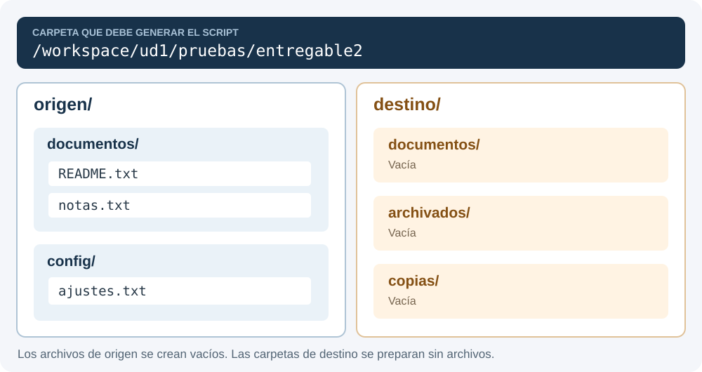

# Entregable 2 UD1 · Preparar y comprobar una entrega

**Módulo:** Sistemas Informáticos · 1.º DAM  
**Duración:** 60 minutos  
**Modalidad:** Individual · Debian GNU/Linux

Crea un programa Bash que prepare los archivos de una entrega, ejecute unas operaciones y compruebe el resultado. Trabaja desde el terminal de VS Code y utiliza las funciones, los bucles y las condiciones que hemos trabajado en clase.

## 1. Archivos y menú

El script principal será **`/workspace/ud1/entregable2.sh`**. En esa misma carpeta guardarás:

| Archivo | Quién lo prepara |
| --- | --- |
| `estructura.txt` | Tú, a partir del esquema del apartado 2. |
| `operaciones.txt` | Se facilita con el enunciado. |
| `plantilla.txt` | Se facilita con el enunciado. |

Descarga [operaciones.txt](../../../assets/si/ud1/entregable2/operaciones.txt) y [plantilla.txt](../../../assets/si/ud1/entregable2/plantilla.txt). Conserva sus nombres y su contenido.

El programa debe mostrar este menú y volver a él después de cada opción:

```text
ENTREGABLE 2 UD1

1. Generar estructura
2. Ejecutar operaciones
3. Preparar README
4. Comprobar entrega y guardar informe
5. Ver las últimas cinco operaciones
6. Mostrar estructura actual
7. Salir
```

Organiza el programa mediante funciones. Utiliza `if [[ ... ]]`, `elif` y `else` para las opciones y las instrucciones. Una opción incorrecta debe mostrar un aviso y permitir continuar. Después de mostrar un resultado, realiza una pausa antes de volver al menú.

El script debe funcionar aunque se lance desde otro directorio. Las rutas relativas de los TXT se interpretan desde **`/workspace/ud1`**, donde se encuentra el script.

## 2. Generar la estructura desde estructura.txt

Redacta **`estructura.txt`** para que el script pueda generar este esquema dentro de **`/workspace/ud1/pruebas/entregable2`**:

<figure class="unity-shot" markdown="1">

[{ loading=lazy }](../../../assets/images/si/entregable_ud1_2_estructura.svg){ aria-label="Ampliar el esquema" }

<figcaption>Redacta estructura.txt a partir de este esquema. Pulsa la imagen para ampliarla.</figcaption>
</figure>

Los tres archivos de origen deben estar inicialmente vacíos. Las carpetas de destino también estarán vacías.

Cada línea de tu TXT tendrá el formato **`INSTRUCCION;RUTA`**. Utiliza:

| Instrucción | Acción |
| --- | --- |
| `MKDIR` | Crear un directorio. |
| `TOUCH` | Crear un archivo vacío. |

Las rutas del fichero serán relativas a `/workspace/ud1`. Crea primero los directorios y después sus archivos. Cada instrucción debe terminar con un salto de línea; no incluyas líneas en blanco.

La opción **1** leerá el fichero con un `for` numérico, obtendrá cada línea mediante `sed` y separará sus campos con `IFS` y `read -ra`. Debe calcular el número de líneas del archivo, sin fijarlo en el código.

**La estructura se crea interpretando tu TXT.** No escribas los comandos de creación directamente dentro de la función ni crees las carpetas a mano. No utilices `eval`.

## 3. Ejecutar operaciones.txt

La opción **2** debe interpretar, en este orden, el contenido del fichero facilitado:

```text
COPY;./plantilla.txt;./pruebas/entregable2/origen/documentos/README.txt
COPY;./pruebas/entregable2/origen/documentos/README.txt;./pruebas/entregable2/destino/documentos/README.txt
MOVE;./pruebas/entregable2/origen/documentos/notas.txt;./pruebas/entregable2/destino/archivados/notas.txt
COPYDIR;./pruebas/entregable2/origen/config;./pruebas/entregable2/destino/copias/config
```

Cada línea contiene **`OPERACION;ORIGEN;DESTINO`**. Utiliza `cp`, `mv` o `cp -r` según corresponda. Obtén las instrucciones del fichero con la misma forma de lectura del apartado anterior; no las escribas directamente en la función.

El resultado será un README en origen y otro en destino, las notas trasladadas a `destino/archivados` y una copia de config con su archivo ajustes.txt.

## 4. Preparar el README

La opción **3** debe:

1. Copiar `destino/documentos/README.txt` a **`destino/copias/README_original.txt`** antes de modificarlo.
2. Utilizar `sed` para cambiar **`Entrega pendiente`** por **`Entrega preparada`** en el README de destino.
3. Guardar el cambio en el archivo y mostrar su contenido actualizado.

La plantilla facilitada contiene:

```text
Proyecto de Sistemas Informáticos
Entrega pendiente
```

El README de origen y la copia de seguridad deben conservar el texto pendiente. Prueba esta opción una vez, después de ejecutar las opciones 1 y 2.

## 5. Comprobar y guardar el informe

La opción **4** realizará estas cinco comprobaciones, con rutas relativas a la carpeta generada:

| Comprobación | Resultado que debes verificar |
| --- | --- |
| `destino/copias/config` | Existe y es un directorio. |
| `destino/archivados/notas.txt` | Existe y es un archivo. |
| `destino/copias/config/ajustes.txt` | Existe y es un archivo. |
| `destino/documentos/README.txt` | Existe y no está vacío. |
| `destino/documentos/README.txt` | Contiene `Entrega preparada`. |

Utiliza las comprobaciones de archivos y directorios y la búsqueda con `grep` vistas en UD1.9. Si falta un archivo, debe indicarse el error y continuar con las demás comprobaciones.

Muestra **`[OK]`** o **`[ERROR]`** en cada caso y termina con el total de comprobaciones correctas y fallidas. Guarda esos mismos resultados en **`/workspace/ud1/pruebas/entregable2/informe.txt`**. Cada validación debe sustituir el informe anterior y reiniciar los contadores.

Esta función comprueba lo que hay: no debe crear ni corregir los archivos que valida. Después de completar las opciones 1, 2 y 3, el resultado esperado es **5 correctos y 0 errores**.

## 6. Registro y visualización

Al generar la estructura, ejecutar las operaciones y preparar el README, añade **una línea por cada creación, copia, movimiento o edición** a:

```text
/workspace/ud1/pruebas/entregable2/registro.txt
```

Cada línea debe identificar la operación, la ruta o rutas utilizadas y si se ha realizado correctamente. El registro debe conservar las entradas anteriores.

La opción **5** utilizará **`tail`** para mostrar las últimas cinco líneas. Si todavía no hay registro, muestra un aviso y vuelve al menú. Si hay menos de cinco entradas, muestra las disponibles.

La opción **6** mostrará con `tree` la estructura actual. La opción **7** finalizará el programa.

## 7. Referencia breve de sintaxis

| Para qué | Ejemplo |
| --- | --- |
| Obtener el total de líneas | `totalLineas=$(wc -l < ./archivo.txt)` |
| Guardar la línea número i en una variable | `contenido=$(sed -n "$i"'p' ./archivo.txt)` |
| Separar los campos por ; | `IFS=';' read -ra datos <<< "$contenido"` |
| Acceder a los campos | `${datos[0]}`, `${datos[1]}`, `${datos[2]}` |
| Sustituir un texto y guardar el cambio | `sed -i 's/antiguo/nuevo/' ./archivo.txt` |
| Mostrar las últimas cinco líneas | `tail -n 5 ./registro.txt` |

`i` representa el número de línea que estás recorriendo. `wc -l` cuenta saltos de línea: termina también la última instrucción del TXT con un salto de línea.

## 8. Comprobación y entrega

Prueba las opciones **1, 2, 3 y 4 en ese orden**. Comprueba después el registro y la estructura. Prueba también una opción incorrecta y la salida del programa.

Para repetir la prueba desde el principio, elimina únicamente la carpeta generada `pruebas/entregable2` y vuelve a empezar. Conserva el script y los TXT de `/workspace/ud1`.

Entrega **`entregable2.sh`**, tu **`estructura.txt`** y los archivos **`informe.txt`** y **`registro.txt`** obtenidos al completar la prueba.

| Apartado | Puntuación |
| --- | --- |
| TXT de estructura y generación | 3 puntos |
| Lectura y ejecución de operaciones | 2 puntos |
| Copia de seguridad y modificación del README | 1 punto |
| Comprobaciones, contadores e informe | 2 puntos |
| Menú, funciones y registro con tail | 2 puntos |
| **Total** | **10 puntos** |
